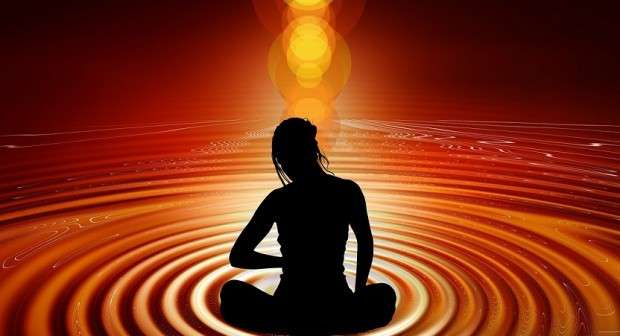
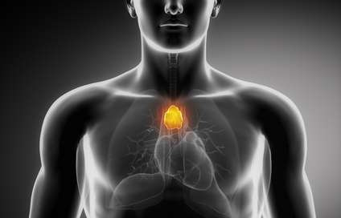

# Организм дах аз жаргалын цэг

Энэхүү цэгийг тимус гэх бөгөөд цээжний дээд хэсэг өвчүүний эхлэх цэг дээр байдаг гурван шүдэт сэрээ маягийн хэлбэртэй булчирхай юм. Тимус нь, грекээр “амьдралын хүч” гэсэн үг аж. Өнгөрсөн зууны 60-д онд, эрдэмтэд уг булчирхайг, дархлааны гол үүрэг гүйцэтгэдэг гэдгийг нээжээ.

. Энэ булчирхай, нугасны эд эсд үүсдэг дархлааны эсүүдийг, нян халдвар, аутоиммуны өвчлөлүүдтэй тэмцдэг, Т-лимфоцид болгон хувиргаж, тимийн даавруудыг бий болгон, дархлааг дэмжин, арьсны нөхөн сэргээлт, эд эсийг сэргээх үүрэгтэй бөгөөд организмыг залуужуулах үйлчлэлтэй байдаг байна. Хүний амьдралын эхний таван жилд, идэвхитэй ажиллан, насан туршид нь хүрэлцэх Т-лимфоцидуудыг нөөцөлж өгдөг, аажмаар шимэгдэж үгүй болдог гайхалтай эрхтэн юм. Шимэгдэх хугацаа нь оройтох тусам хүнд сайн байх нь гарцаагүй. Тиймээс, түүнийг дэмжих амьтан ургамлын гаралтай уураг хэрэглэж байх хэрэгтэй аж. /бүх төрлийн мах, сүүн бүтээгдэхүүн, гурвалжин будаа, шош/. Мөн дулааны үйлчлэлд дуртай ба саунд орох, бүлээн жин, эфирийн тосон түрхлэг массаж хийх сайн байдаг байна.Сстресс, нерв, уг булчирхайд маш муу нөлөөлдөг бөгөөд агшиж жижигрэн үүргээ гүйцэтгэхээ больж, хүн хурдтайгаар хөгширч эхэлдэг. Байнга ханиад хүрдэг, хомхой долоох, хатиг өвдөг гарахад өртөмтгий хүмүүсийн тимус асуудалтай байдаг. Рентген, эхо-р оношлогддог. Үйл ажиллагааг нь сайжруулахын тулд, уг булчирхай байгаа хэсэгт, 10-20 удаа хурууны үзүүрээр, эсвэл гараа хагас атган, өөрт тааламжтай байхаар нэг жигд тогшиж цохиж өгдөг. Энэ хэдхэн секундын арга биед тамир өгч, эрч хүчээр дүүргэж өгдөг. Мөн тэндээ гараа тавих нь, энергийн урсгалыг дэмжих сайн нөлөөтэй. Өглөө бүр, тогтмол хийж, өдөрт мөн хэд хэдэн удаа идэвхжүүлэх нь, эрч хүчтэй болгохоос гадна баяр жаргалын мэдрэмж төрүүлдэг гэнэ. Айдас, сандрал, өөртөө итгэлгүй байдал, стрессийг дардаг байна.
