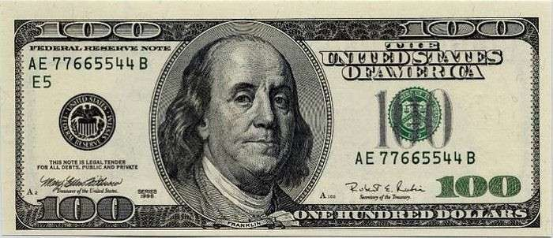

# Өргүй байх, өөдрөг зан

Та, дараах зүйлийг уншаад, толгой чинь эргэнэ.

Нэгэн жижигхэн хотод,чинээлэг турист ирж, зочид буудалд бууж, эзэнд нь 100$ өгчихөөд, өрөөнүүдийг үзэхээр явав.\
Буудлын эзэн мөнгийг авмагцаа, яаралтай явж, махны худалдагчид өрөө аваачиж өгөв. \
Махны худалдагч, мөнгөө барьж гүйсээр, фермийн эзэнд, махны өрөө аваачиж өгөв. \
Фермийн эзэн мөнгийг авангуутаа, машин засварын газарт өрөө аваачиж өгөв. \
Машин засварын эзэн, дэлгүүрт хүнсний үнэ, өрөө аваачиж өгөв. \
Дэлгүүрийн эзэн, худалдагч охины цалингийн өрөө өгөв. \
Худалдагч охин мөнгө авмагцаа, зочид буудал руу гүйж, зочид буудалд байрлаж байсан төлбөрийн өрөө зочид буудлын эзэнд аваачиж өгөв. \
Яг энэ үед, турист, шатаар бууж ирэн, таалагдах өрөө байсангүй гээд мөнгөө буцааж авав. Ингээд хэнд ч энэ мөнгө үлдсэнгүй. Гэсэн ч, энэ хотын эдгээр хүмүүс хэн хэндээ өргүй сэтгэл өөдрөг амьдардаг гэнэ. \
“Өргүй хүн, өөдөлнө”, нээрээ л, энэ “хөөрхөн хотын”-хон одоо ч гэсэн, жаргалтай, сэтгэл цэвэр явдаг гэсэн шүү.
