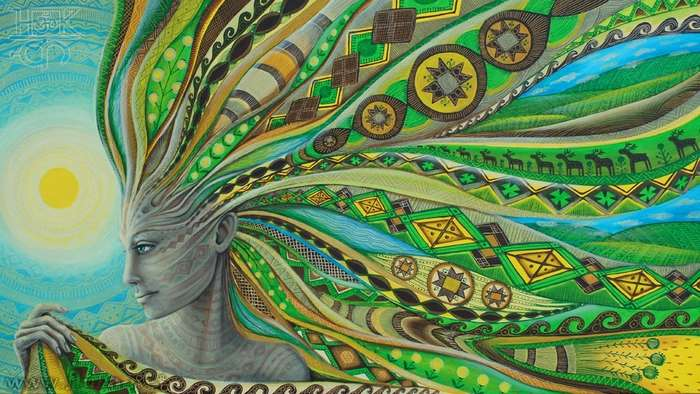

# Өөрийгөө хайрлаж сурах нь, “карма”-г өөрчилдөг

“Карма”-г, ямар нэг муу үйлийн төлөөс эсвэл шийтгэл биш харин энергийн цэнэглэлт буюу амин энергийг хэрэгжүүлэх зарчим гэж үзэх хэрэгтэй байдаг байна. Хүн өөрийгөө хайрласнаар, энергийн цэнэглэлт явагдаж, түүнийгээ амьдралын орон зайд чиглүүлдэг гэж үздэг. Энэхүү чиглүүлсэн амин энерги, үйл явдал, тохиолдол, хүмүүсээр дамжуулан бидэнд тустай, бусдад тустай сайн үйлсүүдийг бий болгож байдаг аж. Хүн, өөрийгөө үл хайрлах нь, мөн л, хүмүүс, тохиолдлуудаар дамжин сөрөг орчин бүрдэхэд хүргэдэг аж. Тиймээс, өөрийгөө хайрлаж чаддаггүй хүн бусдыг хайрлаж чадахгүй гэж үздэг.

Хүн бүр, өөрийн амьдралдаа, “ямар нэг зүйл”-г засаж залруулах, сайжруулахыг хүсч байдаг. Эдгээр “ямар нэг зүйл” нь бидний амьдралын хүрээлэл дэх, хайр, харилцаа, гэр бүл, ажил, мөнгө төгрөг бөгөөд эдгээрийг өөрийн хүслээр байлгах боломжийг эрж хайх, олох асуудал нь хүний өөрийгөө хайрлаж чадах эсэх, дотоод сэтгэлдээ хэрхэн ханддагаас хамаардаг байна. “Карма”- нь, бидний хүсэл төсөөллийг бус харин бидний энергийн цэнэглэлтийг мөрдлөг болгодог. Үүнийг, сайн хүсэл зорилготойгоор, аливааг бүтээхээр, хэн нэгэнд хандаад бүтэхгүй байх тохиолдлуудад, хүн, “яагаад бүтсэнгүй вэ?”, “ би юуг буруу хийчих вэ?”, яагаад хүссэн зүйл минь талаар өнгөрнө вэ?, “энэ үйлийн үр үү?”, гэх мэт хариултгүй асуултад унаж мухардаж, мохож байдгаар, мөн, өөрийгөө хайрлах буюу энергийн цэнэглэлт ямар байна “карма” тийм байна гэсэн хариултаар тайлбарлаж болно. Бид, хүслээ багахан ухаад үздэг бол, өөрсдийгөө хайрладаггүйгээ, мөн хүсч буй зүйлд хамааралтай хүмүүсээс тэрхүү хайрыг нөхөхийг хүссэн хүсэлт тавьж, хэрэв тэд тэр хайрыг нөхөх үйлдэл хийвэл хүсэл биелэх, үгүй бол бүтэхгүй байх байдалд ордог алдаа гаргадгаа мэдэх болно. Өөрийгөө хайрлах гэдэг нь, хүн өөрийн дотоод ертөнцөө, өөрийн гэр мэт хүлээн авч, гаднаас хамааралгүй байлгахыг хэлэх бөгөөд өөрийн дуртай зүйлс, хүсэл эрмэлзэлдээ тууштай байж, хүндэтгэлтэй хандахыг хэлдэг байна. Гадаад орчин нөхцөл сайн, сайхан байх үед, хүн өөрийгөө хүндлэх, хайрлах, нийцтэй байдалд өөрөө ч мэдэлгүй ордог. Гэтэл амьдрал нь өөрөө амьд, цаг агаар шиг өөрчлөгдөн солигдож байдаг тул гадаад нөхцөл буюу амьдрал өөрчлөгдөхөд, хүний өөрийгөө хайрлах хүндэтгэх байдал үгүй болж, дургүй зүйлсээ эрхлэхээс өөр гарцгүй байдалд орж хүсэл нь биелэхээ больдог. Үүгээрээ “карма”-нь, гадаад нөхцөл байдлаас маш их хамаарч байдаг аж. Тиймд, хүн, бороо цастайд гадаа гарахгүй, гэртээ суудгийн адил, дотоод ертөнцөө тайван, халдашгүй байлгах хэрэгтэй байдаг аж. Аливаа зүйлсийг хадах үеийн, алхаар хадаасыг онож цохих эсвэл онохгүй хуруугаа цохих гэсэн хоёр тохиолдлын, аль алинд, тэр л алх үйлчилж, мөн ижил хүч зарцуулагддаг гэсэн физикийн хуультай “карма” адил. “Карма”-г, хүн заримдаа хадаасны толгойг онохгүй алдаж хуруугаа цохих боломжтой байдаг алхны нэгэн адил, нэгэн төрлийн алх юм гэж үзэх нь ч бий. Өөрийгөө хайрлах, хүндлэх нь, өөрийн “карма”-г сонгох, сонголтын эрх чөлөөг олж авах боломжтой болгодог. Хүн дотоод ертөнцөө хайрлаж өөрийнхөө талаар муу, эргэлзээтэй бодлуудыг агуулахгүй, өөрийгөө хайрлан хүндэтгэснээр, өөрийн “карма”-г удирдах боломжтой юм. Мөн, “Карма”-н хуулийг, бусад физикийн хуулийн адил сохор гэж үздэг бөгөөд эдгээр хуулиуд байсан, байдаг, үйлчилж байдаг, ирээдүйд ч үйлчилсээр байх тайлагдашгүй хүч гэдгийг хүлээн зөвшөөрөхөөс аргагүй билээ. Тиймээс хойш тавилгүй, өөрийгөө хайрлах боломж олгох гадны хувьсамтгай таатай орчин нөхцөл, цаг үеийг хүлээхгүйгээр, өөрийгөө хайрлах арга ухаанд суралцахыг эрмэлзэх нь зүйтэй юм. Өөрийнхөө дотор, гадны хамааралгүй ертөнцийг, бид өөрсдөө л байгуулж чадна.
