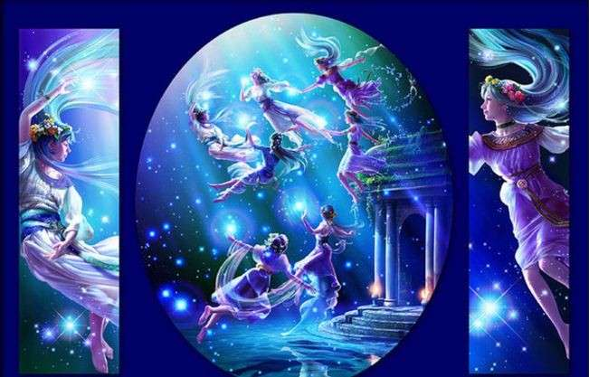
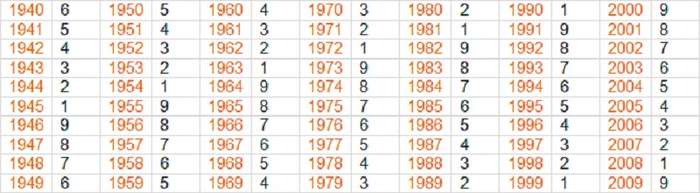

# Өөрийгөө таних “9 од”-ны арга

“9 од”-ны арга нь, эртний хятадаас гаралтай бөгөөд одон зурхай, тоон зурхай хоёрыг нэгтгэсэн байдаг. Энэ зурхай, хүний давуу ба сул талууд, эрүүл мэндийг тодорхойлохоос гадна одоо үеийнхээ, байр байдалдаа дүгнэлт хийх боломж олгодогоороо гайхагддаг аж.

**Дараах хүснэгтээс төрсөн оноо олж, харалдаа тооны тайллыг уншаарай.**

---

1. Энэ одонд эрхшээсэн хүмүүс нөхөрсөг, сэтгэлийн хөдөлгөөнтэй байдаг. Мэдрэг эмзэг сэтгэлтэй, үе үе дуугаа хурааж, идэвхигүй болдог. Энэ хүмүүс өөрийн эргэлзээ, түгшүүртэй тэмцэхгүй бол өөрөө, өөрийнхөө өвчлөлийн шалтгаан болох магадлалтай. Буруу зуршил, хамаарлаас болгоомжлох хэрэгтэй.\
2. Энэ одныхон маш халамжтай гэрсэг хүмүүс байдаг. Гэр бүл гал голомтоо нэгдүгээрт тавьдаг, их бодит, тэвчээртэй, бусдын төлөө аливааг золиослоход бэлэн байдаг. Эдгээр хүмүүс хоол тэжээлийн дур хүслээ дарж хянахад их анхаарах хэрэгтэй. Маш амархан жин нэмэх хандлагатай. \
3. Энэ хүмүүс, маш хөдөлгөөнтэй, зүтгэлтэй хэзээ ч алив зүйлийг бүтэхийг хүлээгээд зүгээр сууж чаддаггүй. Хэн нэгний тусламж хүлээлгүй ямар ч байдлаас гарах гарц олж чаддаг. Өөдрөг, хөгжилтэй зангаараа бусдаас ялгарна. Огцом уурлах, биеэ барихгүй байдал гаргах хандлагатай. Үүнийхээ дараа өөрийгөө буруутгаж, их гэмшдэг. \
4. Энэ одныхон оюунлаг бүтээлч хүмүүс. Тэд “3 од”-ныхонтой их төстэй. Бүхэнд өөрийнхөө хүчээр хүрдэг байдалдаа дасчихсан байдаг. Тэд аялах зугаалах дуртай, хөдөлгөөнтэй. Өндөр хариуцлага үүрэхээс болгоомжлох хэрэгтэй. Нэг зэрэг олон ажил барьж авч хийхээсээ өмнө сайн бодох хэрэгтэй. \
5. Гайхалтай зорилготой, хүчтэй хүмүүс. Жинхэнэ зохион байгуулагч, манлайлагч удирдагч. Яваандаа хэт их хариуцлага үүрдэгээсээ болж, зан чанар нь хаагдмал, зожиг болж, үйл явдлуудыг идэвхигүй ажиглагч болох магадлалтай тул сэтгэлгээгээ засч дотроо байгаа асар их потенциалаа ашиглах хэрэгтэй. \
6. Эршүүд хатуужилтай, шулуун шударга, хөдөлмөрч, хариуцлагатай, ихэвчлэн дарга, удирагч нар байдаг. Явцын дунд, түрэмгий, өөртөө хэт итгэлтэй болох гээд байх тал бий. Маш амархан асуудал үүсгэж, дараа нь хийсэн хэлсэндээ харамсаж гэмшдэг зантай. \
7. Их романтик, амарлингуй хүмүүс, энэ хүмүүсийг амьдралын хатуу хөтүүд ямар ч бэлтгэлгүй гэж бодмоор. Гэтэл тэд тийм биш. Мөнгө эд баялагийг бараг л нэгдүгээрт тавьдаг, олдог, маш хөдөлмөрч, гайхалтай хариуцлагатай хүмүүс юм. Эдгээр хүмүүс, хичнээнийг өгнө, төчнөөнийг авна гэдгийг санаж явах хэрэгтэй. \
8. Эдгээр хүмүүс, дуугүй хүйтэн хүмүүс шиг харагддаг болов ч үнэндээ их сайхан сэтгэлтэй, тэднийг өөрийн сайн сайхан чанараа нээхэд туслах хэрэгтэй байдаг.Ихэвчлэн энэ одныхон, амьдралын бусад зүйлсийг ч мартан маш их ажиллаж байдаг. Тэд ажилдаа завсарлага хийж байх асуудлыг мартаж болохгүй. \
9. Идэвхитэй, хүчтэй хүмүүс. Хүний аргыг олдог. Маш хурц ухаантай, цахилгаан шиг хурдан ойлгож хүлээж авдаг, хариу үйлчлэл нь ч адил. Хэт идэвхи гаргадаг нь цухал бухимдалд хүргэх гээд байдаг. Ойр дотныхондоо хатуурхах хандлага гаргадаг.
