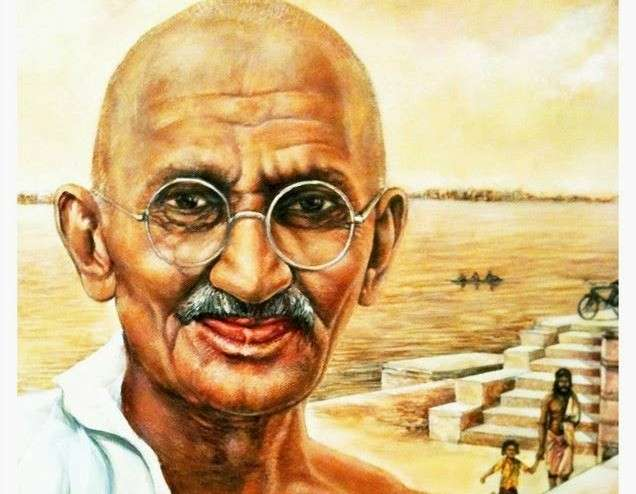

# Өөрийн ертөнцийг өөрчилөх нь

Махатма Гандийг, Энэтхэгт гэгээнтэн, бурхан мэт хүндлэн дурсдаг. Энэ хүн, 1947 онд, өөрийн улс орноо Английн колоничлолоос салгаж, тусгаар тогтнолд хүргэсэн гавъяатай, мэргэн ухаантан хүн билээ. Энэ ухаантан, хүн өөрийгөө өөрчилснөөр хорвоог өөрчилж болно гэсэн алдарт үгээ хэлсэн байдаг.

-Орчин, хүрээлэн буй ертөнцөө өөрчилөхийг хүсвэл өөрийгөө өөрчил. Бодол санаагаа өөрчилөхөд, орчин тойрны бүх зүйл өөрчилөгддөг.\
-Өөрийгөө хянадаг байх. Таны мэдрэмж, хариу үйлдэл зөвхөн танаас хамаардаг. Эргэн тойрон дох хэвшмэл загвар болсон ёс суртахуунаас ангид байх эсэхийг зөвхөн та л шийднэ. Таны мэдрэмж, өдөр тутмын амьдралын хэв маягийг хүлээн авах бодол санааг танаас өөр хэн ч удирдаж чадахгүй гэдгийг ойлгох хэрэгтэй. Өөрөөрөө байхыг эрхэмлэ. \
-Өршөөл уучлал, мөн түүнийг мартдаг байх. Хэрэв хэн нэгнийг өршөөж уучилж, мартахгүй бол, өөрийн мэдрэмжээ тухайн хүнд эзлүүлж байдаг. Уучилснаар хүн, өөрийгөө чөлөөлдөг\
-Үйл хөдлөлийг эрхэмлэ. Хүний өөрийнх нь 1 грамм туршлага, 1 тонн бусдын зөвлөгөөнөөс үнэ цэнэтэй. Сурч, судалж уншаад үйл хөдлөлгүй бол үхмэл мэдлэг л болно. Сурч мэдсэнээ бодит болгох үйл хөдлөл үр дүнд хүргэдэг\
-Одоо цагт амьдар. Аливааг урьдчилан төлөвлөж болох ч урьдчилан харж чадахгүй. Тиймээс байгаа бүхнээ ашиглан, байгаа боломжоо дайчлан одоо цагт амьдар. Ирээдүйгээр амьдрах нь, болгоомжлол, санаа зовинолыг бий болгож бодол санааг бохиртуулж байдаг. Орж ирээгүй зүйлийг хүлээж, түүгээр аливааг бүтээнэ гэж тооцож сууснаас, одоо байгаа багахан зүйлээр бодит амьдралаа бүтээ. \
-Бид бүгд, ижилхэн ердийн л хүмүүс. Хүн хэн ч байсан, мөн л, адилхан хүн. Хэн нэгнийг хүрсэн амжилт, алдар суугаар нь онцгойлон хүлээж авах хэрэггүй. Хэнд ч, ялангуяа өөртөө стандарт хэмжээ бүү тавь. \
-Тууштай бай. Аливааг эхлэх үед, хүмүүс эхлээд анзаарч эхлэнэ. Дараа нь тохуурхана, тэгээд тэмцэлдэнэ, эцсийн эцэст ялалт таны гарт байдаг. Энэ бүхнийг даван туулах сэтгэлийн тэнхээтэй байх хэрэгтэй. Түүнчилэн тухайн хийж буй зүйлдээ туйлаас дуртай байх нь таныг амжилтад хүргэдэг. Тууштай байхад тусалдаг нэг зүйл нь хошин шогийн мэдрэмж. Энэ нь аливаад хандах хандлагыг гайхалтай хөнгөлж өгдөг гэж үздэг. \
-Хүмүүсээс зөвхөн сайн талыг нь харж сур. Амьдрал тань хялбар болж, харилцаа эерэг тааламжтай болдог\
-Өөрөөрөө байж сур. Аз жаргал бол таны бодож буй, ярьж буй, хийж буй зүйл ижилсэн, нэгэн хэмнэл, зохилдлогоонд орох үе юм. Ярьж хэлж буй зүйл тань, үйл хөдлөлөөсөө зөрүүтэй байвал, сэтгэл зүрхээрээ амьдарч чадахгүй байгааг илэрхийлдэг. Өөөрийгөө бүү хуураарай. \
-Үргэлж өсч хөгжихийг эрхэмлэ. Энэ бол амьдралын хууль юм. Энэ нь, өөрийн төрөлх чанар, орчин тойрноо ойлгох ганц гарц юм. Улиг болсон үзэл бодол, хэв маягаас шинэ сэргэг сэтгэхүй рүү шилжих хамгийн ашигтай арга бол оюун санаагаа хөгжүүлэх зам бөгөөд унших, судлах, тунгаан бодох, танин мэдэхүйд тэмүүлэх арга юм.
