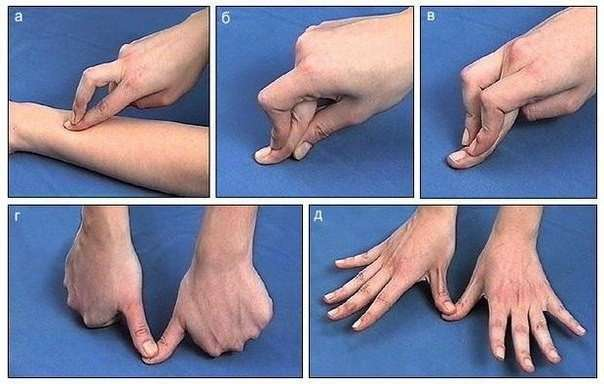
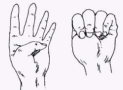
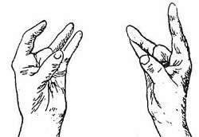
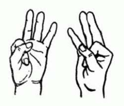
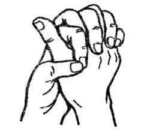
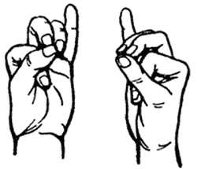
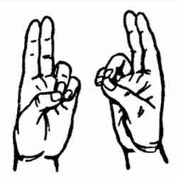
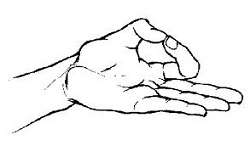
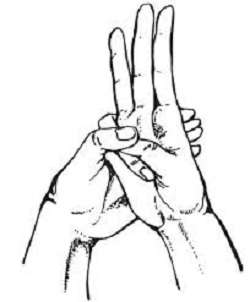

# Өөрийнхөө хуруунуудаар өөрийгөө эмчлэх гайхамшигт арга ба эмгүйгээр өөрийгөө эмчлэх нь

Таны хуруунууд, биеийг тань эмчилэх чадвартай. Үенүүд нь уян хатан бол бие организм тань эрүүл байна, харин хуруунууд нугарахдаа муу, сул бол эрүүл мэнддээ анхаарах хэрэгтэйг сануулж байна гэсэн үг ажээ.

Барууны эмч нар хуруунууд болон биеийн дотоод эрхтэнүүд хоорондоо уялдаа холбоотой болохыг тогтоож албан ёсоор хүлээн зөвшөөрчээ.

Хуруу тус бүр ямар эрхтэнүүдтэй холбоотой вэ?

Эрхий – тархи

Долоовор – ходоод

Дунд хуруу – гэдэс хоол боловсруулах эрхтэн

Ядам – элэг

Чигчий - зүрх

Иймд биеэ амархан аргаар эмчлэхийг хүсвэл гартаа тэжээлийн тос түрхэх үедээ хөнгөн массаж хийж, дараах дасгалуудыг хийгээрэй.

#### Толгой өвдөх, даралт ихсэх үед:

Ядамаар чигчийг, ядмыг дунд хуруугаар, дунд хурууг долоовроор, долооврыг эрхийгээр дарж өгөх ба буцааж дарааллаар нь дарах хэрэгтэй.

#### Зүрх судасны өвчлөл болон стрессээс сэргийлэхэд:

Гарынхаа үеэр тойрог хөдөлгөөн хийж, энэ үедээ хуруугаа дарааллаар нь нугална.

---

#### Чих өвдөх, сонсгол муудахад:

Дунд хуруугаар эрхий хурууны угт дарна.

---

#### Үе мөчний өвчний үед:

Долоовор хурууг нугалан эрхий хурууны уг дээр дарж, эрхийгээрээ хөнгөхөн дарна.

---

#### Ханиад хатгаа, гайморит:

Хуруунуудаа салаавчлан, нэг эрхий хуруугаа нөгөө гарын эрхий долоовор хоёроор ээлжлүүлэн ороож чангална.

---

#### Зүрх хүчтэй өвдөх үед:

Долоовор хуруугаа нугалж, эрхий хурууны уг дээр дарж, дунд хуруу, ядам хуруу эрхий хурууг өндөгөөр нь нийлүүлж дарна. Хоёр гараараа зэрэг хийх ба өвчин намдтал хийнэ. Энэ дасгал нь нитроглицерин эмийн үйлчлэлтэй дүйцдэг.

---

#### Хараа муудахад:

Чигчий, долоовор эрхий хуруунуудаа өндөгөөр нь нийлүүлж дарах

---

#### Тайвширч анхаарлаа төвлөрүүлэхийн тулд:

Долоовор, эрхий хоёрыг нийлүүлж, хэдэн удаа гүнзгий амьсгаа авах

---

#### Ходоод гэдэс хямрах, дүүрэх, элэгний өвчний үед:

Баруун гарын чигчийг эрхий хурууны уг дээр дарж, зүүн гараараа баруун гараа ороож, зүүн гарын эрхийгээр баруун эрхий дээр дарна

Эдгээр дасгалуудыг, биеэ эрүүлжүүлэх эмчлэхийн тулд өдөрт 2-3 удаа 15 минут хийх хэрэгтэй.
