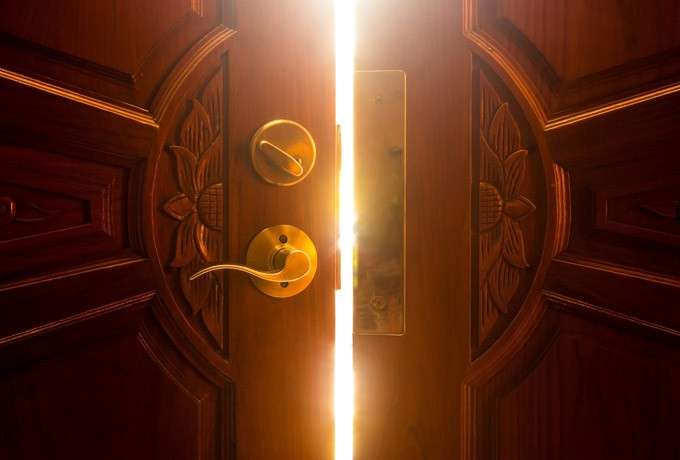
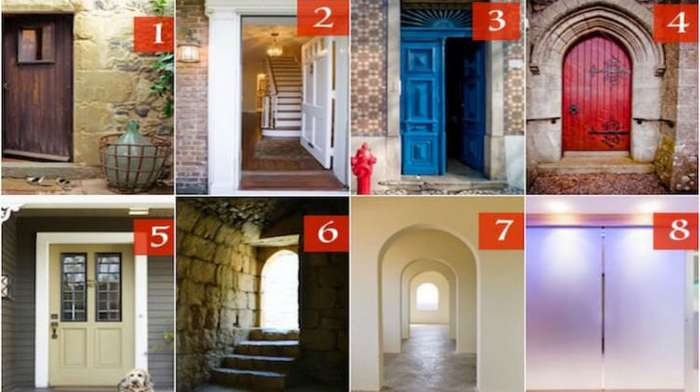

# Өөрийнхөө талаар мэдмээр байна уу...

Орчин үеийн дэвшилтэт хүн та, өөрийн оюун ухаан, өөрийн хүч чадалдаа итгэн амьдардаг тань гарцаагүй. Гэхдээ, ямар ч зүйлийг өөр өнцөгөөс харах сонин байдаг. Бид, хичнээн гуйвшгүй, ухаантай ч, аливааг хүлээж авах, таалах байдал маань ертөнцийн нууцлаг олон зүйлийг нээж өгдөг байхыг мөн үгүйсгэж чаддаггүй. Хамгийн их тайлагддаггүй, төөрөлддөг зүйл маань бидний байгальлаг мөн чанар. Төрөлх чанар болох харааны зөн совингоо ашиглан таалагдсан зүйлээ сонгон өөрийгөө таних алхам хийх гээд үзэцгээе.

Дараах хаалгануудаас сонгон, харгалзах тайллыг уншаарай.

---

#### Хаалга № 1

Ийм хүмүүсийг, “уснаас чимээгүй, өвснөөс нам” гэж ярьдаг. Та, могой шиг тайван, амьдралд гүн ухаанлаг ханддагт тань атаархмаар. Энэхүү эрчимтэй, бужигнасан амьдрал дунд та, яаж амар амгалан, зохилдлогоог олж амьдарна вэ? Та, ганцаараа байх дуртай, үдэшлэг цэнгүүн таных биш. Олуул бужигнасан үдэшлэг зугаалгаас, өөрийн ойр дотныхон, найз нөхөдтэйгээ цомхон баярлахыг илүүд тооцдог. Таны амьдрал, намуухан, хэвшмэл, алхам бүр нь шалгагдсан, тэнцвэртэй амьдрал. Гэхдээ, та, ганцхан амьдарна гэдгээ сана. Амьдралдаа, багахан өөр өнгө будаг, хөдөлгөөн нэмээд өгвөл яасан юм? Тогтоол ус намаг болон хувирдагийг мэднэ биз?

#### Хаалга № 2

Энэ хаалгыг сонгосон бол, та, ажил алба, харьцаа, амьдралын аль алинд, ухамсартай, бүр ухамсарлаагүй ч байж магад хувийн өсөлтийг эрхэмлэж байдаг хүн. Гэхдээ, нэг бяцхан гажуудал байдаг нь, хүссэн зүйлдээ хүрэхийн тулд, өөрөө, их зүтгэл шаардсан зам сонгох нь бий. Тиймээс амжилт чинь их үнээр олддог. Та, анхаарлын төвд байх дуртай, амбицтай, шударга. Амьдрал танд, зүгээр зүйл өгөхгүй гэдгийг маш сайн мэддэг тул, тэвчээр, зүтгэл бүхнийг шийднэ гэж үздэг. Танд нэгэн давтагдашгүй сайхан зүйл бий, тэр нь, заавал хүрсэн үр дүнгээсээ биш, харин үр дүнд хүрэхээр туулж буй зүйлсээсээ таашаал авч чаддаг зан тань.

#### Хаалга № 3

Өвөрмөц хүн. Эрсдэлээс айдаггүй адал явдалд дуртай. Өөрийнхөө гал цог шиг энэхүү зангаа дарж байх хэрэгтэй. Аюул ослоос сэрэмжлэх, танихгүй, үл мэдэгдэх зүйлтэй орооцолдохоос зайлсхийж бай. Эрсдэлийн дараа юу байгааг, мөн эрсдэлээс юу олж авахаа бодож тунгаа. Гэсэн ч та, Бурханы өвөрт байгаа юм шиг, сахиусан тэнгэрийн хамгаалалт дор гэмээр амьдардаг тань гайхмаар...

#### Хаалга № 4

Улаан өнгийн хаалга сонгосон бол, энэ нь, таны дайчин чанарыг харуулж байна. Цас, бороо, халуун өдрүүд таны хувьд юу ч биш. Албан тушаалын төлөө эсвэл аливаа харьцаанд давуу байх, мөн өөрийн давуу эрхийн төлөөх тэмцэлд яахаас ч буцахгүй. Зорилгоо олох бэрхшээлийг давчихсан одоо, түүнийхээ төлөө тэмцэлдэхээр иржээ...

#### Хаалга № 5

Аянга цахилгаан цахьсан, амьдралын далайд сэлүүрдсээр ядраагүй биз? Тайван бай, одоохон, салхи шуурга намдан бүх зүйл хэвийн болно. Тэр ч бүү хэл, зам дээр чинь тэвш дүүрэн аз жаргал асгарах нь. Та, аядуу, нам гүм байдлыг хайж байна. Хайсан хүн түүнийг заавал олдог, тогшсон хүнд үүд нээгддэг гэсэн бурханы хууль бийг сана. Өөрийгөө зөвхөн таатай хүмүүсээр хүрээлүүл. Таагүй хүмүүсээс зайгаа барь.

#### Хаалга № 6

Сонгосон зүйл тань, танд багахан бэрхшээл учраад буйг харуулж байна. Сэтгэл санаа тань сайнгүй, урам хугарлын байдалд байна. Гэхдээ, танд, гэгээн маргаашийг бүтээх эрч хүч одоо ч хангалттай байна шүү дээ. Бүү гунд, бүх зүйл гарт тань байна. Оройд нь уйлах, өглөөд нь баярлах, байдаг л зүйл. Ялалтын өмнө багахан цөхрөх хэсэгхэн үе байдаг гэдгийг та, өөрөө ч мэднэ. Тиймээс, зоригтойгоор урагшаа!

#### Хаалга № 7

Та, жаргалтай мэдрэмжээр дүүрэн байна. Бүхнийг ягаанаар харж, шуудай дүүрэн өөдрөг сэтгэлтэйгээр, аль ч хаалга руу, бүр өшиглөөд орчихоор зоримог хүн юм. Хувь заяаны эргүүлгээс, авч буй зүйлдээ хорхойсон, сэтгэл ханамж авч чаддаг сайхан чадвартай хүн. Удахгүй нэгэн сонголт ирнэ. Бүү сандар, хэцүү таагүй зүйл алга байна.

#### Хаалга № 8

Та, бусдын хэрэгт хошуу дүрэх туйлын дургүй. Мөн маш сониуч. Эргэн тойрон дох бүх зүйл сонирхолыг тань татаж дуудаж байдаг. Төрөлхийн өөдрөг учраас угтан ирэх үйл явдалуудыг сөрөн баяртайгаар алхдаг. Хамгийн зоримог адал явдал эрэлхийлэгчид хүртэл, эрүүл ухаанд хязгаарлагдаж байдаг. Гэтэл, та, юунд ч эргэлзэхгүй зөвхөн урагшилдаг гайхалтай чанартай. Амьдрал ганц. Хийгээгүй сайнаас, хийсэн муу нь дээр. Тийм шүү...
