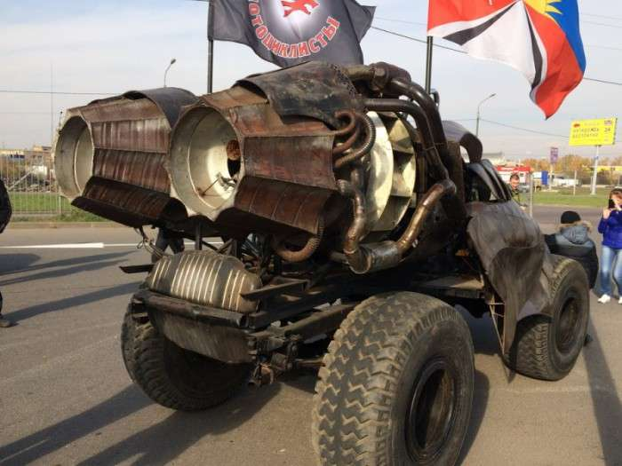
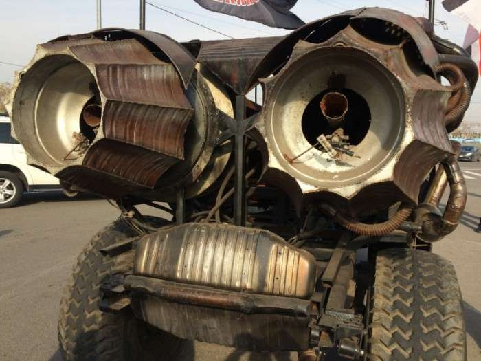

# Орос эрийн гараар бүтсэн “Чонон- машин”

“Галзуу Макс” киноны мангас-машинуудыг ч давсан, гайхалтай бүтээл болох, чонон-машиныг, сибирийн нэгэн, урам зоригоор жигүүрлэсэн инженер, өөрийн гараар, янз бүрийн машинуудын сэлбэг, хэрэгслүүдийг ашиглан бүтээжээ.

Тиймээс энэ машин, нэг талаасаа, авто машины “Франкенштейн” болсон гэдэгтэй хэн ч маргахгүй байна.

---

Энэ “Чоно” машин, V12 хөдөлгүүртэй, 100км/цагийн хурдыг хэдхэн секундэд авдагаараа онцлог бөгөөд дуу нь илэрхийлэхийн аргагүй чанга. Бас нэг гол онцлог нь мэдээж, машины гадаад дизайн! Шүдээ ярзайлгасан чоно!

---

Үүнийг хийхэд оруулсан хүсэл, сэтгэл, зорилго, хүч хөдөлмөрийн үрээр бүтсэн, энэхүү давтагдашгүй бүтээл, хүсэл зорилгоор жигүүрлэсэн, урам зоригийн бодит жишээ болох нь дамжиггүй.
