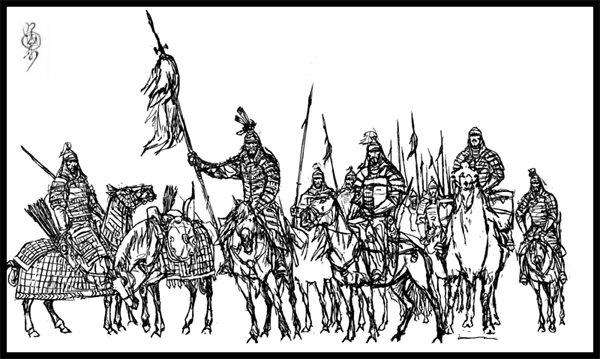
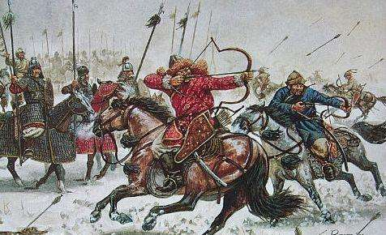

# Оросууд, “Алтан орд”-н үр удам

Москвагийн УИС-ын профессор, Оросын түүхч Юрий Пивоваров, Оросууд, “Киевийн Русь”-с гаралтай биш, харин “Алтан Орд”-н үр удам гэж, өөрийн шинжилгээ судалгааны ажлууд дээр үндэслэсэн дүгнэлтээ олон нийтийн өмнө танилцуулжээ.

Энэ талаар олон баримтуудыг харуулсан бичлэг бүхий нэвтрүүлэг, боловсрол танин мэдэхүйн сувгуудаар гаргасан боловч, харамсалтай нь энэхүү сувгуудыг үздэг хүмүүс бага байдгаас, олон нийтэд хүрч чадаагүй болохыг онцолжээ. Оросууд, “Киевийн Русь”-тай бараг харилцаагүй байсныг онцлоод, ямагт, “Алтан Орд”-н дор, хамрагдаж явсаныг батлан, үүнийг, Оросын засаглал, үргэлж авторитар дэглэмтэй явж ирсэнтэй холбон үзэж тайлбарлажээ. Мөн өмнө нь, нэгэн барууны судлаач, Крым-н газар нутагтай холбоотой маргаан гарсан тохиолдолд, Крым-г, Путин, Монголд өгөх нь зүйтэй гэж нотолж байсныг дурдсан байна.

---

Тэртээх, түүхэн цаг үед, Москвагийн вант улсыг, яах аргагүй “Алтан Орд”-с салсан гэж нийтээр хүлээн зөвшөөрдөгийг, нотолгоондоо, мөн ашигласан ажээ.
