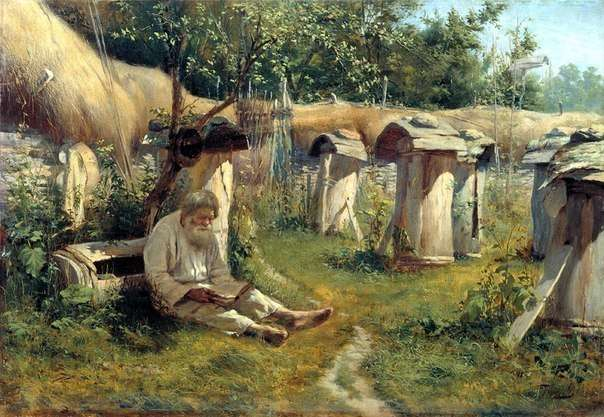

# Оросын ардын эмчилгээ

Оросын ардын эмчилгээний аргууд, амнаас ам дамжин ирсэнээр, одоо ч оросын ард түмэн өргөнөөр ашигласаар байдаг бөгөөд тэд, өвөг дээдсээс нь “хуучцуулын зөвлөгөө” гэж нэрлэгдэн ирсэн шалгарсан, үр дүнтэй аргууд гэж үздэг.

#### Хуучцуулын зөвлөгөө:

Хоолны өмнө ус уу-залуу нас чинь уртасна\
Гарын арьсандаа, сармис, зуун настын шүүс түрх, анхны байдалдаа орно\
Шар өвчинг, гишүүнийн ханд устгана\
Эр хүн хэдий настай байна төдий чинээ сонгино их ид\
Нэвт харагддаг ил судсанд, гаднаас нь алимны цуу түрх\
Өлөндөө идсэн шүд сармис, өдрийн турш нянгаас хамгаална\
Зөгийн бал нимбэг, амьсгаадах зовиурыг бүрэн дарна /мөн ханиалгахыг дарна/\
Артрит, тулай, склерозын үед шийгуа ханатал ид\
Хөлийн мөөгөнцөртэй бол хөл нүцгэн өвсөн дундуур туучаад бай\
Дарагдахгүй хамуунд, давстай халуун усны ууранд орох \
Шээс задгайрахад ногоон гоньдны үрний ханд уу\
Шамбарамд улиасны навч тавь\
Хөлийн уланд нимбэг үр, хөл өвдөхгүй\
Өргөст хэмх, лууван, хүрэн манжингийн шүүсний холимог бие дэх чулууг хөөнө\
Гэдэс гүйлгэхэд, таван салааны навч ид\
Хатигт баригдвал сонгино ихээр ид\
Хүрэн манжингийн шүүс уухад биед чулуу үүсэхгүй\
Эрүүл байхыг хүсвэл /эмчээс илүү/ зөгий үржүүлж, бүх зүйлийг нь хэрэглэ\
Түлэнхийд төмсний хальс тавь\
Ханиалга, нусгай ханиад, толгой өвдөхөд, сонгино зөгийн бал хольж ид\
Ясны хугархайд өндөгний хальс нунтаглаж дотуур хэрэглэ\
Арьсны өвчинд, ногоон гоньд, сармис хольж үр\
Артроз, мөн шөрмөс татах олширвол эсгий гуталд, вандуй хийгээд өмсөөд алхаад бай\
Нойргүйдэл, толгой өвдөхөд байцаа ихээр ид\
Шамбарамд, луувангийн ногоон иш хандалж цай шиг уу\
Түлэнхийд, лууван үрж жижиглээд чацарганатай хольж тавь\
Астмын үед, булгийн усанд овъёос буцалгаад уу, биеэс чулууг хүртэл хөөдөг
