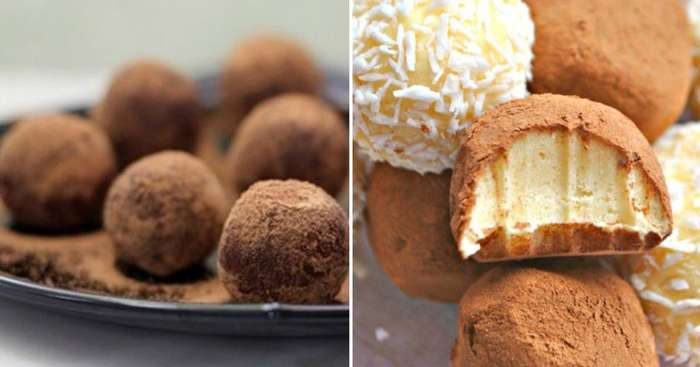
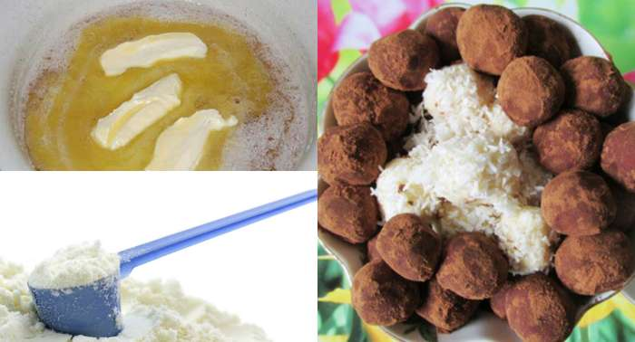
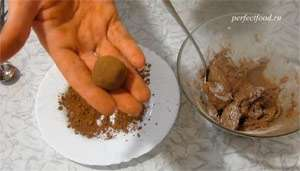
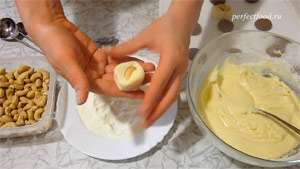
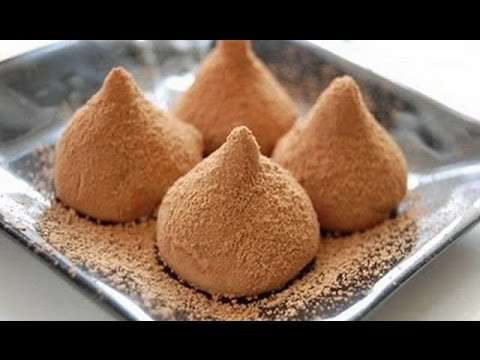

# Өөрсдөө амтлаг чихэр хийж идэцгээе

Та бүхэндээ, нэг ч дэлгүүрт байхгүй, гарын доорх материалаар өөрсдөө хийх, ямар ч таагүй нэмэлтгүй, амтлаг чихэр хийх арга танилцуулъя.

#### Орц:

Хуурай сүү 250 гр\
Элсэн чихэр 300-350 гр\
Цөцгийн тос 100 гр\
Ус 100 мл\
Нунтаг какао 2-3 хоолны халбага\
Ваниль эсвэл кардамон 1 чимх

#### Бэлтгэх:

Зузаавтар ёроолтой саванд, ус сахараа хольж буцалгаад галаа зөөллөн 7-10 минут өтгөртөл нь байлгана.\
Гал дээрээс авч, цөцгийн тосоо нэмж сайтар хутгана\
Тасралтгүй хутгах явцдаа хуурай сүүгээ бага багаар нэмж өгнө. Энэ үедээ, ваниль, корица, кардамоны аль нэгийг 1 чимх хийж хутгах хэрэгтэй.\
Хэсэгхэн байлгаад уг зуурмагаа бөөрөнхийлж, хуурай какаонд өнхрүүлээд хөргөгчинд хийнэ. Зуурмагийнхаа нэг хэсгийг какаотой хольж, кокосын үйрмэгд өнхрүүлж өөр төрлийн чихэр мөн хийж болох юм. Гадуур нь бүрж гоёх, амтлах, хэлбэр дүрсийг нь өөрчилөх, гоёмсог цаасаар боож чимэх өөр аргуудыг бодож, сэтгэж баяжуулаарай.

---

---

---

---

