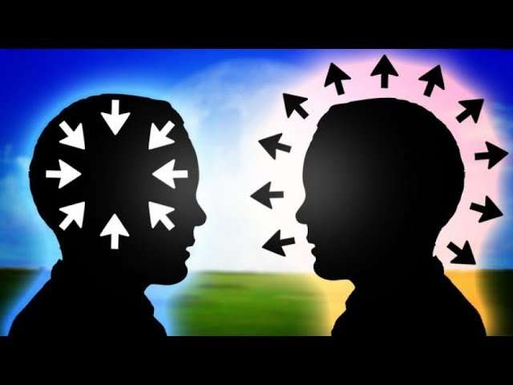

# Өөртөө итгэлтэй хүн болохын тулд яах ёстой вэ?

Байнгын өөрийгөө бусадтай харьцуулах байдал, бусдаар өөрийгөө хүлээн зөвшөөрүүлэх арга эрэлхийлэх зэрэг нь өөрийгөө үнэлэх мэдрэмж сул, өөртөө итгэлгүй байдлын илрэл юм. Өөртөө итгэлтэй хүн сайн сайхан мэдрэмжээр дүүрэн, өөрөөрөө байж чаддаг, мөн өөрийгөө мэдрэх, үнэлэх мэдрэмж нь ухамсарт нь суусан байдаг. Танд эдгээр мэдрэмжүүд байна уу, эсвэл бүр байхгүй байна уу? Өөрийн үнэлэмж, өвөрмөц давтагдашгүй чанараа ойлгохын тулд өөрөө өөртөө, өөрийгөө хүлээн авах дараах хэдхэн алхмуудыг хийж болох юм.

#### Шийдвэр гаргах

Огцом, гэнэт өөртөө итгэлтэй болох ямар нэгэн ид шидийн мэт арга байдаггүй. Мөн энэхүү итгэл хүн төрөхөд хамт төрдөггүй. Харин өөртөө итгэлтэй болох хамгийн шилдэг арга нь, өөртөө итгэлтэй хүн болохыг хүсч, хүлээн авч, зөвшөөрч, өөрөө өөртөө зарлан тунхаглах арга юм. Эдгээр нь зөвхөн таны, танаас шалтгаалсан шийдвэр бөгөөд та, яг одоо энэхүү шийдвэрээ гаргачихсан гэж тооцоорой. Таны өмнөөс хэн ч үүнийг хийж чадахгүй, харин та шийдвэрээ гаргачихлаа.

#### Өөрийгөө илэрхийлэх аргуудаа өөрчилөх

Та, амжилттай, өөртөө итгэлтэй хүмүүсийг анзаараарай. Тэдний яриа хөөрөө, үгсийн санд "би мэдэхгүй”, “би чадахгүй”, “би чаддаггүй” гэсэн үгс байдаггүй. Үг яриа нь тодорхой, бодолтой хэлэгдэж байдаг. Өөрийн үг ярианд эдгээр үгсийг хэрэглэхгүй байхыг туйлаас хичээх хэрэгтэй. Энэ үгс таны өөрийн тань сэтгэл санаанд муугаар нөлөөлөөд зогсохгүй, бусад хүмүүс таныг хэрхэн хүлээн авахад сөргөөр нөлөөлж байдаг. Мөн “биеийн хэл” буюу яаж зогсдог, ямар дохио зангаа хэргэлдэг, нуруу, мөр толгойн зөв байрлалаа анзаарч байгаарай.

#### Өөртөө итгэлгүй байдал хүн бүрт байдаг

Дэлхий дээрх бүх хүнд, хүн бүрт их бага хэмжээгээр өөртөө итгэлгүй байдал суусан байдаг. Энэ нь сөрөг бодлуудад хир эзэмдэгдэдгээр хэмжигддэг бөгөөд өөртөө итгэлтэй болохыг хүсдэг хүмүүс өөрийгөө голох болон бусадтай өөрийгөө харьцуулах мэдрэмжүүдээ, илүү хүчтэй эерэг бодлууд, өөдрөг сэтгэлээр дарж, эргэлзээ, атаархалаас салсан шийдэмгий зантай байдаг.

#### Бүхий л сайн сайхан үгс болон өөрт тань хайрласан талархал магтаалыг цээжилсэн мэт санаж байх

Өөрт тань хаяглагдсан талархал, магтаалын үгс, эерэг сайхан сэтгэгдлүүдийг болвол бодит хэлбэр, бичгээр хадгалах, мөн оюун санаандаа суулгаарай. Эерэг бодол нь, өөртөө итгэх итгэлийг суулгах хамгийн гайхалтай үр дүнтэй арга юм шүү.

#### Азгүйтэл, уналтаас айхгүй байх

Өөртөө итгэлтэй хүмүүс, азгүйтэл, уналтыг зайлшгүй зүйл гэдгийг мэддэг, тиймээс тэд түүнээс айдаггүй аж. Айдас эргэлзээ, хүний аливааг хүлээн авах сэтгэл, хөдөлгөөн өөрчилөлтийн чөдөр юм. Өөртөө итгэлтэй хүмүүс алдагдал уналтыг зайлшгүй зүйл гэж үздэгээс итгэлтэйгээр даван туулдаг. Энэ зүйл болоод өнгөрнө гэдгийг мэддэг. Та амьдралын ямар нэгэн цохилтын дараа хурдан сэхээрэн босч чаддаг уу?

#### Аль болох их, байнга инээж байх

Амьдрал маш хурдан өнгөрдөг. Тиймээс тайван сайхнаар, илүү их таашаал авахын төлөө амьдар. Амьдрал их зугаатай зүйл. Алдаа азгүйтлээ шоолж инээгээд өнгөрүүлэх гээд үзээрэй. Сэтгэл санаа тань хөнгөрч тавиран, тэр зүйл тийм ч аймшигтай зүйл биш санагдна шүү.

#### Хүсч буй сайхан зүйлдээ бодлоо төвлөрүүлэх

Өөртөө итгэлтэй хүмүүс ирээдүйгээ дандаа сайн сайхнаар хардаг. Зөвхөн сайн зүйлс түүнтэй тохиолдно гэж боддогоос үр дүн нь мөн л тийм байдаг. Та юу бодож байна? Бодож байгаа зүйлийнхээ үр дүнг сайтар бодож хянаж сураарай.

#### Өөрийн дотоод сэтгэлээ сонсож сурах

Өөрийнхөө сэтгэлийг дагахын оронд бусдыг дагах, бусдад төрүүлэх сэтгэгдэлдээ ач холбогдол өгөх нь жинхэнэ төөрөгдөл. Өөрийгөө өөрөө л удирд. Дотор сэтгэл тань таны хамгийн итгэлтэй зөвлөх буюу зөн совин тань юм. Түүндээ итгэж сур.

#### Зорилготой амьдрах

Зорилго тодорхой байх нь агуу их итгэлийг өгдөг. Зорилгоо биелүүлэхийн тулд хийх үйлдэл, үйл хөдлөлийг дагаад өөртөө итгэх итгэл өсч байдаг бөгөөд тэр чинээгээр амьдрал тань өөрчилөгдөж байдаг. Амьдралаа өөрөө удирдах хамгийн их боломжийг зорилго өгдөг юм.
