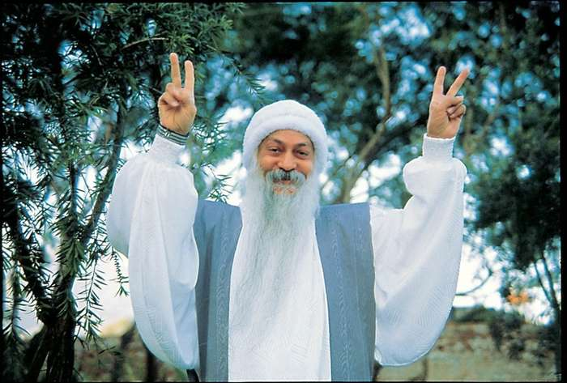

# Ошогийн сургамжууд

Энэ сургамжууд ирээдүйн амьдрал руу хөтөлнө. Танд ямар нэг төлөвлөсөн шийдэгдэх эсэхэд нь зовиноод байгаа асуудал байвал дараах сургамжуудыг уншаарай.

#### 1. Хайр

Нэгэн хаан, хаан ширээгээ залгамжлагчаа сонгох болж, хоёр ихэр хүүгийнхээ алийг нь сонгохоо мэдэхгүй байв. Тэр хоёр, хоёулаа ухаантай, зоригтой ер нь яг адил өрсөлдөгчид байв. Хаан хоёр хүүдээ ууттай цэцгийн үр өгч, үүнийг хэн сайн хадгалсан нь хаан болно гээд өгчээ. Эхний хүү нь, үрийг гёмсог авдранд хийн хадгалав. Хоёрдох хүү үрийг тарив. 3 жил өнгөрч хаан хөвгүүдээ дуудан, үрнүүдээ авчирахыг тушаахад эхний хүүгийн үр авдранд ялзарчихсан, харин хоёрдох хүү сайхан цэцэг авч ирж, -би үүнийг бүрэн ургамагц таны үрийг хурааж өгье гэснээр хаан болох нөхцөлөө хангасан гэдэг. \
-Таны хувьд, аливааг энэ үр мэт авч үзэж хэрэгжүүлэх ёстой байх нь. Хайрлах. Тарих. Үгүй бол хэнд ч хэрэггүй болно.

#### 2. Сөргөлдөөн

Тариалангийн талбайн дэргэдүүр өнгөрч явсан нэгэн худалдаачин нэг боолыг харж зогсоод өрөвдөн хоолложээ. Боол түүнд, -“бүх зүйл болж өнгөрдөг, энэ зүйл ч мөн болоод өнгөрнө” гэж хэлжээ. 3 жилийн дараа тэд дахин таарав. Боол баян болсон байсан бөгөөд худалдаачинг үнэт зүйлсээр шагнаад нөгөөх л үгээ хэлжээ. Дараагийн удаа худалдаачин нөгөө боол байгаад баян болсон хүний шарилыг харав. Чулуун дээр нь “”бүх зүйл болж өнгөрдөг” гэж бичсэнийг уншаад, за энэ чинь болоод өнгөрдөг зүйл биш дээ гэж бодов. Дараа нь нилээд хэдэн жилийн дараа шарил хөрсөнд шингэснийг хараад худалдаачин нээрээ л бүх зүйл улиран оддог гэж боджээ. \
-Таны хувьд: болж буй зүйлс таны хүсэл сонирхолд нийцэхгүй байвал түүнтэй тэмцэх гэж бүү хүчээ зориул, өөрөө шийдэгднэ.

#### 3. Өөрийгөө хүлээж авах

Нэг хаан өглөө эрт цэцэрлэгдотроо зугаалж явахдаа хатаж хорчийсон ургамал моднуудыг анзаарч хараад ийнхүү бодов. Царс, нарс шиг өндөр байж чадахгүйдээ, нарс усан үзмийн мод шиг жимсэлж чаддаггүйдээ, харин усан үзмийн мод сарнай шиг анхилуун үнэр гаргаж чаддаггүйдээ хатаж хорчийн үхэж байлаа. Ганцхан хальсан цэцэг л сагсайтал цэцэглэсэн байсан бөгөөд, хааны асуултад,-та намайг ийм байхаар л тарьсан, би өөр зүйл болж чадахгүйгээ мэднэ. Тиймээс би энэ өөрийн төрлийн дунд хамгийн сайн нь байхаар шийдсэн юм гэж хариулжээ. \
-Таны хувьд: бурхан хэнийг ч хялбархан бүтээх байсан биз. Чи хэрэгтэй учраас л энэ дэлхийд мэндэлсэн. Тиймээс бурханы шийдвэрт хүндэтгэлтэй хандаж өөрөө өөрийгөө байгаагаар нь хүлээж авч байгаарай.

#### 4. Мэргэн цэцэнОрдны эмч дээр нэгэн шүдгүй, буурал толгойтой баян орж ирээд, санаа алдсанаа,- би нүдээ аниад л хэвтээд л, ордны үзэсгэлэнт татвар эмсийг цэцэгс мэт алаглан сууж байгаагаар, намайг ормогц бүгд нууц хаалгаар зугтан алга болж байгаагаар зүүдлэх юм гэхэд нь, ордны эмч,-энэ зүүднээсээ салахад хэрэгтэй эм тан авахаар явна уу? Гэж асуухад нь, баян өвгөн,-үгүй ээ, үгүй! Надад ганцхан тэр нууц хаалгуудыг хаах арга л хэрэгтэй байна гэж ээ. -Таны хувьд: хүмүүс өөртөө байгаа зүйлсдээ сэтгэл хангалуун амьдардаг байсан бол аз жаргалтай байх байсансан. Гэвч бусдын юманд санаархдаг хүмүүс их байдаг. Анхаар.5. Нийтийн зүйлНэгэн гүн ухаантан ганц хос гуталтай байжээ. Гутлаа засуулахаар гуталчинд ороход, гуталчин –“би одоо хааж байна, та гутлаа орхиод, маргааш авна уу”, гэхэд гүн ухаантан, -“надад өөр гутал байхгүй шүү дээ”, гэхэд -“би танд, түр өмсөхөөр өөр гутал өгье” гэжээ. Гүн ухаантан, -“би хүний гутал өмсдөггүй” гэвэл гуталчин – “та нар хүний бодол санааг үргэлж тархиндаа тээдэг байж яагаад үгүй гэж” гэлээ. -Таны хувьд: энэ хорвоо ертөнцөд яг таных гэж заяагдсан зүйл зөвхөн бодол санаа байдаг тул анхаарах хэрэгтэй. Бусад зүйлс нийтийнх байж болдог.6. Эрч хүчАнгулимала гэх нэгэнтэй хүмүүс муу харьцаад байсан тул, тэр мянган хүнийг бүрэлгэж хуруугаар нь хүзүүний зүүлт хийхээр шийдэж 999 хуруутай болов.Тэгтэл нэгэн мэргэн хүнтэй таарчээ. Тэр хүн Ангулималын энэ явдлын талаар мэдэж байсан тул чи энэ модны мөчрийг хугалаад буцаагаад нийлүүлж чадвал хийдгээ үргэлжлүүл гэснээр түүнийг зогсоосон гэдэг. - Таны хувьд: эрч хүчээ зөв зүйлд ашигла үгүй бол эрч хүч тань уур хилэн болж хувирдаг7. Замын гэгээХаранхуй шөнө нэг гүн ухаантан, нэг энгийн хүн хоёр төөрчээ. Энэ үед гүн ухаантан болж буй асуудлын учир утгыг бодон явахад энгийн хүн хувь тавиландаа даатган явав. Тэгтэл гэнэт цахилгаан цахихад, гүн ухаантан тэнгэррүү харж явсан тул юу ч харсангүй, замаасаа гарч улам төөрчээ, харин энгийн хүн өмнөхөө харж явсан тул амжиж зөв замаа олжээ. -Таны хувьд. Урдахаа анхааралтай харж урагшаа итгэлтэйгээр алх. Цахилгаан шиг цахих бяцхан боломжуудыг ч ашигла. Гүн ухаан бол оюун бодлын, учир шалтгааны бодлын процесс тиймээс ямар нэг зүйлд хөтлөхгүй.8. ТалархалОрой болж нэгэн настай эмэгтэй мөргөлчин, тосгонд ирж хонох айл хайхад хэн нь ч оруулсангүй. Ядарсан эмэгтэй тосгоны захад нэгэн алимны модны доор унтсан бөгөөд шөнө дунд сэрээд хартал сарны гэрэлд цэцэглэж буй алимны мод гойд үзэсгэлэнтэй харагджээ. Тэр босч тосгоны зүг харан, -“намайг орулж хонуулаагүй та бүхэнд баярлалаа” хэмээн талархсан бөгөөд түүний дараа нэгэн алдартай давтагдашгүй уран зураг тэр эмэгтэйн гараар бүтсэн гэдэг. -Таны хувьд: амьдралаас өгч буй бүхнийг талархан хүлээж авч сураарай. Сэтгэл ханамж, гуниглал аль аль нь хүнийг хөгжүүлж байдаг.9. ИтгэлНэг анчин ширэнгэд 3 хоног төөрч явж байгаад бас нэгэн төөрсөн хүнтэй тааралдаж баяртайгаар тэврэлдэн уулзав. Тэгээд бие биенээсээ яагаад ийнхүү баярлалдсанаа асуухад, эхнийх нь:-би төөрөөд хэн нэг хүнтэй уулзна гэсэн найдвар тасарсан байсан гэхэд, нөгөөх нь:-би ч төөрөөд, зам заах хүнтэй уулзлаа гэж баярласан, одоо хамтдаа төөрч дээ, гэжээ. - Таны хувьд: Хүн ганцаараа ч байхдаа жаргаж болдог. Энэ бол аз жаргал. Харин хоёулаа болсон ч аз жаргалгүй байх тохиолдол байдаг.10. Гэр бүлийн гаднаИйсус бага байхдаа ээж ааваасаа холдон номлогчидтой ярьж суухад нь цуцталаа эрж хайсан аав нь ирж –“чи энд юу хийж сууна вэ? Бид зөндөө хайлаа” гэхэд, -“”би энд оюун санааны эцэгтэйгээ хөөрөлдөж байна” гэсэн аж. -эрт орой хэзээ нэгэн цагт хүүхэд хэзээд биеэ даан эх эцгээсээ салж оюун санаагаа даган явдаг. Бие мах бод болон оюун санааны тусгаар байдал хэзээд хэрэгтэй.11. Диваажингийн хаалгаСамурай нэгэн номын багшаас, там, диваажингийн хаалга гэж байдаг уу? Хаана байдаг вэ? гэж асуужээ. Лам багш “чи хэн бэ?” гэхэд, -“би самурай”. –“тэгвэл чи хэрмэл тэнүүлч юм байна”гэв. Уур нь хүрсэн самурай, сэлмээ сугалтал, лам багш инээмсэглээд энэ бол Там мөн Диваажин. Энэ хоёр зүйл бидний дотор оршдог. Бодлогогүй хийсэн үйлдэл тамын хаалгыг нээж, сайн үйлс диваажингийн хаалгыг нээдэг гэжээ. -Таны хувьд: Өөрийнхөө үйлдэл, сэтгэл хөдлөлөө хянах.
