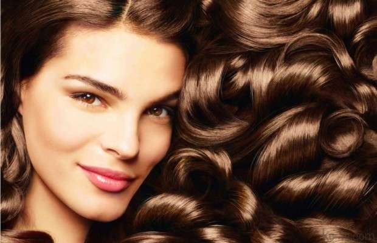
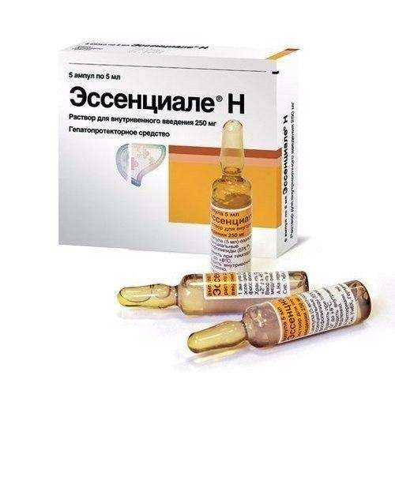

# Өтгөн сайхан үстэй болох хялбар, үр дүнтэй арга

Танд, эмийн санд зарагддаг, ампултай “Эссенциале”, тариа хэрэг болно. Энэ бүтээгдэхүүнд, бүх витаминууд, эсийн бүрхүүлүүдийг тэтгэдэг фосфолидууд ордог учраас, үсний угийг бэхжүүлж, ургуулдаг байна. Мөн эдгээр орцууд нь ус, тосны аль алинд нь уусдаг шинж чанартай тул, үсийг нойтон байхад нь түрхэх нь үр дүнтэй. /үс угаасаа тослог/

---

#### Орц:

-0.5 ампул, “эссенциале”. /богино үсэнд, 1/3 ампул/\
-1 ширхэг өндөгний шар\
-1-2 халбага цөцгий

#### Хэрэглэх:

-Толгойгоо, ердийн аргаар угаагаад, шууд түрхнэ. \
-Үснийхээ уг хэсэгт түрхэн хөнгөн массажлаж өгнө. \
-Гялгар уут эсвэл зориулалтын хулдаасан малгай өмсч, гадуур нь том, биеийн алчуураар бигнэж бооно. \
-Цаг орчим байлгаад, усаар зайлан, сэнс хэрэглэхгүй ердийн аргаар хатаана.

Долоо хоногийн зайтай 3-5 удаа хэрэглэнэ. Бүх төрлийн үсэнд тохирдог бөгөөд үр дүн нь нэг удаа хэрэглэхэд л харагддаг, шалгарсан арга юм байна.
