# Өвөө болон түүний муур хоорондын гайхалтай нөхөрлөл

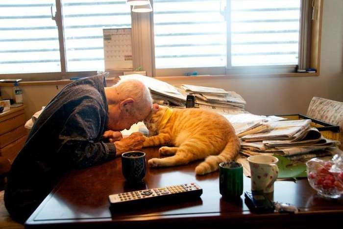

Токио дахь гэрэл зурагчин Акику Ду Понтын 94 настай өвөө Жижи нь хэдэн жилийн өмнө Альцгеймерын өвчин /зөнөх, мартах өвчин/ туссанаа мэдсэн байна. Үүнээс хойш өвөө нь ганцаардаж, бусдаас өөрийгөө тусгаарлах болсныг Акику анзаарсан байна. Түүний өвөө нь амьтанд хайртай болохоор Акику түүнд зориулан бяцхан муурын зулзага авч нууцаар тэжээж, бяцхан зулзагыг 4 сар хүрэхэд нь өвөөдөө харуулжээ. Бяцхан зулзага Кинако түүний амьдралыг гайхалтай болгожээ. Кинако түүний өвчин болон сэтгэлийн зовиурт нь эерэгээр нөлөөлж байгаа нь үнэхээр гайхалтай. Жижи өвөө болон Кинако муурын аз жаргалтай мөчүүдийг ач охин Акику нь гэрэл зурганд буулгажээ. Муур бол зөвхөн тэжээвэр амьтан бус харин гэр бүл, анд найз болохыг Жижи өвөө болон Кинако муур харуулж байна.

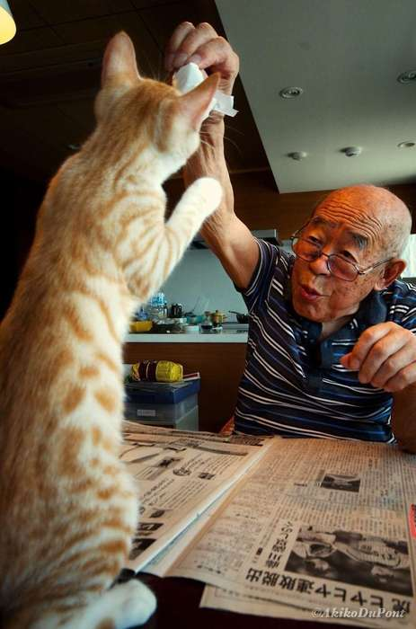

---

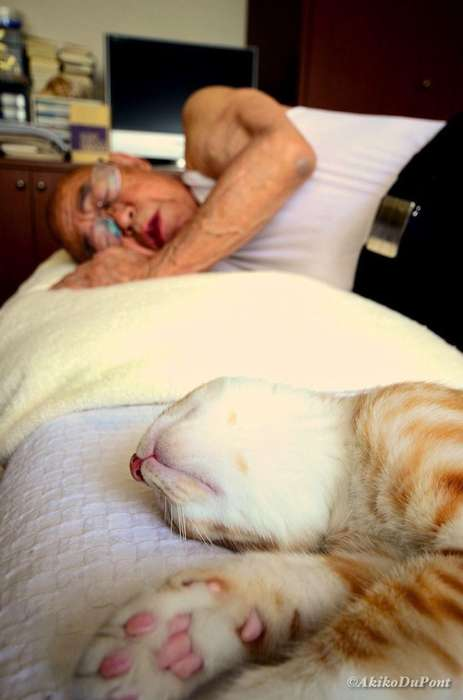

---

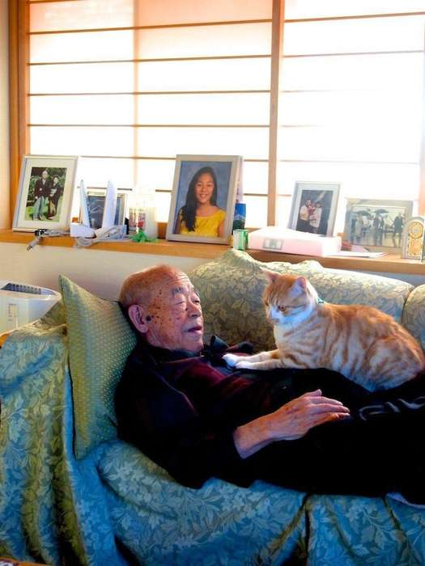

---

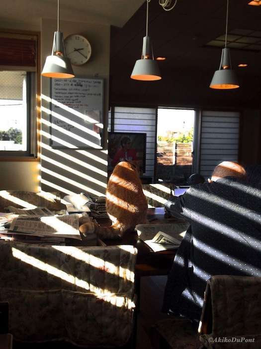

---

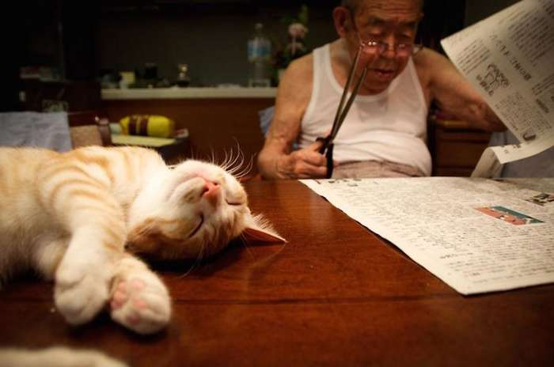

---

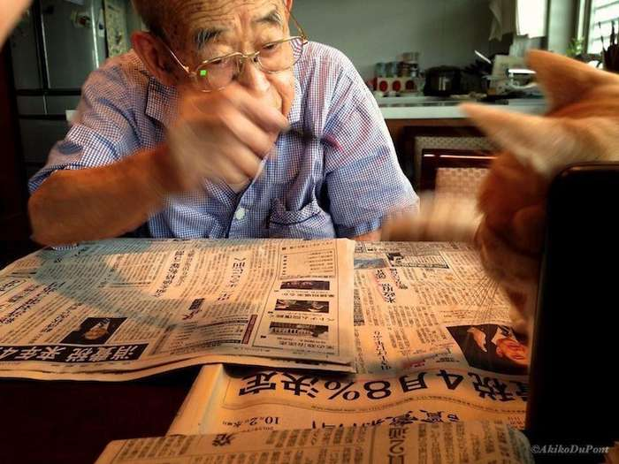

---

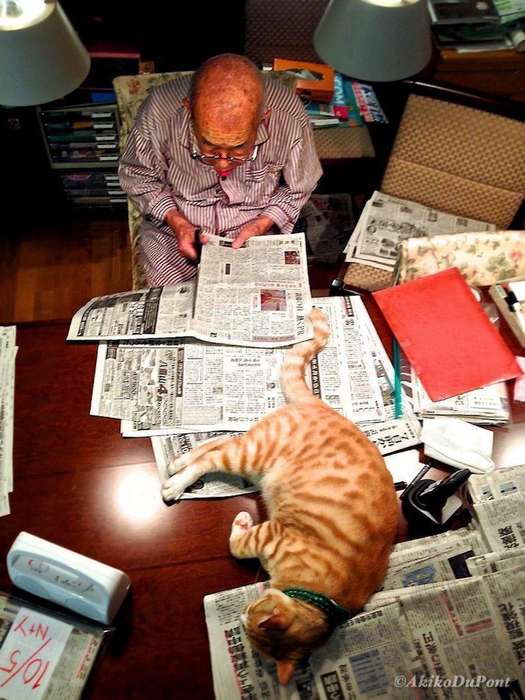

---

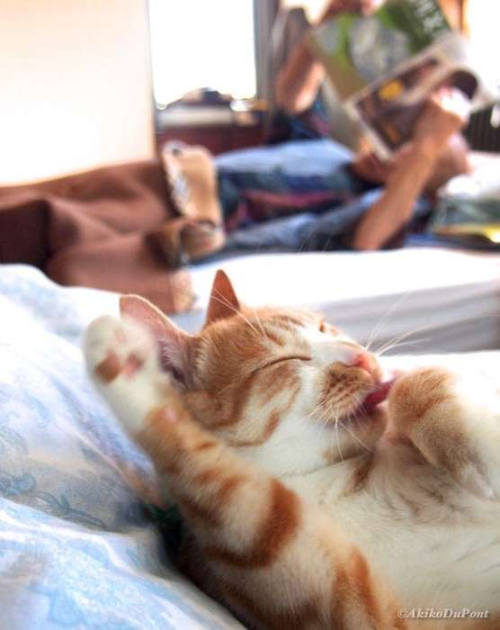

---

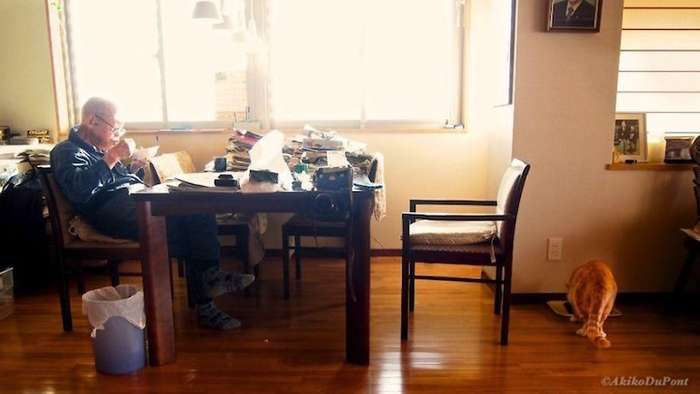

---

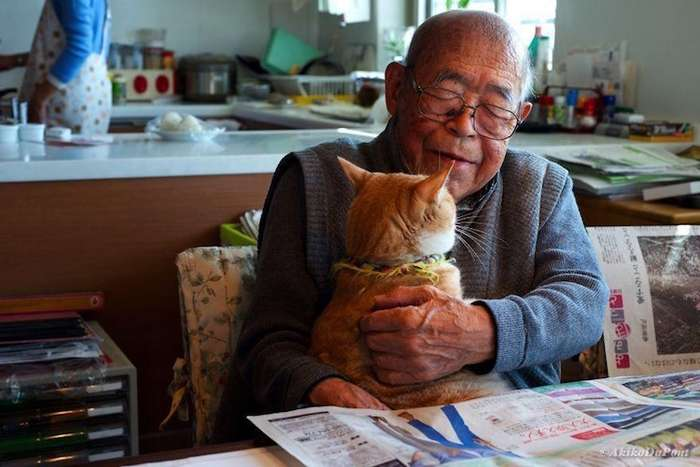

---

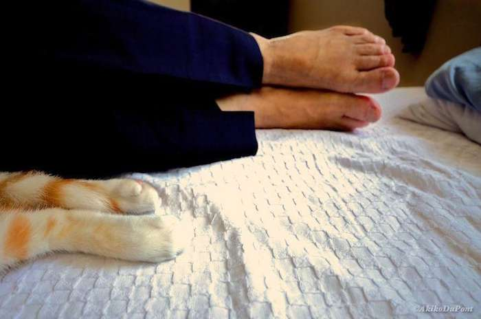
