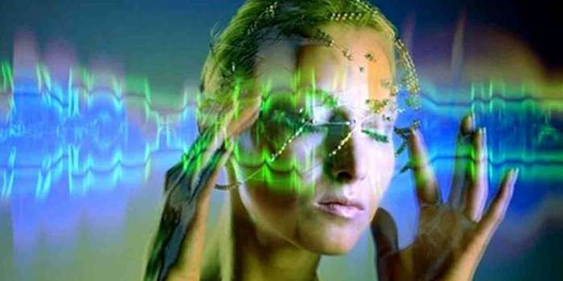

# Өвчлөл бол амьдралын утга учирыг ойлгосон эсэхтэй холбоотой

Бүхий л өвчин, хүнийг, дотоод ертөнцдөө анхаарах болсоныг харуулж байдаг байна. Харин хүн, өвдмөгцөө, дотоод сэтгэлээсээ шалтгаан хайхгүй эмч, эмнэлэг рүү явж, эмийн эмчилгээгээр эдгэрнэ гэж боддог.

Гэвч ертөнцийн тайлшгүй хууль нь, дотор сэтгэлээ эмчлэлгүй тухайн өвчин эдгэрсэн ч байсан, дараагийн хүнд өвчнөөр нэрвэдэг ажээ. Нян бол, зөвхөн хүн, ургамал амьтны амьд эс дотор үржих боломжтой халдвар үүсгэгч юм. Хүний биеийн организм дах өвчин үүсгэгч нян, хүний, өөрийн оршихуйн тухай бодол, байр суурь, нэр хүндийнхээ талаарх өөрийн үнэлэмжээс үүдсэн хор хөнөөлтэй бодол санаанаас нөхцөлдсөн энергитэй орчинд, өсч үржих нөхцөлөөр хангагдаж байдаг байна. Хүний биеийн өвчлөл нь, тухайн хүн баяр баясгалан, сэтгэл ханамж байхгүй болсон, бодсон санасан нь нуран унасан, сэтгэлээр унасан, уйтгар гуниг, зовлон зүдгүүртэй болсон зэргийг зааж байдаг. Нян үржин өвчлүүлэх хөрс нь болдог энергийн эдгээр чичирхийлэл мөн удам дамжсан байх магадлалтай байдаг гэнэ. Төрөл төрөгсөд нь амьдралын талаар доогуур бодолтой, доромж зүйлсийн төлөөх шаналал тээдэг байсан, эсвэл амьдралын итгэлээ алдсан байсан зэрэг байдлууд удамшин дамжих аюултай аж. Өвчин үүсгэгч нян хүний эд эсэд сууж, хүний биеийн нэг хэсэг болсноор, нянг устгахын тулд, биеийн нэг хэсгийг мөн устгах хэрэгтэй болдог. Анагаах ухаан нянг эмээр дардаг, харин нян хүний энергээр тэжээгддэг байна. Хүн хичнээн нянгийн эсрэг эм уув ч, дорой сэтгэлгээнээсээ салахгүй. Нянгийн эсрэг эмийн эмчилгээ биед үйлчлэх боловч бодол сэтгэлгээнд үйлчилдэггүй. Тиймээс хүн, аливаа өвчний эдгэрлийг хүсч байвал, шалтгаанаа эмчлэх хэрэгтэй юм. Энэхүү шалтгааныг эмчлэх арга бол зөвхөн хүнд, өөрт нь байх бөгөөд сэтгэлээ засч, ертөнцийг хүлээн авч, хүндлэх, бусдыг хайрлах, амьдралыг үзэх үзлээ өөрчлөх, амьдралын утга учирыг олох, өөрийгөө таних зэрэг асуудлуудад оршдог.

Өвчин үүсгэгч нянг, мөн хүмүүсийг зөв өөрчлөгдөхөд түлхэц болох, ертөнцийн илгээмж гэж үзэх нь ч бий. Тиймээс өвдсөн хүн, эдгэрлийн төлөө аливааг эрж хайх нь, өөрийгөө болон амьдралын утга учирыг таних гараа нь болж өгдөг ч байж болох юм.
