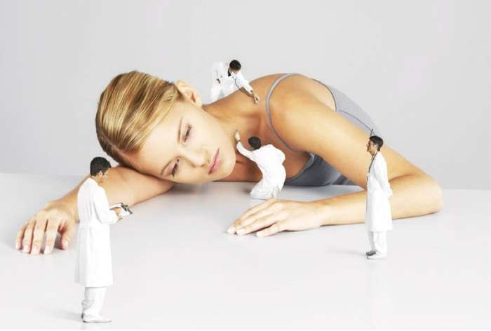

# Өвчлөлийн шалтгаан ба бодлууд

Өвчин хаанаас ирдэг вэ? Бидний хэний маань ч толгойд ордоггүй сэтгэл зүйн талаас, өвчиний үүслийг авч үзэж болдог байна. Гунигтай царайтай хүний бодол ямар байх нь бүхэнд ойлгомжтой. Настай хүмүүсийн царай зүс, өнгөрүүлсэн амьдралдаа бодож ирсэн бодлынх нь шууд тусгалыг илэрхийлж байдаг гэж үздэг. Олонхи өвчин, өвчлөлүүдийн метафизик оношлогоо, шалтгаан, мөн ямар өвчлөлтэй байна, түүгээр нь, хүний юу боддог болон тэрхүү бодлууд биед нь хэрхэн нөлөөлдөг болохыг харуулсан жагсаалтыг танилцуулъя. /90-95% таардаг/

-Толгой. Толгой бидний гол эрхтэн. Биднийг үндсэндээ толгойгоор хүлээж авч, толгойгоор таньдаг. Толгой асуудалтай бол амьдрал чинь асуудалтай байна гэсэн үг. -Чих. Хүн муу сонсдог болохыг, тухайн хүний амьдралд, сонсох дургүй зүйл байнга байдагтай холбож үздэг. Чих дүлийрэх нь удаан хугацаагаар, хэнийг ч юм сонсох дургүй байснаас тархинд явагдсан сэтгэхүйн процессын үр дүнгээс үүдэлтэй гэдэг.\
-Нүд. Хараа эрт муудах нь, харах дургүй зүйлс амьдралд нь байгааг харуулдаг. Ялангуяа, нүдний шил зүүсэн бага насны хүүхдүүдийн амьдралд болж буй зүйлсийг анхаараарай.\
-Толгойн өвчин. Өөрийгөө үнэлэхээ болихиод толгойн өвчин үүсдэг. Хаана, хэзээ доромжлолд орж байна, дорд үзэгдэж байна гэдгээ бодож олоод түүнээс зайлсхийхэд уг өвчин алга болно. \
-Мигрень. Төгс байхыг хүсдэг хүмүүсийн өвчин. Мөн амьдрал нь цочрол бухимдлаар дүүрэн хүмүүс тусдаг.\
-Хүзүү, хоолой. Хүзүү бол бодлын уян хатан чанар, асуудлыг өөр талаас харах, хүний үзэл бодлыг ойлгох чадварыг харуулдаг эрхтэн. Хэрэв хүзүүний хөдөлгөөн хязгаарлагдаад эхэлвэл, зөрүүд зан давамгайлаад эхэлчихсэн байдаг гэнэ. Хоолойн өвчнүүд, эрхээ эдэлж чадахгүй байх, сэтгэл ханамжгүй байх зэргээс үүсдэг.\
-Ларингит. Цочрол бухимдал, уур цухлаас эхтэй. Хоолойнд бүтээлч энергийн цэг байрладаг бөгөөд хүүхэн хэл, бамбай булчирхайтай холбоотой өвчлөл өөрийн хүссэнээ хийж бүтээгээгүйдээ шаналж явдагийн илрэл гэнэ. Мөн хоолойнд өөрчлөлтийн цэг байдгаас аливаа өөрчлөлтийг эсэргүүцэх үед, хоолой сэрвэгнэх, шалтгаангүй ханиах байдал илэрч байдаг байна.\
-Нуруу. Нуруу нь бидний тулгуур эрхтэн юм. Нуруу өвдөх нь, гэр бүлээсээ хангалттай дэмжлэг авч чаддаггүйтэй холбоотой гэнэ. Нурууны дээд хэсгээр өвдөх нь, -“миний гэр бүлийн хүн намайг ойлгохгүй, дэмжихгүй байна” гэсэн бодлоос, дунд хэсгийн өвдөлт өөрийн гэмээ мэдэрсэн бодол тээж явдагаас, нурууны доод хэсгийн өвдөлт байнга өөрийн мөнгөний байдалд санаа зовж, хирээс хэтэрсэн хэрэгцээгээ дийлдэггүйгээс болдог гэнэ.\
-Уушиг. Өгөх авах чадварын илэрхийлэл. Бүрэн дүүрэн амьдрах эрхээ эдлэхээс айдгаас, боломжгүй гэж боддогоос уушигны өвчлөлүүд эхтэй. Их тамхи татдаг хүмүүс ихэвчлэн амьдралыг үгүйсгэдэг хүмүүс байдаг бөгөөд тамхидалтынхаа цаана хүчгүй, өөрийгөө үнэлэх үнэлэмжийн дутуу дулимаг байдлаа нууж байдаг гэнэ.\
-Хөх. Өөрийн анхаарлаараа, хэн нэгнийг эсвэл ямар нэг үйл ажиллагааг хааж боодог зан араншингаас хөхний асуудлууд үүсдэг. Мөн уур хилэн, гомдол цөхрөл нөлөөлдөг.\
-Зүрх. Зүрх нь хайрын билгэдэл, харин цус, баяр баясгаланг билэгддэг. Амьдралд хайр, баяр баясгалан байхгүй бол зүрх агшин хөрж, цусны урсалт удааширч, аажмаар цус багадалт, судасны өвчлөлүүд, инфарктад хүргэдэг аж. Амьдралын баяр баясгаланг мэдэрч, амьдралын утга учрыг эрж хайснаар илааршуулж болдог.\
-Ходоод. Аливаа санаанууд, байр байдлыг бодож боловсруулахтай холбоотой. Ходоодны асуудал нь, шинэ, танил биш асуудлуудын учрыг олохгүй байх, айх, түүнд дасан зохицоход хэцүү байгаа зэргээс үүдэлтэй байдаг. Жишээ нь, хүн анх онгоцоор нисэх үедээ, дотор нь муухай оргиж, ходоод агшиж, сунаж базлахыг мэдэрдэг. Харин, дараа дараагийн нислэгүүдэд ингэх нь зүгээр болсон байдаг. Ходоодны шарх, өөрийгөө санаандаа хүртэл байлгаж чадахгүй байгаадаа санаа зовинох сэтгэлээс үүдэлтэй гэдэг. Мөн, бусдын сэтгэл санаанд нийцүүлэх гэж хичээх үйлдэл нь өөрийн эрхээ хязгаарлахад хүргэдэг үеийн сэтгэл санааны байдал энэ өвчин тусахад нөлөөлдөг. Өөрийгөө хайрладаг, хүндэлдэг хүмүүс ямар нэг шархлаат өвчин тусдаггүй. Өөрийн сэтгэл санааны байдлаа, “хүүхэд” шигээ хайрлан зөөлөн хандаж, анхаарч, дэмжиж, хүндлэх хэрэгтэй байдаг байна.\
-Цөсний чулуу. Салах гээд чадахгүй байгаа гашуун дурсамжууд, бардам зантай холбоотой гэдэг. “Өнгөрснийг баяртайгаар үдье, амьдрал сайхан, би бас сайхан” гэсэн бодол тээх хэрэгтэй. Тустай.\
-Давсаг, шулуун гэдэс, бэлэг эрхтэний өвчлөлүүд. Тухайн эрхтэнүүдийн гүйцэтгэдэг үүргүүдийг муухай, бохир гэж хэтрүүлэн авч үзэх, боддогтой холбоотой байх магадлалтай байдаг. Үндсэндээ эдгээр эрхтэнүүд, бусад эрхтэнүүдийн л адил хэрэгцээтэй эрхтэнүүд. Байхгүй бол яах билээ? \
-Өндгөвч. Бүтээж чадаагүй, хүч хүрээгүй ажил үйлсээ их бодсоноос өвчилдөг.\
-Хөл. Хөлний асуудлууд нь, амьдралын замын урагшлах хөдөлгөөн эсвэл ямар нэг чиглэлд хөдлөх өөрчлөлтөөс айх үед гардаг. Судас бүдүүрэх нь гэр орон эсвэл ажилаа үзэн ядахаас эхтэй. \
-Үе мөчний өвчин. Өөрийгөө болон бусдыг байнга шүүмжилдэг хүмүүс энэ өвчинд өртдөг. Төгс байхыг хичээдэг тул үүрэх ачаа нь дааж давшгүй байдгаас өвддөг.\
Астма. Хүний мөс чанар нь хэт хөгжсөн хүмүүс, аливаа зүйлийн бурууг өөртөө тохож, амьсгалах эрхгүй юм шиг санагдатлаа сэтгэл санаа нь хямарснаар энэ өвчин эхэлдэг гэж үздэг. Байршил, орчин нөхцөлөө солиход сайн нөлөөтэй гэдэг.\
-Хорт хавдар. Гүн гүнзгий суусан гомдол цөхрөл, дотроос нь хүнийг идэж буйн илрэл гэж үздэг. Сэтгэл санаанд нь гарцгүй байдал, найдваргүй байдал давамгайлсан хүмүүс,мөн бусдыг буруутгах дуртай, өөрийгөө шүүмжилдэг хүмүүс өртөх магадлалтай байдаг гэнэ. Өөрийгөө байгаагаар нь хүлээж авч, хайрлаж сурахад энэ өвчин эдгэдэг.\
-Илүүдэл жин. Ямар нэг зүйлээс өөрийгөө хамгаалуулахыг хүсэх, хайх, эрэлхийлэх, хамаалалт хэрэгтэй байх үед хүн таргалдаг гэнэ. Өөртөө итгэлгүй байх нь мөн илүүдэл жинтэй болгодог. Өөрөө өөртөө итгэх, амьдралд итгэх, сөрөг бодлуудаас салах зэрэг нь турах шилдэг арга гэнэ.
