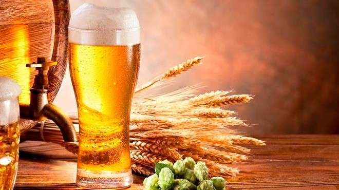
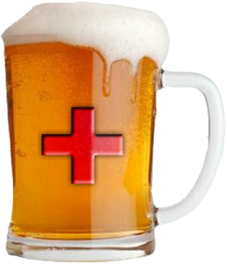

# Өвдөлт дарах ууш

Толгой тань дандаа өвддөг үү? Нуруу өвдөж байна уу? Ходоодонд асуудал гардаг уу? Өвдөлтийг дарахын тулд эм уусаар л байна уу?

Эмч нар гайхалтай сонин арга дэвшүүлж, өвчин намдаах эм авч уухын оронд 1 литр шар айраг уухыг зөвлөж, зарим хүмүүст таатай, зарим спиртлэг ундаа үзэн ядагчидын хувьд дургүй нь хүрэхээр зөвлөгөө шүү, гэж дашрамд нь анхааруулжээ. Гринвичийн их сургуулийн судлаачид, бие даасан тус тусдаа 18 судалгааны үр дүнд литр шар айраг өвдөлтийг намдаадаг, цусан дах алколийн зөвшөөрөгдсөн хэмжээ 0,08 процент байдаг гээд үүнээс хэтрүүлэхгүй шар айраг хэрэглэх нь, бие эвгүйцэх, өвдөх үед уудаг химийн гаралтай эм тангаас хавьгүй илүү үйлчилгээтэй, мөн хор нөлөөгүй гэж тодорхойлжээ. Судалгааны удирдагч, Гринвичийн профессор, The Sun сэтгүүлд өгсөн ярилцлагадаа, -“өвчин намдаах үйлчилэлээрээ алкоголь нь, кодеин мэтийн опоид үйлчилгээтэй эмийн бүтээгдэхүүнтэй дүйцнэ. Парацетамол эмнээс хамаагүй хүчтэй. Алкоголиос согтууруулах үр нөлөөгүй эм гаргаж авч болдогсон бол энэ нь өнөөдрийн байдлаар хамгийн сайн өвчин намдаагч эм байхсан” гэж хэлжээ. Гэхдээ энэ зөвлөгөөнд анхааралтай хандах ёстой бөгөөд эмч нар, хүний алкоголь хэрэглэх зөвшөөрөгдсөн хэмжээг маш бага гэдгийг дахин сануулаад, долоо хоногт 14 нэгж буюу 7 литр шар айраг, 6 хундага дарс буюу 175мл дарс гэж тогтоосныг дурдах нь зүйтэй.
