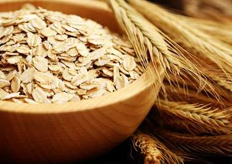
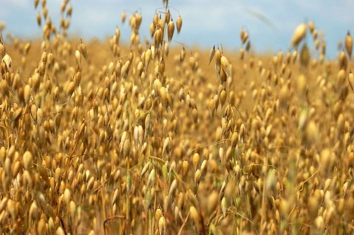

# Овъёосны хандаар, бие организм, гоо сайхнаа зэрэг эрүүлжүүлэх арга

Овъёос нь, геркулес нэрээр худалдаалагддаг бөгөөд уургаар маш баялаг, В1,В2,Д4 амин дэмүүд болон кали фосфор, төмөр, магни, иодын томоохон эх үүсвэр, зөв хооллолтын хамгийн шилдэг бүтээгдэхүүн юм.

Овъёосны ханд цусыг шинэчлэн, холестирины агууламжийг бууруулан, бүдүүн гэдэсний хорт хавдар, зүрхний титэм судасны эмгэг үүсэхээс бүрэн сэргийлэхээс гадна бодисын солилцоог сайжруулж, бөөрний үйл ажиллагааг дэмжин, дархлааг өсгөдөг. Ер нь бүх организмыг сэргээдэг. Бэлтгэхэд маш амархан, 3 хоолны халбага, цэвэрлэсэн овъёосыг /бутласан бол бүр сайн/ 500 грамм усанд хийж, буцалмагц галаа хасч, зөөлөн гал дээр 15-20 минут чанаад, марлиар шүүн бэлэн болно. Өдөрт 2 стакан орчмыг уудаг. Хурдан нөлөөлдөг бөгөөд бие хөнгөрч, эрч хүчтэй болдог. Гоо сайханд, давхар нөлөөлж, үс, хумс бэхжин арьс толигор болохоос гадна жин барих үйлчилгээ үзүүлдэг.
