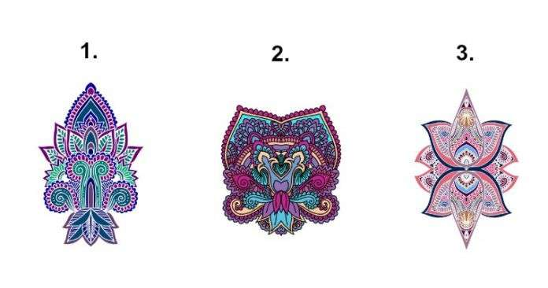

# Өвөг дээдсээс өгч буй сануулга /тест/

Хүн, аливааг харж сонгохын цаана юу далдлагдаж байдгийг хэн ч тайлбарлаж чаддаггүй бөгөөд харааны хүлээн авалтыг, тайлбарлашгүй олон зүйлийг тодорхойлох боломжтой гэж үздэг. Дүрсүүдээс сонгон, өвөг дээдсээсээ өгч буй сануулгыг уншаад үзээрэй.

1. Та, өөрийн шийдмэг бус байдал, айдас, эргэлзээнд автсаар, аливаа хүсэл, үйлдэл, үйл хэргийнхээ биелэлтийн тохиромжтой үеийг удаан хүлээсэн гэдгээ өөртөө болон бусдын өмнө хүлээх хэрэгтэй. Бүх зүйлс аажмаар байраа олж, байх ёстой зүйлс бага багаар бүрднэ гэсэн их бодит бодлоор амьдардаг. Харин одоо, өөрт байгаа бүх зориг зүрх, шийдэмгий байдал, эрч хүчээ дайчилан урагшлахыг сануулж байна.

2. Та, хүйтэн сэтгэл, тооцоон дээр тулгуурласан, шинжиж сонжсон бүхий л хандлагаасаа татгалзаж, өөрийн хүч чадлаа аливааг ойлгох, хайрлахад төвлөрүүлэх ёстой болжээ. Бодож тунгаадаг сайхан авъяасаа ашиглан, бсудыг өөрөөр хардаг, өөр давтамжид сонсдог болж, мэдрэхүй мэдрэмжээ сонсохыг илүү анхаар.

3. Та амьдралд, мөн зорьсон бүхэндээ идэвхитэй, эрч хүчтэй ч, хэт нэг талыг баримталж, замынхаа зөвхөн нэг хэсгийг хардагаас амьдрал тань багахан тодорхой бус тогтворгүй. Энэ эрчээрээ урагшил, гэхдээ аливааг олон талаас харж, үйлдэл, үйл хэргийнхээ боломжит үр дагавруудыг тооцоолж бай. Та, хэт хурдад анхаарч, олон хүчин зүйлсийг харахгүй орхигдуулан бүдэрчихэхээс болгоомжил.
