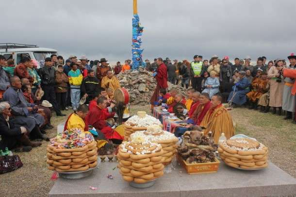
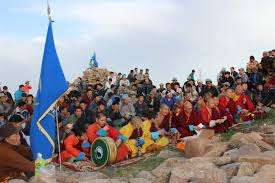

# Овоо тойрч гороолохдоо “ЛХА ЖАЛ ОО” гэж хэлдэг

Хангай дэлхийд эзэнгүй юм гэж нэгээхэн бээр ч байхгүй. Учир иймээс уул усны эзэн болсон лус савдгийг аргадаж тайлга тахилга үйлдэхийг монголчууд эрхэмлэдэсээр иржээ. Лус дотроо хоёр янз, бурханы номонд орсон түүнд сүжиглэдэг гэж байхад, бурхан дээдийн номыг үл тоодог, түүнд сүжиглэдэггүй гэж хоёр янз байдаг.

Лус савдгийг тахиж, хариуд нь энэ насныхаа барцад саадаас ангид байж, олон амьтанд тустай зүйл гаргуулахын тулд лус савдгийг тахиж тайтгаруулдаг байна. Тэнгэр дотор, номын үйлэнд баясдаг цагаан зүйлийн тэнгэрүүд лусын тахилганд даган баясаж байдаг. Овоо тахилганд оролцох хүн тэр тахилгат овооны ан амьтны амь хороохыг цээрлэдэг. Тахилга хийсэн өдөр тахилгат уулын ан амьтнаас цус гаргах, мод огтлох, булаг шандын усанд бохир оруулах зэргийг хатуу хориглодог.\
Дээрх зүйлийг зөрчвөл лусын хорлол тусаж, онош нь олдохгүй өвчин тусах амь насанд нь аюултай тул цээрлэвээс зохистой. Лусад өргөл өргөхдөө шинэ чанасан цайны дээж, сүү, чихэр бал бурам, шар тос, жимс, цагаан ямааны сүү, улаан үнээний сүү, малынхаа сүүгээр хийсэн тараг, ховор нандин торгоны зай тэргүүтэнг өргөл болгож болно. \
Харин лусад өргөдөггүй зүйл нь архи, ларьз (хүдрийн заар) хар бэх хольсон эмийн төрөл, сонгино, сармис, ариун бусын идээ унд өргөхийг хориглоно. Овоо тахилгийн ажилд архи дарс тэргүүтэн ариун бусын идээ унд хэрэглэсэн хүн оролцох ёсон байхгүй, Лус савдгийг дээдийн номоор цэнгүүлж, өргөл өргөсөн буяны үрээр, орон нутаг ган зудгүй, хүн ардын сэтгэл хямрахгүй, элдэв өвчин хорлол гардаггүй байна.
