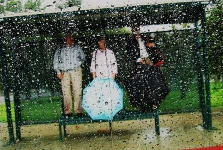

# Өвөрмөц сэтгэлгээ ба бүтээлч хандлага

Та, салхитай харанхуй шөнө машинтай явж байгаад, замын хажууд автобусны буудал дээр зогсох гурван хүнийг харлаа, гэж төсөөлөөрэй.

Эдгээр хүмүүс:\
1. Бие муутай,өвдчихсөн эмгэн\
2. Урд нь таны амийг аварч байсан хуучны танил\
3. Сайхан залуу./бүсгүй/\
Та, хоёр хүний суудалтай машинтай яваа бол, эдгээр хүмүүсээс алийг нь суулгах бол? \
Энэхүү, хүний хүн чанар, зан суртахууныг хөндсөн тестийг, нэгэн компани хүмүүс ажилд авахдаа хэрэглэсэн байна. Та, настай, бие нь муудсан эмгэнийг авч явах байх. Эсвэл амиа аварсан хүндээ хариу тус хийхээр авч болох. Тэгтэл, тэр сайхан мөрөөдлийн залуу /бүсгүй/-г авч явах хүсэл төрж ч магад. Ингээд уг тестэд хамрагдсан хүмүүсээс гацаараа, ондоо хариулж шалгарсан хариултыг танилцуулъя. Уг компани ажилд орох хүсэлтэй 200-д хүнд энэ асуултыг тавихад, ганцхан хүн зөв хариулсанд тооцогдож, ажилд орсон ажээ. Тэр хүн, “би, машиныхаа түлхүүрийг хуучны танилдаа өгч, настай эмэгтэйг эмнэлэгт хүргэж өгөхийг гуйгаад, өөрөө мөрөөдлийн бүсгүйтэй үлдэх байсан” гэж хариулсан аж. \
Өвөрмөц сэтгэлгээ, хүнийг аливааг шийдэх, эрэл хайгуул хийх бүтээлч хандлага зэрэгт гайхалтай нөлөөлдөг ба, хэцүү асуудлуудыг шийдэх, сонирхолтой шийдлүүд нь үргэлжид хүмүүсийг алмайруулж байдаг байна.
