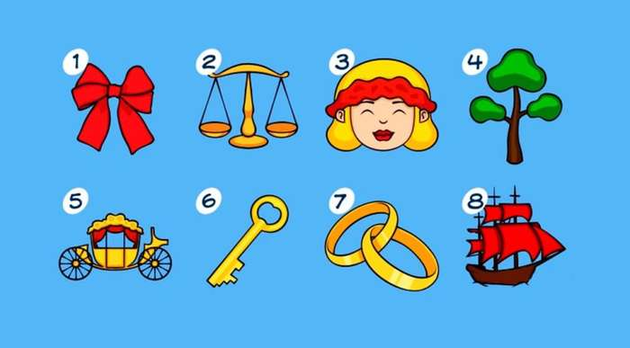

# Ойрын ирээдүйгээ мэдмээр байна уу? Эдгээрээс нэгийг нь сонго

Хүн бүр, өөр өөрийн гэсэн онцлог, давтагдашгүй чанартай байдаг. Өнгө, хэлбэр дүрсийг ч мөн янз бүрээр хүлээн авдаг бөгөөд, энэ мэргэ, эдгээр чанарууд дээр үндэслэгдэн зохиогджээ. Зугаатай бөгөөд үнэний хувьтай болохыг нь, та, одоохон мэдрэнэ. Зураг дээрх, дараах дүрсүүдээс, тайвнаар, таалагдсанаа сонгоод харгалзах хариултыг уншаарай.

---

**Бант** Удахгүй багахан асуудалтай тулгарна. Ойр дотныхонтой тань холбоотой. Эртнээс үүнд бэлдээд яах вэ, асуудлыг хүндрүүлэхгүй байхыг л, тухайн үедээ хичээ. Нөхөрсөг, ухаалаг байх, аз жаргалтай байх нь зөвхөн таны л сонголт. Аз жаргалыг өөрөө сонгосон хүн л аз жаргалтай байдаг юм шүү. Одоохондоо ухаанаараа ялгарах гээд хэрэггүй, урсгалаар байж хүлээзнэ.\
**Жин** Ашиг орлого орж ирэх нь. Нүдээ сайтар нээгээд, боломжуудаа нягтлан хар. Хувь заяаны боломжийг бүү алдаарай. Зарим асуудлууд тань танд ашигтай шийдэгднэ эсвэл шинэ ашигтай нөхцөл байдал үүснэ. Аль аль талыг нь анхаараарай. Багахан гаргасан зүтгэл тань их зүйлийг өгөхөөр байна.\
**Бүсгүй** Таатай уулзалт, тааламжтай уулзалт таныг хүлээж байна. Бодит амьдралдаа бүтээлч байхыг сануулж, далд ухамсартаа илүүтэй найдан хүүсэн зүйлээ л хийхийг зөвлөж байна. Үүнийг сонгосон эмэгтэйчүүд, даашинзтай “эрэгтэйлэг” чанараа далд хийснээр, мөн илүү энхрий, эмэгтэйлэг байвал аз завшааныг атгана. Тархи толгойгоо элдэв зүйлээр бүү гашилга. Өөдрөг бай. Гайхамшиг урд чинь байна. \
**Мод** Удахгүй амьдрал таныг бас л шалгана. Бүү сандар. Мэдлэг туршлага чинь аваад гарна. Бууж өгч хэрэггүй, учир нь та та, бүхнийг давах авъяастай, таныг хэн ч, та өөрөө л боломж өгөхгүй бол, зорилгоос чинь хазайлгаж чаддаггүй. Танд, өөрийгөө өөрчилөх шаардлага алга. Танд хүмүүс итгэдэг, зөвлөгөө авдаг. Бид ч итгэж байна шүү. \
**Сүйх** Та, удахгүй замд гарна. Өөрийгөө танихад тустай таатай аялал. Томоохон аятайхан өөрчилөлт хүлээж байна. Аян замаасаа, ашигтай олон зүйлийг мэдэж, “суусан газраасаа шороо атгах” нь. \
**Түлхүүр** Та өмнөө тодорхой зорилго тавьжээ. Уг зорилгодоо хүрэх магадлал маш өндөр. Гэхдээ, хүмүүстэй маш болгоомжтой бай. Тэдний зүгээс, худал, хуурмаг харилцааны эрсдэл ирнэ. Үлдсэн амьдралдаа мартахааргүй сургамж болох магадлалтай. Толгой дараалан хүмүүст итгэдэгээ зогсоо. Бүх хүн таны найзууд биш, бүгд танд сайныг хүсэхгүй шүү дээ. Зорилгодоо ухаанаа төвлөрүүлж, зорилгоо хайрла. \
**Бөгж** Гэр бүлгүй хүмүүс ханиа олно. Гэр бүлтэй хүмүүс, үр хүүхэдтэй болно. Амьдралыг өөдрөгөөр харснаар, урт удаан үргэлжлэх сайхан амьдрал таныг угтаж байна. Багахан тэвчээрэй. \
**Хөлөг онгоц** Та, өөрчилөлтийн салхины сэвшээг мэдэрчихсэн л байна даа. Амьдралынхаа олон хүрээндэх өөрчилөлтийн эзэн нь та өөрөө юм. Эерэг сөрөг байдлын аль нь болох нь, танаас, зөвхөн танаас шалтгаална. Та хүчирхэг хүн юм.
