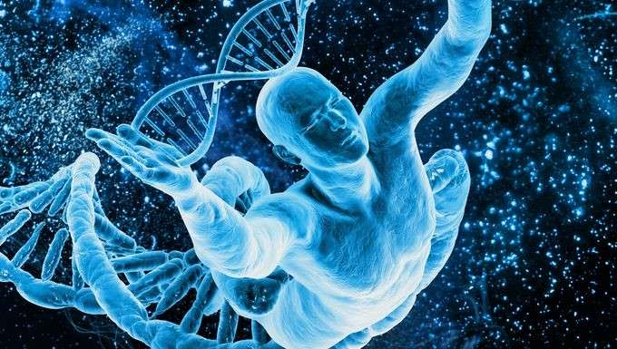

# Оюун ухааны удамшилтай холбоотой сонирхолтой баримтууд

Генетикийн ертөнцийн эдгээр баримтууд нь, хүмүүсийг үр удмынхаа оюуны санд эерэг сайн хувь нэмэр оруулахуйц амьдрах ёстойг сануулах юм.

-Эцгээс хүүд оюун ухаан удамшдаггүй. Хэрэв эцэг нь сод ухаантан бол, хүүд нь 100% дамжина гэж байдаггүй гэнэ. Тиймээс, сайн муу чанарууд удамших чадвар нь адил байдаг учираас, олхиогүй эцэгтэй хүү нар, эцгээ дуурайхвий гэж айх шаардлагагүй\
-Эцгийн оюун ухаан, зөвхөн охидод удамшдаг. Гэхдээ зөвхөн тал нь. Бусдыг охид хүмүүжлээс олж авна\
-Эрэгтэй хүн, эцгээсээ удамшиж авсан оюун ухаан бүхий ээжийнхээ оюуныг өвлөн авдаг\
-Сод ухаантнуудын охид, эцгийнхээ оюуны талыг удамшлаар авч, харин тэдний хүү нар нь жинхэнэ сод ухаантан болдог байна\
Тиймээс 100% сод ухаантан эмэгтэйчүүд цөөхөн мөн 100% усан тэнэг эмэгтэйчүүд байдаггүй, харин сод ухаантай эсвэл эсрэгээр усан тэнэг эрчүүд олноороо байдаг гэнэ.\
Эдгээрээс дүгнэхэд:\
Эрчүүд:\
Өөрийн хүүгийн оюуны чадавхийг таамаглая гэвэл эхнэрийнхээ аавыг харах хэрэгтэй. Хэрэв тэр академич бол хүү тань ухаант нэгэн болно.\
Охин тань, таны ухааны хагасыг авч, оюун ухааны түвшиний хувьд тантай тун ойролцоо байдаг.\
Харин охины чинь хүү буюу зээ хүү тань, таны бүх ухааныг тэр чигт нь өвлөнө. Ухаантай, өөрийгөө дуурайсан үр удамтай болохыг хүсвэл охинтой бол. Эмэгтэйчүүд:\
Таны хүү, оюун ухааны хувьд таны өөрийн тань аавын хувилбар учираас, түүнийг “эцгээ дуурайсан энэ тэр” гэх нь утгагүй.\
Охин тань хүмүүжлийг танаас авч, оюун ухаанаа ааваасаа авсан байдаг.\
Харин охины тань хөвгүүд таны нөхрийн буюу нагац өвөөгийнхөө ухааныг өвлөдөг.\
Үр удмаа сайн сайхан ухаалаг хүмүүс болгоход эрэгтэйчүүд илүү хариуцлагатай байх шаардлагатай юм байна. Өөрсдийгөө охидоосоо олж хараад зогсохгүй, бүр зээ хүү нар дээрээ өөрийн хувилбарыг харна гээд бод доо. Ийнхүү зогсолтгүй үргэлжилэх үр удмынхаа өмнө хүлээх хариуцлага эрчүүдэд заяажээ.
