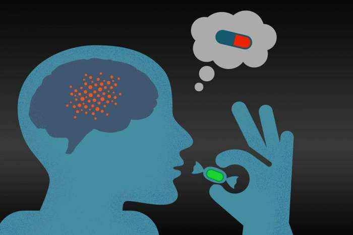
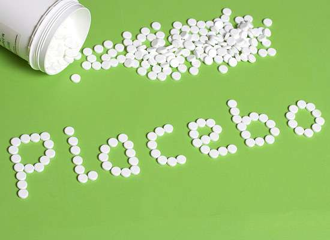

# Плацебо буюу итгэлийн хүчийг ашиглан өвчинийг эдгээх арга

Плацебо- гэдэг нь, эмчилгээний үйлчилгээгүй боловч, итгүүлэн үнэмшүүлэх аргыг ашиглан, өвчитөнг уг эм, эмчилгээнд итгүүлснээр эдгэрэлтийн үр дүнд хүргэх эмчилгээний арга.

Энэ эмчилгээний аргын хамгийн гайхалтай нь, өвчитөн нь, тухайн өгч буй эм, эмчилгээний үр дүнд итгэж, энэхүү итгэл нь өвчинийг нь эдгээдэгт оршдог. Энгийнээр бол хүний сэтгэхүй буюу итгэл, сэтгэлийн хүчийг ашигладаг гэж хэлж болох юм. Плацебо-үр дүн, хүний өөрийнх нь итгэлээс гадна орчин тойрныхны эерэг хандлага, итгэл найдвар төрүүлсэн орчин зэргээс мөн тухайн хүний өөдрөг зан, эерэг сэтгэлгээ, итгэл үнэмшлийн түвшингээс ихээхэн шалтгаалдаг. Анх энэ үг, 18-р зуунд анагаах ухааны хэмжээнд хэрэглэгдэж эхэлсэн бөгөөд өвчитний сэтгэл санааны байдлыг өргөхийн тулд хэлэх ёстой болдог, “шаардлагатай худал хэлэлт” гэж үзэн, ашигладаг байжээ. Гэтэл энэхүү “худал хэлэлт”-ийн дараа өвчтөний биеийн байдал сайжрах байдал ажиглагдах болсноор, эмчилгээний үр дүнтэй нэгэн арга болсон бөгөөд XX зуун хүртэл өргөнөөр ашиглаж байв. Өвчтөнийг итгүүлэн үнэмшүүлэх үед үүссэн итгэлээс үүдэлтэйгээр тархи нь эндорфиныг ялгаруулж, уг бодис нь эмчилгээг орлодог болохыг тогтоосон аж. Уг аргыг турших үед, зарим хүнд уг хэргэлж буй зүйл нь “үйлчилгээгүй” гэж хэлсэн атал эдгэрэлт явагдаж байсан бөгөөд энэ нь тухайн хүмүүс “уг арга”-д итгэсний улмаас эдгэж байгаа нь ажиглагдаж байсан сонирхолтой баримтууд байдаг байна. Саяхнаас, америкт “хүүхдийн залхуурал”-ыг эмчилэх зориулалттай Obecalp гэдэг, зөвхөн сахар ашигласан, капсултай эм гаргасан нь үр дүнтэй байгаа гэнэ. Энэ эмний эмчилгээний үр дүн нь тодорхой, учир нь уг эмний нэрийг араас нь эргүүлж уншихад Placebo гэж уншигддаг.
