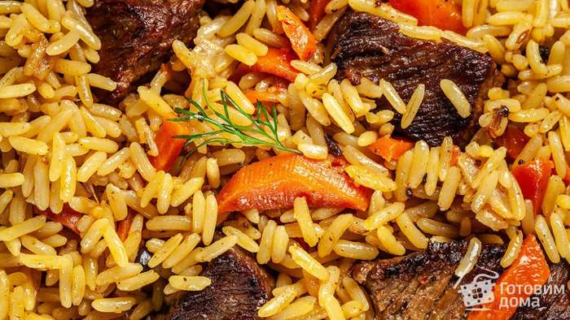
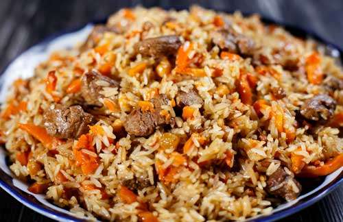

# Плов хийх хялбар жор

Хурдан хугацаанд амжуулан бэлтгэж болох амттай плов хийж сураарай

Орц:

Цагаан будаа 2-3 аяга

Жижиглэж үрсэн лууван -1 ширхэг

Сонгино хэрчсэн - 1 ширхэг

Үзэм - 1 атга

Хатаасан чангаанз - 1 атга

Жижиг дөрвөлжилж хэрчсэн алим - 1 ширхэг

Мах эсвэл тахианы цээж мах – 400гр

Хийх арга:

-ургамлын тосонд лууван сонгиноо шарна

-махаа нэмж, бага зэрэг шаргалдуу өнгөтэй болтол шараад үзэм, чангаанз, алим мөн дуртай амтлагчуудаа нэмнэ

-будаагаа дээрээс нь хийж жигдхэн тараагаад ус нэмж будаа агшаахтай адил жигнэнэ. /Ширүүн гал дээр тавьж, хөөсөрч тагандаа хүрээд дэвэрч асгарах маягтай болмогц цахилгаан зуухны 1 дээр тавьж болтол жигнэх/

