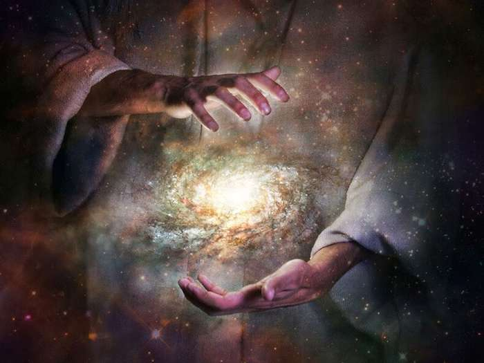
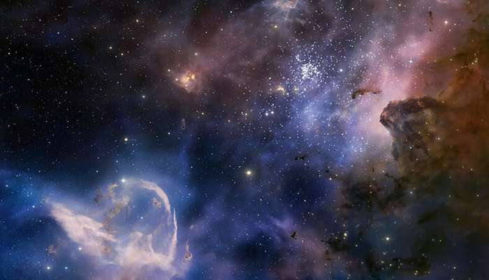

# Профессор Нажип Валитов: Би Бурхан байдгийг нотоллоо

Башкирын Их Сургуулийн профессор Нажип Валитов, урд өмнө нь бурхан шашнаас ихэд хөндий, бүх насаа шинжлэх ухааны шинжилгээ судалгаанд зориулж, дэлхийд танигдатлаа зүтгэсэн хүн ажээ. Тэрээр өөрийнх нь хийсэн энэ судалгаа, шинжлэх ухааны хүрээллийнхний анхаарлыг татна гэж огтхон төсөөлөөгүй байсан байна. Түүний бие даан хийсэн, “таталцал, цахилгаан соронзон орон зайн хүчний хөдөлгөөн ба атом, молекулд химийн үйлчлэл үзүүлэх үеийн вакум хэлбэлзэл” туршилт, судалгааны үр дүн, шинжлэх ухааны хүрээллийнхнийг цочирдуулсан сэдэв болжээ.

. Энэ эрдэм шинжилгээний ажил нь, АНУ-н 7, Английн 2, Франц, Токиогийн их сургуулиуд болон Москвагийн 15 их, дээд сургууль гэхчлэн нийт 12 орны 45 тэргүүлэх их, дээд сургуулиудын, шинжлэх ухааны номын санд хадгалагдан судлагдаж байна. Энэ судалгааны ажлаар: муруйн орон зайн 9 шинэ шинж чанар, атомын бүтцийн талаар 16 шинэ өгөгдөл, таталцал, цахилгаан соронзон талбайн нэгдсэн онолын 16 шинэ тэгшитгэл, одон орны таталцлын хүчний 14 шинэ шинж чанар, 16 шинэ хууль батлагдсан ажээ. Энэхүү онол, ертөнцийн бүх объектууд, хоорондын зайнаас үл хамааран, хормын дотор харилцан үйлчилдэг гэдгийг онол, туршилтаар баталсан байна. Урд өмнө нь, ямар ч харилцан үйлчлэл, гэрлийн хурдаас хэтэрсэн хурдаар явагдах боломжгүй гэж үздэг байжээ. Судалгааны ажлаа хийж дууссанаас хойш, хэсэг хугацааны дараа профессор, огт санаанд оромгүй нэгэн захидлыг хүлээн авчээ. Уг захидал нь, Ватиканы Римийн Пап өөрөө бичсэн, “ таныг, шинжилгээ судалгааны энэхүү ажлыг хийхэд түлхсэн тэр үнэт санааг хязгааргүй үнэлэхийн зэрэгцээ энэ судалгааг нарийвчлан судалж, шинжилж баталгаажуулсаны үндсэн дээр танд, бид талархлаа илгээхээр шийдлээ” гэсэн агуулгатай байжээ. Үүний дараа, профессор, Библи, Тора, Коран судруудыг уншсан бөгөөд түүний шинжлэх ухааны нээлт, эдгээр судруудын мөн чанаруудтай таарч байгааг мэдэж хязгааргүй гайхсан гэнэ. Тэрээр, Бурханы судруудад байнга давтагдах “Бурхан бүхнийг нэгэн зэрэг хардаг, сонсдог” гэдгийг, хэрэв Бурхан байдаг бол энэ чадварыг эзэмших боломжтой гээд, тархины нейроныг бүрдүүлдэг молекулын атомуудын урагшлах, хэлбэлзэх, эргэлдэх хөдөлгөөнүүд нь бодлын процесс, таталцалын талбай ба цахилгаан соронзон хүчний шулууны шингээлт, ялгаруулалтын үйлчлэлийг дагуулдаг, тиймээс бодлыг материаллаг гэж үзэж болно гэсэн байна. Ийнхүү, улс үндэстнүүдийн, Господь, Будда, Аллах, Есүс гэх мэт янз бүрээр нэрлэх, Ертөнцийн дээд оюун, биднийг хаана ч байсан, бидний бодлыг мэдэж байдаг, биднийг эрхшээдэг гэснийг баталсан шинжлэх ухаанлаг алхам хийгджээ. Валитовын онолыг, химийн 20, физикийн 28, механикийн 40, термодинамикийн 12 хуулийг няцаасан гэж хамтран зүтгэгчид нь тооцож байна. Мөн түүний, “тэнцвэртэй буцаах процессын үед, цаг хугацаа энерги, массад хувирдаг, харин дараа нь буцах процесст орох боломжтой” гэсэн баталгаа нь, үхэгсэд амилах талаар бурхны номонд бичдэг зүйлсийг үгүйсгэж болохгүй байдалд хүргэж байна гэж үзжээ. Профессор Валитов, өөрийн дүгнэлтүүдээ, холбогдох газруудад, шалгуулах хүсэлт тавьсан бөгөөд тэдний зүгээс, няцаагаагүйгээр үл барам ОШУ-ны академын академич Андрей Трофимук урам зоригийг нь үнэлсэн хариу ирүүлсэн аж. Одоо профессор, улс төр, шинжлэх ухаан, шашны зүтгэлтнүүдийн захидал, сэтгэгдэлд дарагдан суудаг гэнэ. Мөн, тэрээр, “Би эхлээд, Бурханы оршихуйг томъёогоор нотолсон нээлт хийсэн, харин дараа нь, өөрийнхөө зүрхэнд Түүнийг нээлээ” гээд, өөрийгөө шүтлэгтэй гэж тооцдог болсон ажээ.
