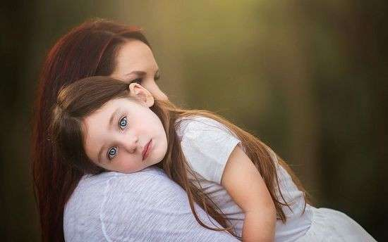
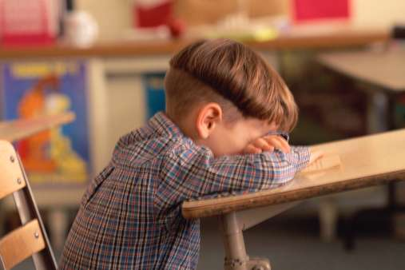

# Үр хүүхэддээ хэлж байх ёстой үгс

Дараах үгсийг тэр бүр, хүүхдүүд сонсч өсдөггүй гэнэ. Эдгээр үгсийг аль болох үр хүүхэддээ хэлж байх нь хүүхдийн хүмүүжил, ирээдүйд хэрэгтэй байдаг аж. Тун цөөхөн хүүхэд, дараах үгсийг сонсч өсдөг бөгөөд бүрэн ойлголцол дунд өсч, амжилттай хүн болдог гэнэ. Бид, үр хүүхдээ хайрладаг хэдий ч, үгэндээ харам байдаг юм биш биз?

Бүх зүйл хэвийн байна.\
Чи ямар ч байсан, надад таалагддаг\
Чи миний хамгийн чухал хүн\
Би чамайг сонсъё\
Би үргэлж дэргэд чинь байна\
Чи намайг заавал аз жаргалтай байлгах албагүй\
Чи, сэтгэл хөдлөлөөсөө, хамаагүй илүү чухал хүн. Сэтгэл хөдлөл болоод л өнгөрдөг зүйл\
Би чамайг юунд дуртайг чинь мэдмээр байна\
Би чамтай нэгдмээр байна\
Би чамтай хамт хэвтье\
Чи намайг үргэлж инээлгэж байдаг\
Би чамд итгэж байна\
Чи миний итгэл найдвар\
Чи энэ байдлыг шийдэж чадна\
Чи төгс биш, би ч мөн адил төгс биш, харин бидний хайр төгс зүйл юм\
Баярлалаа\
Би чамаар бахархдаг\
Чамайг байгаад би баяртай байдаг, чиний байгаа чинь л намайг баярлуулдаг\
Алдаа гаргах нь, хэвийн, байдаг л зүйл\
Бүү аливаад яарч бай\
Чи хүчтэй шүү дээ\
Би чиний ээж байгаараа бахархдаг\
Чи зоригтой\
Би чамайг хэзээд уучилна\
Би чамайг үргэлж боддог\
Би чамайг үргэлж санадаг\
Чи бодлоо өөрчилөх нь хэвийн зүйл юм\
Чи тусламж гуйх нь мөн хэвийн зүйл\
Би чамайг сонсч байна\
Намайг уучил\
Чи, миний амьдралыг сайхан болгодог\
Чи бол надаас илүү авъяаслаг\
Чи, үнэтэй, өөрийн гэсэн нэр төртэй, гайхалтай хүүхэд\
Чи, миний амьдралын утга учир\
Би чамд хязгааргүй хайртай
