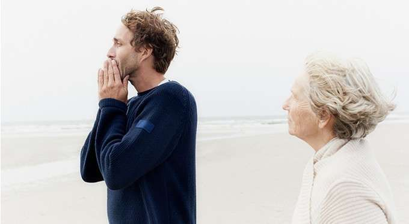

# Үр хүүхэддээ хэт санаа тавих болон санаа зовохын уршиг

Нэг удаа Бурхан дээр, шуудайтай зүйл үүрч , ачаандаа бөгтийж ядарсан эмэгтэй ирэв. Бурхан түүнээс, -Ядраа юу? Үүрсэн ачаагаа буулгаад амар даа, суугаач! гэхэд, эмэгтэй –Баярлалаа, би яарахгүй бол болохгүй, би танаас нэг зүйл гуйчихаад явлаа. Намайг, тань дээр ирж явах энэ хугацаанд, хүүд минь минь муу зүйл болоогүй байгаа? Тэгсэн бол би, өөрийгөө хэзээ ч өршөөхгүй.

-Чи юун дээр өөрийгөө өршөөхгүй гээд байгаа юм?\
-Хүүтэй минь ямар нэг юм тохиолдвол...\
-Би зөвхөн үүний төлөө ажилладаг юм даа. Би, чамайг эргэлзэх юу хийсэн бол?\
-Үгүй, энэ амьдралд зөндөө аюул эрсдэл байдаг. Муу нөлөө, огцом өөрчилөлт, эргэлтүүд гэх мэт. Хүү минь, бүхнийг үзэх, юунд ч оролцох, бүх зүйл дээр өөрийгөө шалгах хүсэлтэй насан дээрээ байгаа. Унаж ойчвол яана? Бэртчихвий. Буруу зуршилд автвал яана? Замаа алдчихвий. Өвдвөл яана? Үхчихвий. Хоол унд идэхгүй, өлсчихвий.\
-Тэгээд юу гэж? Болгоомжтой л болно биз. Өөрийн арьс маханд өвдөлт гэдгийг мэдрэг. Мөн аливаа зүйлийн муу сайныг ялгадаг болог. Сайн туршлага болно. Яагаад, чи, өөрийг нь, биеэ даагаад суралцахад, дургүй байгаа юм? Суралцаг л даа!\
-Яагаад гэвэл, би түүнийг бүх өвдөлт, амьдралын зовлонгоос хол байлгамаар байна, тиймээс би, энэ ачааг үүрч явдаг. Дотор нь, унахад нь зөөллөх сүрэл байгаа\
-Тэгвэл, чи, намайг, түүнийг сүрлээр тойруулахыг хүсч ирээ юу? За харж бай гээд, нүд ирмэхийн зуур хүүг нь тойруулан, бүх аюул, осол, алдаа, уруу таталт, буруу зүйлсээс хамгаалах сүрэл хаяв. Энэ нь, мөн амьдралаас тусгаарлах орчиныг бүрдүүлэв. Энэ үед хүү нь, тойрон хүрээлсэн тэрхүү сүрлүүдээс гарахыг хүсч, тэмцэж байгааг эмэгтэй харж зогстол, аргаа барсан хүү нь, өнөөх сүрлийг шатаахаар шийдэж гал тавив.\
-Хүү минь, би одоохон очлоо, гэж сандарч айсан эх нь хашгирахад -Дахиад сүрэл нэмүүлмээр байна уу? Гэж Бурхан асууснаа, -Үр хүүхэддээ санаа зовж, сүрэл мэт зүйлийг хичнээн их дэвснэ, хүүхэд, төдий чинээ түүнээс гарахаар тэмүүлдэг юм. Хэрэв гарч чадахгүй бол, бүр амьдралаа шатааж эхэлдэг. Тэр, өвдөлт гэж юу байдгийг мэддэггүй, эрх чөлөөг мөн мэдэхгүй, сонголтын талаар ойлголт ч үгүй болсон байдаг. Шуудай дүүрэн, чиний энэ хамгаалах сүрэл чинь, харин шуудай дүүрэн асуудал гэсэн үг. Үүн дотор чинь, чиний бодож зохиосон бүх л аймшигт зүйлс, чиний дотор дүүрэн амьдардаг айдас болгоомжлолууд л байгаа. Чиний бодож болгоомжилдог, түгшдэг эдгээр зүйлс энергээр чинь тэжээгдэж өсч үржиж байдаг. Тиймээс чиний ачаа, улам хүндэрсээр, нуруу чинь ядарч, бөгтөр болж байгаа юм.\
-Тэгээд би, хүүдээ санаа тавих хэрэггүй гэж үү? Бурхан минь та, юу хэлнэ вэ?\
-Санаа тавь, хүссэнээрээ халамжил. Харин, чи, хэзээ ч битгий санаа зов! Би ч бас түүнд санаа тавьж байгаа шүү дээ. Надад, түүнд санаа тавих, өөрийн ажилыг хийх боломжийг олгооч. Надад зүгээр л бүү саад бол. Гэхдээ, энэ бол чиний надад итгэх итгэл сүсэгтэй холбоотой асуудал, гэж би ойлгодог шүү... гээд эмэгтэйг өрөвдөж хайрласан харцаар харжээ.
