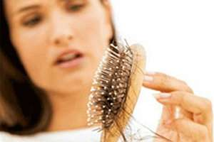

# Үрчлээ арилгах болон чихрийн шижин, халзралтын үед тустай бэлдмэл

Элеутерококкын ханд нь дуслаар хэрэглэдэг ургамлын ханд юм.

-невроз, чихрийн шижин, даралт багасах үед 25-50 дуслыг хоолны өмнө усанд найруулж 30 хоног курс болгон хэрэглэдэг\
-халзралт, үс хагтах хогжруутхад, үсээ угаахаас өмнө үсний уганд түрхээд 30 минут болгоод угаана\
-шархны эдгэрэлтийг хурдасгах, арьсны өвчний үед 15-20 дусал, хоолноос 30 минутын өмнө, өдөрт 3 удаа хэрэглэнэ. 500 мл усанд 1 цайны халбага ханд хийж түүгээрээ шавшина.\
-батга, арьсны үрэвслийн үед 5 дуслыг 1 хоолны халбага усанд хийж шавших. Үрэвсэл дарж, арьсны тос ялгаралтыг тохируулдаг\
-үрчлээс арилгахад, түрхэх шөнийн тосондоо 1 дуслыг хийж өдөр бүр түрхнэ. \
Гайхалтай үр дүнтэй. Мөн ямарч масктай 2 дуслыг хольж 7 хоногт 1 удаа нүүрэндээ тавьж болно. Үрчлээс аажмаар тэнийн, арьс татагдаж нүүр V хэлбэртэй болдог.
