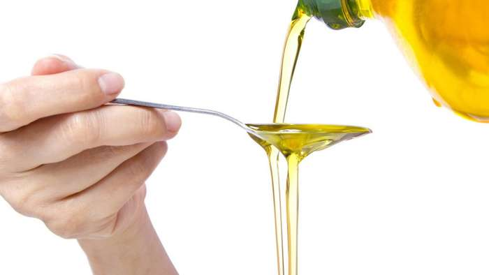

# Үрчлээний эсрэг, ургамлын тоснууд

Эдгээр ургамлын тоснууд, гоо сайхан, залуужуулах үйлчлэлээрээ урд өмнө олны хэрэглээ болж байсан бөгөөд химийн гаралтай тос бүтээгдэхүүнүүд гарснаар мартагдсан гэж үздэг. Орчин үед, байгалийн гаралтай, анхны хэлбэрээрээ байгаа зүйлсэд илүү ач холбогдол өгөх байдал сэргэж байгаа нь авууштай арга юм. Нас нэмэгдэх тусам, хүний арьсанд, арчилгаа дутагдах болон нүүрний хөдөлгөөнөөс үүссэн үрчлээ үүсдэг. Үүнээс хир эрт сэргийлнэ, төдий чинээ урт хугацаанд арьсаа толигор сайхан байлгах боломжтой гэдэг нь бүхэнд ойлгомжтой юм.

Касторовое масло\
90% рицинолейны хүчлийн найрлагатай тул арьсанд тэжээл сайн өгөхөөс гадна бага зэргийн үрчлээг арилгадаг. Бага зэрэг халааж үрчлээтэй хэсэгт массаж маягаар 1 сар түрхнэ\
Масло жожоба\
Хуурай, үрчлээ суусан гундаж байгаа арьсанд, уг тос нь, Е амин дэмийн антиоксидантын өндөр агууламжтай тул арьсанд нөлөөлдөг чөлөөт радикалуудыг устгах чадвартай, мөн найрлага дахь антиоксидантууд нь арьсны уян хатан чанарыг хадгалах үйлчлэлтэй гэж үздэг. Арьсанд хурдан шингэж, агаар нэвтрүүлэхгүй үл мэдэгдэх, хамгаалалтын хальсыг үүсгэдэг бөгөөд маска маягаар эсвэл тэжээлийн тосонд 1:4 харьцаатай байхаар нэмж хэрэглэдэг\
Масло виноградной косточки /усан үзмийн ясны тос/\
Усан үзмийн ясанд, уг жимсний бүх ашигт чанарууд хуралдсан байдаг. Уг тосны антиоксидантуудын өндөр агууламж нь, арьсанд тэжээл өгөх, лифтинг үр дүн өгөх, нүх сүвийг цэвэрлэх, үрчлээс үүсэхээс сэргийлдэг. Ямар ч арьсанд тохирдогоороо онцлог. Хуурай арьсанд, жожоба, кокос, ши тоснуудтай хольж хэрэглэхэд илүү үр дүнтэй ба тослог арьсанд шууд цэврээр нь хэрэглэдэг\
Маалингын үрний тос\
Насжилтын асуудалд өртөж буй арьсанд үйлчлэх үр дүн нь гайхалтай гэдэг. Биологийн үнэлэмжээр, нэгд ордог. Тогтмол хэрэглэхэд, үрчлээс арилах, арьс толийх, нүүрний хэлбэрийг татах үр дүнтэй. Зовхины арьснаас бусад хэсэгт, нүүр хүзүүнд түрхээд 10 минутын дараа угааж хэрэглэдэг. Мөн дотуур, өглөө өлөн элгэн дээрээ хоолны халбагыг уух нь, гоо сайхны гайхалтай үр дүн үзүүлдэг бөгөөд үс хумс хамт эрүүлжиж байдаг\
Зовхины арьсны арчилгаа\
Оливын тос\
Зовхины арьс нимгэн эмзэг байдаг тул олон төрлийн тосны хүчлүүдийн агууламжтай оливын тосыг түрхэхийг үр дүнтэй гэдэг. Гоо сайхны зориулалтын хөвөнд шингээн 10 минут жин маягаар тавих ба илүүдэл тосыг нь хөвөнгөөр шингээж авдаг. Мөн нүдний гадна булангаас дотогш чиглүүлэн хөнгөн тогших хөдөлгөөнөөр түрхэж хэрэглэнэ\
Миндальное масло /бүйлсийн тос/\
Арьсыг чийгшүүлж, нүдний зовхины харлалтыг арилган зовхины үрчлээг арилгадаг. Орой бүр, үрчлээстэй хэсгүүддээ түрхэж массажлан илүүдэл тосыг хөвөнгөөр шингээн авч хэрэглэдэг. Давхар тэжээлийн тос хэрэглэх шаардлагагүй байдаг.\
Чацарганы тос\
Их хуурайшилттай, насжилттай арьсанд тустай. Хүйтэн аргаар шахаж гаргасан тосыг сонгох хэрэгтэй. Дангаар нь хэрэглэхгүй ба Е амин дэмтэй хольж хэрэглэдэг\
Арьсны хөгшрөлт, үрчлээтэхийг зогсооход өдөр тутмын арьсны арчилгаанд анхаарах нь зүйтэй юм.
