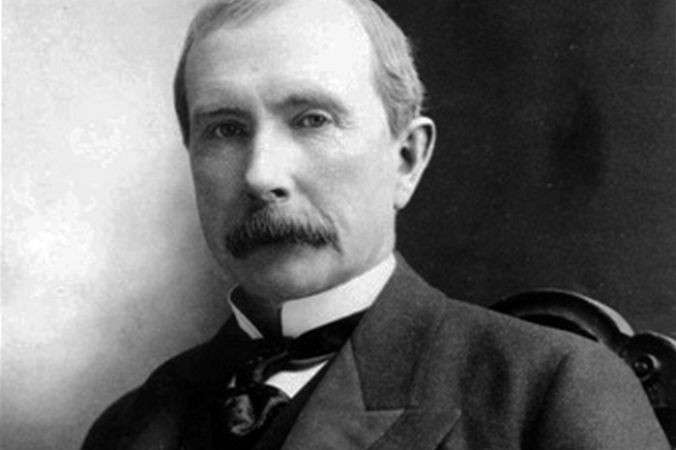

# Рокфеллер: Их зарлагаас айх хэрэггүй харин бага орлогоос айж бай.

Джон Рокфеллер, америкийн баячуудын томоохон төлөөлөл, 1917 түүний эд хөрөнгө 1 сая доллар байсан бөгөөд одоогийн ханшаар 192 тэрбумтай тэнцдэг. Түүний нэрийг эд хөрөнгө баян чинээлэг байдлын билэгдэл гэж одоо ч үзсээр байдаг билээ.

-Хэрэв зорилго тань, зөвхөн баян болоход чиглэж байдаг бол хэзээ ч баяжихгүй

-Надад нэг ийм мэдрэмж үргэлж байдаг. Бурхан намайг томоохон өглөг хандив буян хийх гэж байгааг минь мэддэг, тиймээс хаана ч амжилттай, хаанаас ч ашиг олдог байхаар байлгадаг юм шиг санагддаг.

-Хүнтэй сайн харьцдаг чадвар бол яг кофе, сахар худалдаж авахтай адил үнэлэгдэх ёстой зүйл. Би ийм чадварын төлөө хорвоо дээрх хамгийн өндөр төлбөр хийхсэн.

-Тоглоом шоглоом, мөнгө зээлдэх хоёрыг зэрэг гэнэт хийх хэрэгтэй байдаг.

-Надад боддог ажилчид биш, ажил хийдэг хүмүүс хэрэгтэй.

-Тууштай байдал шиг амжилтад хүргэх өөр чанар байхгүй.

-Мөнгөний төлөө мөнгө хийхээр бүх цаг хугацаагаа зориулдаг хүмүүс шиг өрөвдмөөр жигшүүртэй зүйл гэж байдаггүй .

-Би хэзээ ч, энэ амьдралдаа хэн болох бол гэсэн таамаг тээж байгаагүй, харин би нэгэн ТОм зүйлийн төлөө төрсөн гэдгээ үргэлж мэддэг байсан.

-Бизнес дээр суурилсан нөхөрлөл, найзын харьцаан дээр суурилсан нөхөрлөлөөс хавьгүй илүү юм.

-Би мөнгө хийх ёстой, бүр ихийг хийх ёстой гэдгээ мэднэ. Мөн түүнийгээ сэтгэлийнхээ дуудлагаар, зүрх сэтгэл минь хичнээнийг зөвшөөрч байна тэр хэмжээгээр ойр дотныхондоо зориулах ёстойгоо бас мэддэг.

-Их зарлага гарахаас бүү ай, харин бага орлоготой байхаас айж бай.

-Сайн удирдах арга барил гэдэг нь, хүмүүст ажилыг яаж сайн хийдгийг харуулах үйл ажиллагаа юм.

-Би, өөрийн 100% зүтгэлээс олох орлогын оронд, зуун хүний зүтгэлээс 1% орлого олохыг илүүд үздэг.

-Нэр хүндтэй бол, бусад зүйлс даган орж ирдэг юм.

-Би цаг үргэлж, азгүйтэл бүрээ боломж болгон хувиргахыг хичээдэг.

-Би, бүх зүйлийг мэддэг хүнээс илүү урам зоригтой хүнийг хөлслөхийг хичээдэг.

-Бүтэн өдөржин ажилладаг хүнд, мөнгө хийх зав гардаггүй юм шүү.

