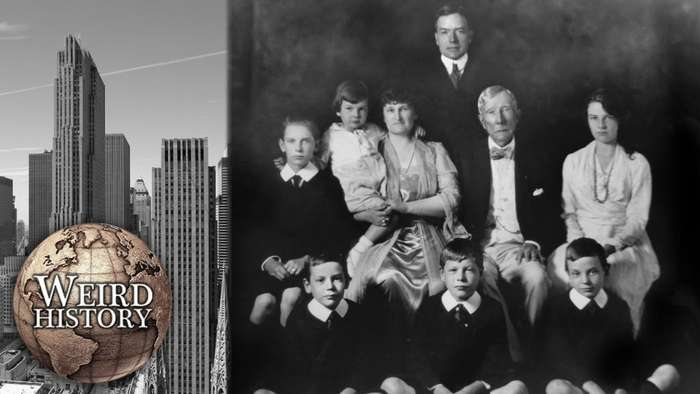

# Рокфеллерийн гэр бүлийнхний үр удмаа амжилттай, чинээлэг болгож өсгөдөг 4 нууц

Хуримтлуулсан эд хөрөнгө баялаг гурван үед зарцуулагдаж дуусдаг гэх ам дамжсан яриа, мөн “Дөрөвдөх үе бүр ганц цамцтай үлддэг” гэх америкчуудын дунд яригддаг хэлц үг, “Дөрөвдөх үе бүр, өвөг дээдсийнхээ ажиллаж байсан тариалан дээр будаа хурааж байдаг” гэсэн япон үг зэргээс эд баялаг мөнх бус, аль нэг үе дээрээ тасран хоосордог гэж үзсээр ирсэн байдаг. Гэтэл, эд хөрөнгөтэй чинээлэг байдлаа урт удаанаар хадгалан өвлүүлсээр яваа Рокфеллерийнхэн, түүхэнд албан ёсны анхны тэрбумтан гэр бүл хэмээн зарлагдаж байсан бөгөөд өнөөгийн байдлаар 250-д өв залгамжлагч, гэр бүлийн гишүүдтэй, 11 тэрбум долларын хөрөнгөтэй, сүүлийн 100-д жилийн турш ашиг орлогоо тасралтгүй өсгөж буй гайхалтай гэр бүл юм. Мөн энэ гэр бүлийнхэн байж болох хамгийн нягт гэр бүлийн холбоотой, нэгдмэл байдлаараа гайхагдсаар иржээ. Бусад эд хөрөнгөтэй гэр бүлүүдээс огт өөр, гэр бүл доторхи хоорондын ямар нэг маргаан, шүүхдэлт огт болж байгаагүй аж. Тэд анхнаасаа хоосон байгаагүй, гэсэн ч, тэр үеийн Асторынхан, Вандерфильд, Карнегийнхан гэсэн баячуудаас нэг зүйлээр өөр байсан нь буян хандивт ихээхэн хөрөнгө зарцуулдаг байснаараа ялгардаг байжээ. Тэдгээр баячууд хандив өргөл хийдэггүй байсан гэдэг. Рокфеллерынхэн 5 тэрбум доллар сайн үйлсийн хандивт өргөсөн байна. Дэвид Рокфеллер нэгэн ярилцлагадаа, -Манай гэр бүл, гэр бүлийн уламжлал, дүрэм журам, тодорхой нэгэн үнэт зүйлийг нэгдмэлээр эрхэмлэн ирсэн, энэ нь гэр бүлийн маань чинээлэг байдлыг хангах нэгдмэл байх хамгийн чухал чанарыг хадгалж ирсэн бөгөөд үр удмаа мөнгөтэй харьцах зөв хандлагыг мөрдөх боломжийг олгодог юм, гэж дурдсан байдаг. Энэ гэр бүл 4 чухал зүйлийг мөрдлөг болгодог байна:

1. Гэр бүлийн уулзалтыг тогтмол зохион байгуулж байх. Жилд хоёр удаа бид заавал цуглардаг. Энэ нь нэг төрлийн хурал чуулган бөгөөд 21 наснаас дээшхи насны бүх гишүүд хамрагддаг. Ирээдүйн төлөвлөгөө, чухал асуудлуудаа ярилцацгаан шийдвэрлэдэг. Энэ үед гишүүн бүр гэр бүлийнхээ нэгэн хэсэг тасархай нь гэдгээ мэдэрдэг юм.

2. Гэр бүл нь, түүх намтраа мэддэг, хүндэтгэлтэй ханддаг хайрладаг байх ёстой. Манай өвөг дээдсийн амьдарч байсан эдлэн, байшин одоо ч байдаг. Тэнд, хэзээ ч гэр бүлийн гишүүдийн хэн нь ч очиж, эцэг өвгөдийнхөө дурсгалыг хүндэтгэх боломжтой байдаг.

3. Үр хүүхдээ биеэ даасан, юунаас ч хамааралгүй болгож өсгөх нь нэн чухал. Биеэ даасан гэдэг нь хэн бүхэнд ойлгомжтой, хамааралгүй гэдэг нь гэр бүлийн бизнесээс шалтгаалахгүй амьдрах чадвар. Мөн гэр бүлийн хамтын бизнес нь, хоорондын маргаанд хүргэх дутагдалтай байдаг тул, бизнесээ задалж салбарлуулан, салбар салбараар нь хариуцаж ажиллахад эрсдэлгүй байдаг.

4. Тусламж дэмжлэг хэрэгтэй хүмүүст туслахын чухлыг үргэлж эрхэмлэж ирсэн. Манай гэр бүлийн нэгдмэл байх чанарыг хангадаг гол хүчин зүйл бол гэр бүлийн маань уламжлал. Энэхүү уламжлал буюу үнэт зүйл маань сайн үйлс, буян хандив. Бидний үүсгэсэн сангууд 5 тэрбум долларын хандив тусламж үзүүлээд байна. Буян хандив хийсэн гэр бүлийн гишүүд, эцэг өвгөдийнхөө уламжлал, ялангуяа бага Джон Рокфеллерын мөрдөж байсан хандив тусламжид гар татдаггүй чанар, өв уламжлалыг хадгалан үргэлжлүүлж байна хэмээн сайшаагддаг.

Джон Рокфеллерийн, “Бүх эрх хариуцлагыг дагуулж, азтай боломж бүр хийх ёстой зүйл рүү хөтөлж, аливааг эзэмших нь үүрэгтэн, өртөн болгодог” гэсэн үг, Рокфеллер төвийн гол хаалганы дэргэдэх чулуун дээр сийлэгдсэн байдаг бөгөөд энэ нь өв уламжлалаа хадгалах мөнхийн сануулга болж байдаг. Бага Дэвид Рокфеллер, анхны цалингаасаа хандив өргөснөө огт мартдаггүй гэнэ. Тэр, тэр үед 10 настай байсан бөгөөд түүнээс хойш долоо хоног бүр сайн үйлсэд хандив тасралтгүй өргөсөөр иржээ. –Энэ уламжлал зуун зууны турш батлагдсан үнэт зүйл маань юм. Хэрэв ямар нэг ач холбогдолгүй байсан бол үгүй болох байсан. Тиймээс би, гэр бүл маань, бусдад хичнээн ихийг өгнө тэр чинээгээр буцаан авна гэж нотолж батласан амьдарлаар амьдрахад, чадах бүхнээ зориулдаг гэж тооцдог гэж ярьсан байдаг.

