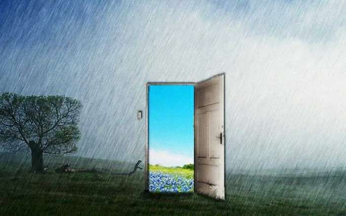
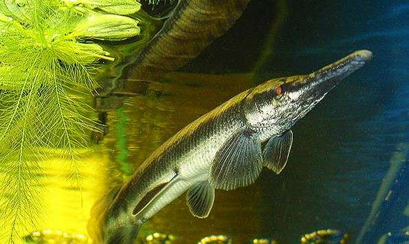

# Саад, хүсэл зорилгыг мохоож хазаарладаг

Хүний, өнгөрсөн үедээ, үзэж өнгөрүүлсэн саад бэрхшээл ухамсарт гүн сууснаар, өсөж өөрчилөгдөх, хөдөлж хөгжихөд нөлөөлдөг юм биш биз? Магадгүй, амьдралд маань, ямар ч саад байхгүй болчихсон, харин бид дассан сурсанаараа нэг газраа дэвхцээд, нэгхэн алхам хийхээсээ айсаар, зохих шагнал, урамшууллаасаа хоцроод байгаа юм биш үү!

Нэгэн туршилт:\
Нэг томоос том аквариуманд, нэг цурхай загас хийжээ. Эхний үед, түүнийг аквариум дотуур чөлөөтэй явуулдаг байснаа, дараа нь, аквариумын тал хэсгийг зузаан тунгалаг шилээр тусгаарлав. Сэлж, хөвөх зай нь багассан цурхай, уг саад харагдахгүй учираас тулж очин, аквариумын нөгөө хэсэгт гарахаар байнга мөргөнө. Удаан хугацааны турш, хөөрхий цурхай уг саадыг нэвтлэх гээд чадахгүй хамаг хүчээ барсан уу, нэвтлэх үйлдэл оролдлого хийхээ больжээ. Дараа нь, судлаачид уг шилэн тусгаарлагчаа авсан бөгөөд харин цурхай нөгөө хэсэг рүү орох оролдлого хийх нь бүү хэл, бүр дөхөж очихоо ч больчихсон аж. Тэр бүхэл бүтэн том аквариуман дотуур сэлэн хөвөх боломжоо ашиглахгүй өнөөх жаахан хэсэгтээ л байж, нөгөө хэсэг рүү очоогүй гэнэ. Эвгүй байгаа биз?
