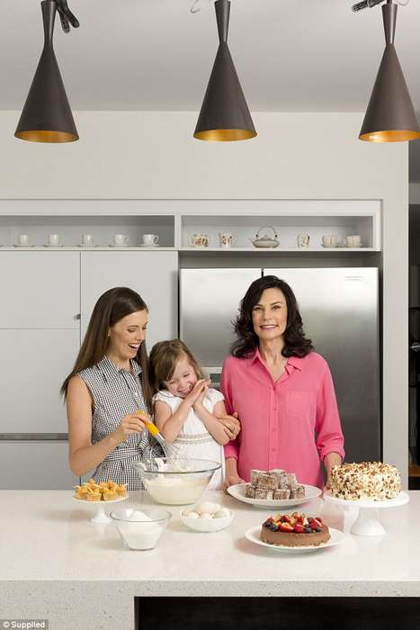
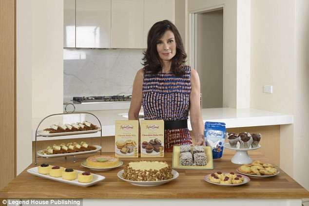
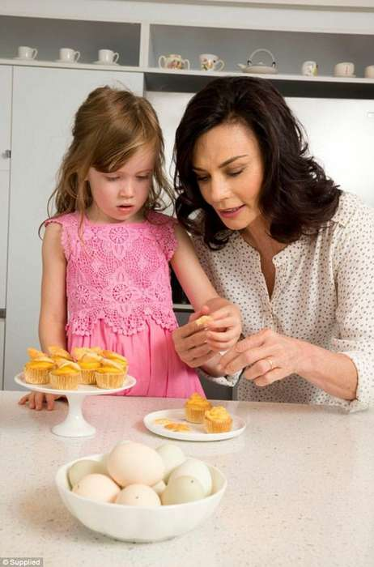

# Сахараас татгалзвал, над шиг байж болно. Би 70 настай

-“Би 70 настай. 28 жилийн өмнө, надад чихрийн шижний эхний шинж илэрч буйг эмч сануулсан. Тэр цагаас би сахараас бүрэн татгалзаж чадсан. Эрүүл мэндээ илүү үнэтэйд тооцсон доо”, гэж австрали эмэгтэй Кэролин Хартц ярьж байна. Тэр, маш өөдрөг сэтгэлтэй эмэгтэй юм. Түүний, өдий 70 насны өндөрлөгт хүрчихээд, байнга хэлж байдаг, “Амьдралын минь бумба дүүрэх болоогүй, үргэлж талаараа байдаг” гэсэн далд утгатай үгнээс нь харахад ч тэр, тэр, эерэг бодлоороо өөрийгөө цэнэглэж явдаг, эрүүл мэнд, амь насаа үнэлж чаддаг болох нь харагддаг. Түүний бие галбир, залуу эмэгтэйчүүдийн атаархалыг хүргэхээр сайхан хадгалагдсаныг, тэр, хүнсний хэрэглээнээсээ сахараа хассантай холбон тайлбарладаг. Түүний, гоо сайхан болон бие галбираа хадгалахад тустай гэж тооцдог хэрэглээнүүд, мөн гайхмаар сайхан зургуудыг нь толилуулж буйдаа баяртай байна.

Энэ эмэгтэй 70 настай, чихрийн шижний анхны шинж илэрмэгц сахараас татгалзсан. Итгэмээргүй байгаа биз?

---

Кэролин, өөрөөр нь хязгааргүй бахархдаг 3 хүүхдийн ээж.

---

Сахарын оронд сахар орлуулагч, ксилит хэрэгэлдэг бөгөөд бялуу, амтлаг нарийн боов хийхдээ мөн зөвхөн ксилитийг ашигладаг. Гойд ялгарах амтгүй гэж хүүхдүүд нь баталдаг гэнэ.

---

Саяхнаас, теннисээр хичээллэж эхэлжээ.

---

Өдөр бүр, хоол хүнсэндээ уураг хэрэглэснээр чихэрлэг зүйлс хэрэглэх дур хүсэл дарагддаг гэж үздэг

---

Хоол хүнсэндээ глютены орцтой зүйл хэрэгэлдэггүй, харин эслэг ихтэй хүнсийг түлхүү хэргэлдэг байна.
