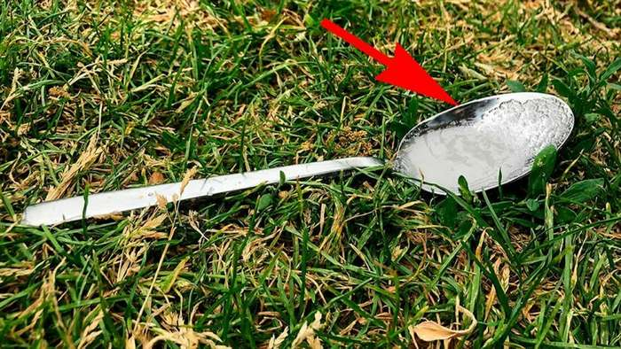
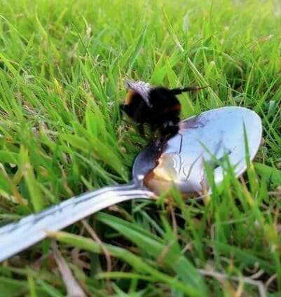

# Сахартай халбага ба буянт үйлс

Английн амьтан судлаач, нийтлэлч, нэрт телевизийн хөтлөгч ноён Дэвид Аттенборо, өөрийн урт удаан 92 насныхаа ихэнхи хугацааг, байгаль эх дэлхийн жижиг амьтад болох нисдэг шавьж судлах, мөн байгаль орчиныг хамгаалахад зориулж иржээ. Тэрээр дэлхийн оршин суугчид бүрийн мэдвэл зохих олон зүйлийн судалгаа, тэдгээрийг хүн төрөлхтөнд хүргэх үйлсээрээ амьд домог болсон нэгэн ажээ. Тэр, -Хэрэв, энэ дэлхийгээс зөгий устан алга болвол, хүн төрөлхтөн 4 жил ч амьдарч чадхгүй, гэж ФБ хуудсандаа бичиж шуугиан тариад байна. Бидний ихэнхи нь зөгий хэмээх энэхүү бяцхан нисдэг шавьжинд ямар ч ач холбогдол өгдөггүй, амьдралд нөлөөлөх талаас олж хардаггүй нь нууцгүй юм. Гэтэл, зөгий бидний хэргэлдэг хоол хүнсний 30 гаруй хувийг, тоосонцор хүртээх үйлдлээрээ хангаж байдаг гэнэ. Сүүлийн 5 жилд, зөгийн тархалт 1/3 дахин буурсаныг нийтлэлдээ дурдахын зэрэгцээ азаар хүний оролцоотойгоор, энэ байдлыг засах, байгаль дэлхийд туслах хялбар арга байгааг дурдсан бөгөөд ядарч энергээ алдсан зөгийнүүдэд зориулж, үүрэндээ хүртэл нисэх чадлыг өгөхийн тулд, хоёр хоолны халбага сахарыг нэг халбага усаар найруулж өвс ургамалтай газарт тавих, байрны айлууд тагт, цонхны тавцан дээрээ ургамал цэцэг тарих зэрэг нь ихээхэн тустай гэж зөвлөөд, байгаль дэлхийдээ өчүүхэн ч атугай тус хүргэх нь хүн төрлөхтөнийг аврах үйлсэд хувь нэмрээ оруулах нэгэн боломж шүү хэмээн уриалжээ.

Тагт, тавцан дээр тарьсан цэцэгс тань бяцхан зөгийнүүдийг баярлуулсан бяцхан диваажин болно гээд боддоо. Заримдаа, огт хөдлөхгүй үхсэн мэт харагдах зөгийг харж байсан байх. Тэд ядарч хүч тамиргүй болох үедээ ийм болдог байна. Энэ тохиолдолд чийглэсэн сахар хажууд нь тавихад сэргэж үүр рүүгээ буцах чадалтай болохоос гадна үхэхээс нь аврах буянтай үйлдэл хийгддэг гэнэ. Мөн энэхүү нийтлэлийг хуваалцаж түгээн байгаль дэлхийдээ буян үйлдээрэй.

---

