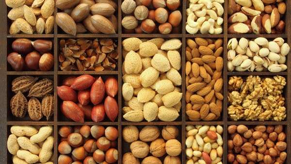
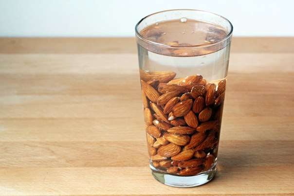

# Самрыг зөв хэрэглэхийн ашиг тус

Хүнсний бүтээгдэхүүнүүдийг зөв хэрэглэх, идэх талаар хангалттай яригддаг. Ганцхан, бүтээгдэхүүн тус бүрээр хэрхэн зөв хэрэглэх талаар тэр болгон мэддэггүй. Самрыг хүнсний хэрэглээнд түлхүү оруулах ёстой гэж үздэг боловч шууд хэрэглэхийг л санал болгосоор ирсэн.

Гэтэл самрын ашиг тусыг бүрэн дүүрэн авахын тулд, бүх төрлийн самрыг заавал усанд дэвтээж идэх ёстой байдаг аж. Хуурай самранд, хоол боловсруулах үйл ажиллагааг сааруулдаг ингибитор гэдэг фермент байдаг бөгөөд тэд хуурай орчинд “унтаж” чийглэг орчинд орохоороо сэргэдэг бөгөөд тэд тэр дундаа усанд, усны үйлчлэлээр “сэрдэг” ба ашигт чанар нь идэвжиж организмд ашигтай үйлчилдэг байна. Самар бие организмд маш ашигтай бөгөөд тархины үйл ажиллагааг сайжруулж, зүрхийг тэтгэн, холестириныг гадагшлуулдаг. Гэхдээ ямар ч зүйлийн хэрэглээ хэтрэх нь, хор болдог гэдгийг мартаж болохгүй. Өдрийн хэрэглээ атга самарнаас хэтрэхгүй байх хэрэгтэй юм байна. Самар бүр, өөр өөр байдаг тул, тус бүрээр нь ямар хугацаанд дэвтээхийг дараах жагсаалтаар харуулав. \
Хушга - 8 цаг\
Миндаль /бүйлс/ -12 цаг\
Хушны самар - 4 цаг\
Фундук -8цаг\
Кешью -6 цаг\
Арахис /газрын самар/- 1-2 цаг

Самар хир хатуу байна, төдийчинээ удаан дэвтээж хэрэглэхийг зөвлөдөг байна. Амттай зүйлсээ ашигтай хэрэглэцгээе.
