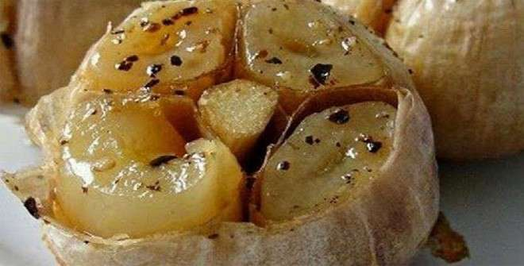
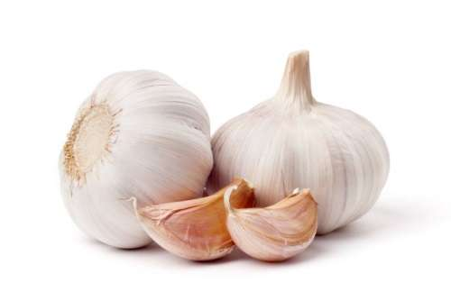

# Сармис-байгалийн ”хүчирхэг  антибиотик”

Сармисны ашиг тусыг мэдэхгүй хүн байхгүй биз ээ.

Сармис, хэрэглэсний дараа 24 цагийн турш, организмд, идэвхтэй үйлчилж, бие дэх паразит, шимэгчдийг устгадаг, хор гадагшлуулдаг, архаг өвчнийг ч эдгээх хүчтэй, бие организмыг эрүүлжүүлэх хосгүй сайн үйлчилгээтэй ургамал юм. Бид, сармисыг хэрглэхээсээ, үнэрээс нь болоод ихэвчлэн татгалздаг. Иймээс, 6 хумс сармисыг 2-3 хоногт нэг удаа, жигнэж эсвэл шарж идэх нь эрүүл мэндэд маш ашигтай, мөн сармис идсэний дараа гардаг үнэрээс болгоомжлох шаардлагагүй болгодог эрүүл мэндийн зөвлөгөөг танилцуулъя.\
Сармисыг цахилгаан зууханд жигнэж эсвэл хайруулын тавганд шарахад, хурц үнэргүй болж, сайн шингэхийн зэрэгцээ, эмчилгээний ашигтай чанаруудаа хадгалсан байдаг байна.\
2-3 хоногт нэг удаа, сармисыг дээрх аргаар болгож идэх нь,цусан дах холестириныг бууруулж, артерийг цэвэрлэснээр даралт тогтворжих, ходоодны асуудлууд, илүүдэл жингийн асуудлууд давхар шийдэгдэх, мөн диабетыг эмчлэх үйлчилгээтэй. Үүний зэрэгцээ, дархлааг өсгөж, архаг ядаргаа, сульдааг эмчлэх, бодисын солилцоог сайжруулах, жин хасахад онцгой үр дүнтэй.

Сармисыг энэ аргаар хэрэглэх үедээ, шингэн зүйл, ахиу уух хэрэгтэй. Таны, организмын эд эс бүр шинэчлэгдэнэ.
