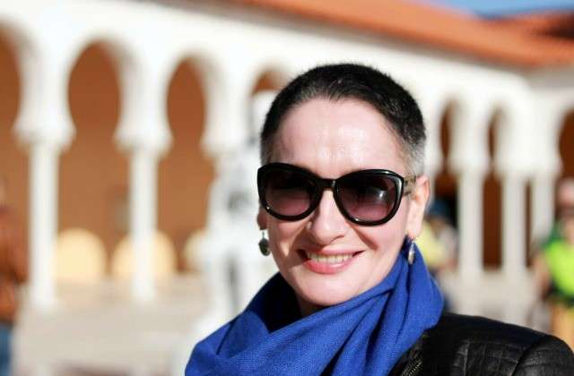
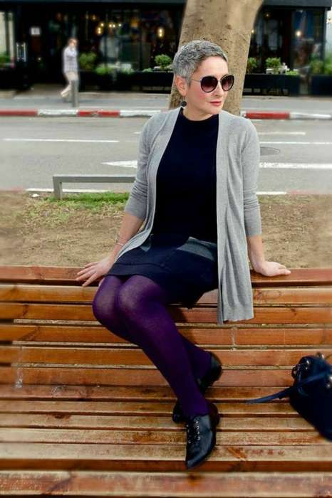

# Сайхан харагдахын үндэс нь өөрийгөө арчилах

Оросын нэртэй имидж-зөвлөх Ирена Бар, 57 настай ч, наснаасаа залуу харагддаг. Тэр, гоо сайхны салоны үйлчилгээнд орохоос илүү гэрийн нөхцөлд өөрийгөө арчилахыг эрхэмлэдэг. Түүнчилэн, гоо сайхны мэс заслын эсрэг бодолтой, мөн наснаасаа хэт залуу харагдахыг эрмэлзэхийг алдаанд тооцож ойлгодоггүй, харин, арчаатай цэвэрхэн сайхан харагдахыг чухалчилдаг нэгэн аж. Дурын насанд, арчилгаа төгс харагдах нь гоё сайхан харагдахын үндэс гэж үздэг. Ирена, өглөө бүр хүйтэн усаар нүүрээ угааж, долоо хоногт тогтмол хоёр удаа арьсны гүн цэвэрлэгээ, мөн орой бүр нүүрэндээ массаж хийдэг. Гоо сайхны бүтээгдэхүүний хувьд, тэр, үнэтэй брендийн зүйл хэрэглэхийг эрмэлздэггүй. Бүтээгдэхүүнүүдийн сурталчилгааг тэр бүр ойшоож үздэггүй гэнэ. Тухайн бүтээгдэхүүний үнээс, үр дүнгийн үзүүлэлт хамааралгүй гэж үздэг. Үнэхээр залуу насаа уртасгах хүсэлтэй бол, харин, хооллолтдоо анхаарах ёстой, би тослог багатай хүнсний бүтээгдэхүүн дагнан хэрэглэхийг эрмэлздэггүй, гэхдээ тослогийн хэрэглээгээ хянадаг, харин чихэрлэг, амтлаг зүйлсээс зөвхөн хар шоколад л хэрэглэдэг гэжээ. Мөн сайхан харагдахад хувийн ариун цэвэр сахих асуудлыг гол үүрэгтэй гээд, үсээ аль болох ургамлын гаралтай шампуниар угаадаг, шүдээ цайруулахын тулд өглөө бүр шүдээ цэвэрлэхдээ соод хэргэлдэг, мөн 8 цагаас багагүй нойрсох нь сайхан харагдахын нэгэн нууц гэж үздэг. Стресс нервээс ангид байх нь өтлөхгүй байхын үндэс, хүмүүс, надаас алжаалаа хэрхэн тайлдаг талаар асуухад, би, -би өөрийгөө ачаалдаггүй учираас, алжаал ядаргаа тайлах шаардлагагүй гэж хариулдаг. Энэ аргад гэхдээ, би, урт удаан хугацааны туршид суралцсан гэж ярьдаг. Тэрээр, нас нэмэгдэхийг зайлшгүй зүйл гэдгийг тайвнаар хүлээн авч ойлгох хэрэгтэй, залуужуулах үйлчилгээнүүд тухайн насыг “нууна” гэж байхгүй гэдэгт эргэлздэггүй. Харин, өөртөө анхаарал тавьж, өөрөө өөрийгөө арчилах нь хамгийн үнэнч арга, мөн өөртөө зохисон хувцаслалтаа тохируулж өмсөх, загварлаг хувцаслахыг чухалчилахыг зөвлөжээ.

