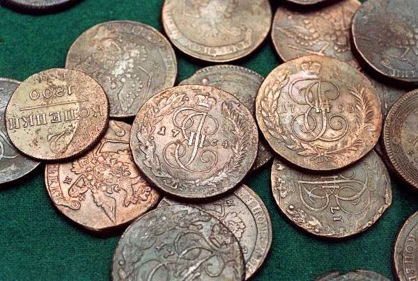

# Сайн дурын боол

Хэзээ ч юм, нэгэн удаа,нэг сахиусан тэнгэр, хүүгийнхээ хүсэлтээр нэгэн түүх ярьж өгчээ. Тэр, холын хол нэгэн гариг дээр хэрхэн хүмүүс өөрсдийгөө сайн дураараа боол болгодог тухай ийнхүү ярьжээ.

Эдгээр, хүн хэмээх амьтад нь, дөрвөлжин бетон хайрцаг дотор, сайн дураараа амьдрах бөгөөд энэ камерынхаа төлбөр болон бусад шаардлагатай бус, бас бус зүйлсийг худалдан авахын тулд, өдөржин ажил хийдэг. Тэгээд ажиллаж олсон мөнгөө, зарим нь, биенд нь муу өмхий үнэртэй ургамал татах, оюун ухааныг нь самууруулдаг гал шиг ундаа уухад зарцуулна. Тэд, химийн аргаар гаргаж авсан, хиймэл хүнс идэж, түүнээсээ болж дандаа өвддөг. Шөнө нь бүрэн амрахын оронд, дур таашаалынхаа төлөө их цаг зарцуулдаг. Тэд өдөр өдрөөр, биеийн амрыг хайсан бүтээлүүд гаргах бөгөөд түүнээсээ болж хөдөлгөөнгүй болж өвдөцгөөдөг. Эргээд, түүнийгээ эмчлэх гэж эм гэдэг зүйлийг худалдан авч ууцгаадаг. Ийм маягаар ямар ч баяр жаргалгүй насыг өнгрүүлдэг нь их сонин. Тэд, өөрсдийн зориулалт болон өөрийн сэтгэлийг эрж хайхаа мартан материаллаг эд зүйлсийн сайн дурын боол болсон бөгөөд одоо, гарахад маш хэцүү, “төрөлт- үхэл” гэсэн сансрын тойрог дотор эргэлдэж байдаг” гэв. Хүү нь санаа алдаад, -“яагаад сайн дураараа ийм болдог байна аа?” гэж асуув. Эцэг нь үргэлжлүүлэн, -“яагаад ийм болсныг миний өвөө, ингэж ярьж өгсөн юм гээд, дээр үед, дэлхий дээр боолын нийгэм гэж өөрсдийнх нь нэрлэдэг үед, нэг хаан түшмэдээ дуудан, та нар харцгаа, хэдэн арван мянган гинжээ чирсэн боолууд чулууг хот руу зөөж байна. Тэднийг манадаг харгалздаг мянга мянган хуягууд, хоол ундыг нь бэлтгэдэг хичнээн хүн байна, тэгсэн ч ажил урагшлахгүй байна. Боолуудын хоол, харгалзагчдын хөлсөнд маш их мөнгө зарцуулж байна. Барилгыг барих боолуудыг барьж тогтоох илүү хямд хялбар системийг бодож олох хэрэгтэй. Тэгвэл улсын сангийн мөнгө их болж та нар ч их мөнгө авах эрхтэй болно гэж хэлжээ. Түшмэдэд их мөнгө өгнө гэсэн санаа машид таалагдаж, нэг мэргэн зөвлөх, - Би, асуудлыг үүрд шийдэх системийг санал болгоё. Маргааш бүх боолуудыг суллаж, гинжээр нь зоос хийнэ. Тэдэнд бүрэн эрх чөлөөтэйг нь зарлахын зэрэгцээ, хийсэн ажил болон авчирч өгсөн чулуу болгоныг нь үнэлж зоос өгнө гэж зарлая. Тэд, эрх чөлөөтэй, мөн эд хөрөнгө, өмч үүсч, энэ нь тэднийг илүү эрчимтэй ажиллахад хүргэх юм. Харгалзах цэргүүд хэрэггүй болно. Ийм байдлаар, бид, хүчээр хөдөлгөдөг боолуудыг сайн дурын боол болгоно. Тэд хувийн сонирхолтой болж, шуналтай болон, бүрэн өгөөжтэй ажиллана, гэснээр маргааш нь боолуудыг суллажээ. Бүх зүйл мэргэн зөвлөхийн хэлснээр болж, хэн ч хааш ч зугтсангүй, зоос болж хувирсан гинжиндээ дөнгөлөгдөн үлджээ. Тэр цагаас хойш хүмүүс бараг өөрчлөгдөөгүй, тэр системээр амьдарцгаадаг” гэхэд, хүү нь, -“Маш гунигтай түүх юм. Үүнийг засч болохгүй гэж үү?” гэв. Аав нь, -“Болно, гэхдээ, хүмүүс, үүнийг засч залруулах зүйлсийг заадаг хүмүүсийнхээ үгэнд ордоггүй юм. Оюун ухаан, үнэн мөн, өөрийгөө таних асуудлуудыг тэд ойлгодоггүй, сайн дурын боолчлолдоо дасчихсан байдаг юм” гэжээ.
