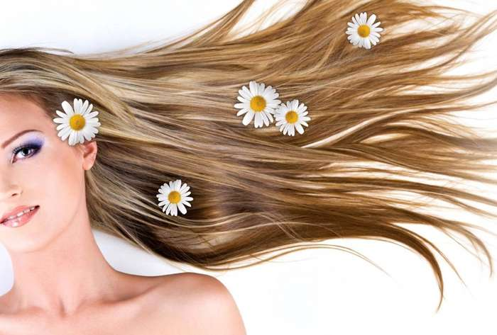

# Үсээ угаахдаа гаргадаг 8 алдаа

Сайхан үстэй байхыг хүсэхгүй хэн байх билээ. Үсэндээ маска тавьж, үнэтэй шампунь хэрэглэж, цаг тухайд нь үзүүрийг нь тайруулах зэрэг арчилгаа хийдэг боловч үсээ угаахдаа гаргадаг түгээмэл алдааг мөн мэдэж авахад илүүдэхгүй.

1. Үсээ алчуураар арчиж хатаахад, үрэлтээс үсний бүтэц гэмтдэг. Алчуураар ороож үсний чийгийг аажим шингээж авахаар орхих хэрэгтэй. Мөн 5-10 минутаас илүү байлгах сайнгүй.\
2. Шампунийг ихээр хэрэглэх сайн биш. Үүнд мөн ангижруулагч ч хамаардаг. Нэг удаа угаах шампуньны хэмжээ, та, үсээ хир олон угаадгаас хамаардаг бөгөөд өдөр бүр угаадаг бол хоёр шампуньдсаны хэрэггүй. Долоо хоногт хоёр угаадаг хүмүүс харин хоёр шампуньдаж болно.\
3. Үсээ ширүүн мушгих, хуйхаа хүчтэй үрж угааж болохгүй. Үсний ширхэг нарийсч үс унах нөхцөл үүсдэг.\
4. Үсээ яарч угаах. Үсний бүх асуудлууд үсний угтай холбоотой байдаг. Үсний угийг яаралгүй сайтар угаадаг байх хэрэгтэй.Угаахдаа яарч угааж болохгүй. Яаралгүй үсний угийг угаах нь сайхан үстэй байхын нууц байдаг.\
5. Ангижруулагч хэрэглэхгүй байх. Ангижруулагч, бальзам нь үсний бүтцийг сайжруулдаг. Гэхдээ уганд түрхэхгүй, үсний үзүүр хэсэг, уртынх нь дагуу түрхэж хэрэглэх хэрэгтэй. \
6. Үсээ ховор угаах. Энэ бол цэвэр, хүн тус бүрийн үсний онцлогоос шалтгаалдаг. Хуурай үстэй хүн байнга биш, тослог үстэй хүн ойр ойрхон угаах хэрэгтэй.\
7. Халуун ус бол үсний дайсан гэж үздэг. Үс, үсний угны арьсыг хуурайшуулж, хагтуулдаг. Бүлээн усаар угааж хүйтэн усаар зайлдаг байх хэрэгтэй.\
8. Байнга үсээ сэнсээр хатаах. Үсээ нойтон байх үед сэнсээр хатааж болохгүй. Алчуураар ороож чийгийг шингээж хэсэгхэн байлгасны дараа сэнсээр хатааж болно.
