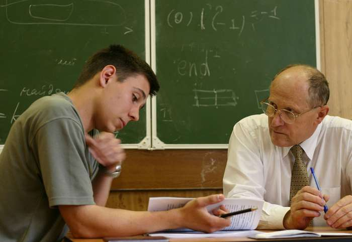

# Сэргэлэн зан

Нэгэн дээд сургуулийн, нэгдүгээр курсын төгсөлтийн шалгалт явагдаж байв. Шалгалт авч буй профессор, -“Шалгалт хоёр цаг, явагдна. Хоёр цагийн дараа шалгалтын хуудсаа өгч чадаагүй оюутнууд, автоматаар хасагдна”, гэж хатуу сануулаад, шалгалт эхлэв. Гэтэл, шалгалт эхлээд, хагас цаг болж байхад, нэгэн оюутан сандран гүйсээр орж ирээд, шалгалтын хуудас гуйхад нь, профессор, -“Тэртэй тэргүй амжихгүй дээ”, гэж ёжтой хэлээд, хуудсыг өгөв. Оюутан суугаад бичиж эхэлсэн бөгөөд удалгүй хоёр цагийн хугацаа өнгөрч, хоцорч ирсэн оюутнаас бусад оюутнууд, хуудсуудаа хураалгав. Оюутан бичсээр, нэг цаг өнгөрч, бэлэн болмогцоо, ширээний ард сууж байсан профессорын өмнө байсан шалгалтын материал дээр хуудсаа аваачаад тавьтал, профессор, -“Үгүй ээ үгүй. Би хүлээж авахгүй, оройтсон”, гэв. Оюутан, хэсэг түдгэлзсэнээ гэнэт, ууртайгаар, -“Та намайг хэн гэдгийг мэдэх үү?” гэж асуув. “Тэгээд юу гэж?” гэж гайхсан профессор, доромжлонгуй хариулахад, оюутан, -”Та намайг хэн гэдгийг мэдэх үү?” гэж гэж чанга дуугаар дахин асуув. Зэвүү нь хүрсэн профессор, -“Мэдэхгүй, чи хэн ч байлаа, хамаагүй нулимчихъя” гэхэд, оюутан, -“За, за. Сайн хэрэг” гэмэгцээ, шалгалтын материалуудыг өргөснөө, дунд хавиар нь өөрийн хуудсаа шургуулчихаад, яаран гарч явжээ.
