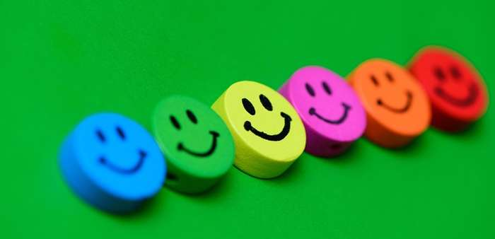
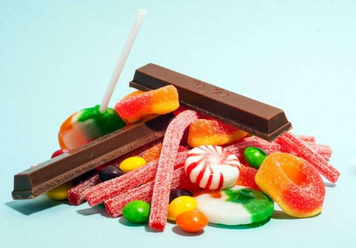

# Сэтгэл санааг өөдрөг байхад тусалдаг, хоол хүнснүүд

Хүний хэрэглэдэг хүнсний бүтэц, хүний сэтгэл санаанд нөлөөлдөг. Хоол хүнс, хүнд аз жаргалын мэдрэмж төрүүлэх , стресс тайлах, айдас түгшүүр, сэтгэл гутралыг дарах чадвартай байдаг гэнэ.

Бидний хэрэглэдэг, хоол хүнс, хоол боловсруулах эрхтэнээс тархируу мэдээлэл дамжуулах чадвартай. Жишээ нь: алкоголь ходоодноос, тархируу хоромхон зуур дамждаг. Үүнтэй адил, мөн бусад хоол хүнс ч тархинд дамжин нөлөөлдөг байна. Алкоголь, тархиндах магнийн хэмжээг огцом бууруулдаг тул, сэтгэл санаа тавгүй үед хэрэглэж болохгүй. Магни дутагдах үед, мартамхай болох, анхаарлаа төвлөрүүлж чадахгүй байх, нойргүй болох зэрэг байдал ажиглагддаг. Чухам ямар хүнс, сэтгэл санааг өөдрөг, баяр баяслаар дүүрэн байлгах чадвартайг танилцуулъя.\
Тараг, йогурт, дарсан байцаа, кимчи, цайны мөөг, алимны цуу, сонгино, хар шоколад, бууцай, самар, жимс жимсгэнэ, хар, ногоон цай, далайн бүтээгдэхүүн, хулууны үр, өндөг. Эдгээр бүтээгдэхүүнүүд, тархины үйл ажиллагаанд нэн шаардлагатай, пробиотик, флавоноид, тиамин, омега3, магни, триптофан зэрэг бодиссуудыг агуулдаг бөгөөд тархины эд эсүүдийг сэргээж, сэтгэл хөдлөлд эерэгээр нөлөөлж, сэтгэл санааг өөдрөг хөгжилтэй болгох чадвартай ажээ.
