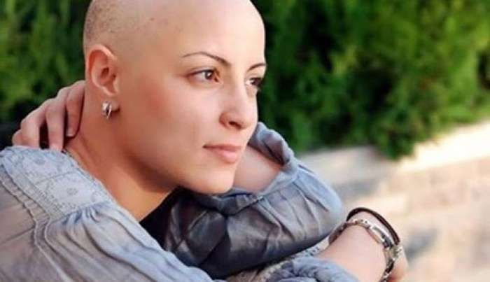
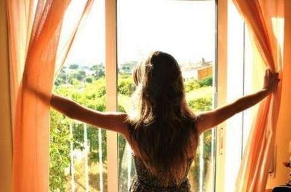

# Сэтгэл санааны хүч

Хүнд өвчтэй энэ эмэгтэйн бичсэн тэмдэглэл, олон хүнд нэгийг бодогдуулах, амьдралын үнэ цэнийг мэдрүүлэх ухаарал хайрласан, сэтгэлийн тэнхээ, сэтгэл санааны шавхагдашгүй хүчийг харуулсан түүх болж, өвчин зовлонтой хүмүүст сургамж, эрүүл саруул хүмүүст амьдрал, Хайрыг ойлгох, хүлээн авахад тустай үгийн ид шидийг агуулсан нэгэн төрлийн эмчилгээ, “Гарцгүй зүйл, боломжгүй зүйл үгүй” гэдэг өөдрөг үгийг баталсан нотолгоо болж өгсөн юм. Хорт хавдарын хамгийн сүүлийн шатанд орсон, эмчилгээгүй, хоёр хоногийн настай гэсэн оноштой энэ эмэгтэй, өөрийн өөдрөг сэтгэл, сэтгэлийн тэнхээгээр хүнд өвчинөө хэрхэн даван гарч эдгэрсэн тухайгаа ийнхүү бичжээ.

-Намайг түрдэг сандалд суулган тасаг руу хүргэхээр яваа хоёр сувилагчийн нэг нь нөгөөгөөсөө, -Хааш нь аваачих юм? Тусгаарлах тасаг уу? Нийтийнхүү? гэж асуухад, нөгөөх нь, -Юу гэж нийтийнх байх вэ, тусдаа өрөө, гэж хариулаад, надруу өрөвдсөн харцаар харснаа, -Эмч тусдаа өрөөнд аваач гэсэн шүү дээ, гэх үед, сэтгэл минь бяцхан хямарч учирыг нь мэдэхгүй учираас гайхаж байж билээ. Харин би дараа нь, тусдаа өрөө рүү, үхэх гэж буй хүмүүсийг, бусад өвчитнүүдэд үхэж буйг нь харуулахгүйн тулд оруулдаг болохыг мэдсэн юм. Тэд, намайг хэвтүүлээд, ганцааранг минь орхиод гарч явцгаав. Энэ үед би, би хаашаа ч явах хэрэггүй, би хэнд ч ямар нэг зүйл хийх албагүй, юу ч хэрэггүй, мөн хариуцлага энэ тэр гэсэн зүйлс маань үгүй болж буйг мэдрэн сэтгэл хоосрон, нэг л сонин амар, бараг л амарлингуйн ертөнцөд орох шиг, бүхий л хорвоогийн зүйлс холдон, бүх юм хамаагүй, юу ч, хэн ч сонирхолгүй болон бараг л амрах шиг, энэ нь таатай ч юм шиг санагдаж, би ганцаараа, зөвхөн өөртэйгээ, өөрийн амьдралтайгаа үлдэж, өөрийн амьд буйдаа ч эргэлзсэн байдалд, өнгөрүүлсэн амьдрал минь, мөн энэ хорвоогийн бүх зүйлс нь, нөмрөн ирж буй Үхэл, түүний цаадах Үл мэдэгдэх тэрхүү ертөнцтэй харьцуулахад хичнээн бага, жижиг, богино болохыг ойлгож, мөн амьдрал, жинхэнэ амьдралын урд өмнө ойшоон анзаарч байгаагүй зүйлс болох шувуудын жиргээ, орны минь дээгүүр хананд ташуулдан туссан нарны туяа, цонхны цаана намайг даллах мэт найгалзах алтан шаргал навчис, намрын хөхөлбөр тэнгэр, сэрж буй их хотын чимээ, машины дохио, зам дээгүүр яаран алхах өндөр өсгийтийн товшоо, бүр, модноосоо тасран эргэлдэн унаж буй навчисын чимээг хүртэл сонсож энэ бүхнийг голоосоо хайрлаж буйгаа мэдэрсэн. Энэ үедээ би, өөрийн эрхгүй, -Бурхан минь энэ бүхнийг ойлгуулсанд баярлалаа. Амьдрал ямар сайхан юм бэ? Түүнийг хайрлахгүй байхын аргагүй юм. Үхэхийн минь өмнөхөн ч гэсэн ойлгуулсанд баярлалаа гэж залбирч билээ. Тэгээд өөртөө, -За яах вэ, амьдралыг эдлэх, хайрлах хоёрын хоёр өдөр чамд байна шүү дээ гэж хэлэхдээ учиргүй баярласан. Тэгэхэд би, бүх зүйлийг хайрлаж чаддагаа, хайрлаж болдогийг мэдэрсэн. Бүх зүйл хичнээн үнэтэй болохыг ойлгосон. Миний байгаа тусдаа өрөө, бие организмын минь эдгэшгүйд тооцсон өвчин зэрэг нь, над дээр ирж байгаа хэнийг ч болов, над дээр тэднийг оруулах давуу талыг олгож байгааг мэдсэндээ хүртэл баярласныг минь яана. Төрөл төрөгсөд, ойр дотныхон, хамаатан садныхан минь эргэх нэрийдлээр надтай салах ёс гүйцэтгэхээр ирж байгааг, тэдэнд үхэх гэж буй хүнтэй ярилцах, харилцах ямар хэцүү байгааг би ойлгож байсан. Тэдний хөөрхийлөлтэй царайг харж, гунихрахын оронд баярлахаар шийдсэн дээ. –Би ер нь хэзээ эд нартай ингэж зэрэг уулзаж байлаа даа гэсэн бодол төрж баярлаж эхэлсэн. Эргэж ирсэн хүмүүсийг би, хөгжөөхийн тулд онигоо, хошин, хөгжилтэй зүйлс ярьж өгч, өөрөө ихээр инээж хөхөрдөг байв. Тэд маань ч Бурханы авралаар хүчилсэн ч атугай инээлдэцгээн, салах ёс гүйцэтгэлт баяр баясгалантай, сэтгэл хангалуун уур амьсгалд өрнөсөөр, нэг мэдэхэд, хоёр өдөр өнгөрч гуравдах өдөр болсон ч би, амьд. Хэвтэж залхсан би, босч цонхоор хараад сууж байтал эмчилэгч эмч орж ирээд –Босч болохгүй, гэж намайг хэвтүүлэхээр зүтгэв. Би, хариуд нь –Энэ юу өөрчилөх юм бэ?, гэхэд, -Юу ч өөрчилөхгүй л дээ, гэхдээ босч болохгүй, -Яагаад?, -Та, үхлийн оноштой, амьдрахад ч хэцүү байхад босох гээд байх юм, гэчихээд гарав. Надад өгсөн хоёр өдөр өнгөрчихсөн дөрөв дөх өдрөө би амьд. Бүр амттан идмээр санагдаж, түүнийгээ идэж байсан гээч. Сэтгэл санаа минь сайхан. Харин эмчийн хувьд таагүй маягтай. Тэр миний шинжилгээнүүд өөрчилөгдөхгүй байгаад, бие минь муудахгүй байгааг ойлгохгүй байн байн орж ирж үзнэ. Би, эмчийг өрөвдөн, саяхан өөрт минь нээгдсэн, бүхнийг хайрлах, үнэлэх сэтгэл минь, эргэн тойрныхныг минь бүгд баяртай байгаасай гэж хүсээд л. Би маргааш нь, бүр тасгаасаа гарч, хонгилд байх зурагт үзэж байгаад баригдав. Эмч, -Та яаж үүнийг хийгээд байна аа? гэж бараг хашгиран асуух юм. Би, -Юу хийсэн гэж, гэхэд, -Шинжилгээ, миний танд бичсэн шинжилгээний хариунууд, -Би яаж мэдэх юм, мэдэх ч хэрэг алга, гэчихэв. Маргааш нь намайг нийтийн тасаг руу шилжүүлэв. Салах ёс хийж оршуулахаар цугласан хамаатан садан маань буцацгаав. Миний орсон нийтийн тасагт, таван эмэгтэй хана руу харан, дүнсгэр царайлан дуугүй хэвтэцгээн, идэвхитэйгээр үхэцгээж байна. Би гурван цаг орчим тэсээд, ямар нэг зүйл хийхгүй бол доторхи хайр минь багтрах нь ээ. Би, босч эргэлтээр ирсэн томоос том тарвасыг ширээн дээр зүсч байхдаа, -Тарвас, химийн эмчилгээний дараа дотор муухайрахыг зогсоодог гэсэн гэж хэлтэл, тэд итгэлгүйхэн босоцгоож, гуйвж дайван ширээнд дөхөцгөөн ирэв. –Нээрээ гэж үү? гэцгээхэд нь, -Тийм, тийм гэж хэлсэн ч дотроо би, үнэхээр мэдэхгүй байсан юм. Хамгийн сул биетэй таягтай эмэгтэй, -Нээрээ зүгээр болчихлоо, гэхэд бусад нь, баяртайгаар, -Нээрээ тийм байна гэцгээв. Үүнээс хойш бид, онигоо, хөгжилтэй явдлууд ярьж инээлдэцгээж суудаг болов. Гурван өдөр өнгөрсний дараа, эмч надад, -Та өөр тасаг руу шилжихгүй юу? гэсэн хүсэлт тавив. Манай тасгийн эмэгтэйчүүд, намайг тавиагүй юм даа. Манай тасаг руу хөрш тасгийнхан ирж цугларан, хамтдаа инээд наргиа, дуу шуугиантай, өдрийг өнгөрүүлдэг болов. Учир нь манай тасагт бидний нүдэнд харагддаггүй Хайр бялхаж байсан юм. Бид сүүлдээ, бүр, чадах нь бүжиглэдэг хүртэл болсон. Жижүүрийн эмч энэ үед орж ирсэнээ, -Би гучин жил ажиллахдаа ийм юм болохыг үзээгүй, гэчихээд эргэн гарахад нь бид, нүүрний хувирлыг нь шоолж үхтлээ инээлдэцгээж билээ. Би, ном уншиж, цонхоор харж, хүмүүстэй ярилцаж, хонгилоор алхаж, харсан бүх зүйлс, ном, компот, хөрш, хашаанд зогсох машин, цонхны цаана байгаа хөгшин модыг хүртэл хайрлаж байгаагаа гайхаж байв. Эмчлэгч эмч маань орж ирж үзэх бүртээ, над руу нэг л сонин харна. Гурван долоо хоногийн дараа эмч маань, -Таны гемоглобин эрүүл хүнийхээс 20 нэгжээр өссөн байна. Үүнээс дээш өсгөж болохгүй гэчихээд гарав. Тэр надад нэг л уурлаад байх шиг санагдна. Аргагүй биз ээ, онош буруу тавьсан тэнэг байдалд орчихсон. Гэтэл тэрхүү онош буруу тавигдах ямар ч боломжгүй байсан. Нэг удаа, тэр, -Би таны оношийг учирыг нь олохоо байлаа. Танд юу ч хийхгүй байхад эдгэрэлт явагдаад байдаг, гэхэд нь, би, -Тэгээд энэ ямар онош юм бол? гэхэд, -Бодож олоогүй байна гэж сулхан хэчихээд гарч явав.\
Би эмнэлгээс гарах болж, эмч маань, -Та, гарч байгаа нь харамсалтай юм. Манайд зөндөө хүнд өвчитнүүд байна даа, гэж надад хэлж байж билээ. Манай тасгийн өвчитнүүд бүгд үхэлгүй, эдгэрэлт явагдаж эмнэлгээс гарцгаасан. Ийнхүү амьдрал минь үргэлжилсээр... Мөн, миний амьдралыг үзэх үзэл бодол өөрчилөгдсөн. Би, үхэл амьдралын зааг дээрээс, амьдралыг тэр чигт нь өндрийн өндрөөс харж эхэлсэн юм шиг, харах хүрээ маань тэлсэн мэт санагддаг. Амьдрал маш энгийн, амархан юм билээ. Ганцхан хайрлаад л сурчихвал, боломж бололцоо хязгааргүй, хүсэл болгон биелнэ, харин хүсэл маань заавал хайрыг агуулсан байх ёстой гэдгийг ойлгосон. Хууралт, мэхлэлт, атаархал, гомдол, бусдад мууг хүсэх зэрэг сөрөг зүйлс ор мөргүй алга болж, амьдралд байх зайгүй болгодог зүйл бол хайр юм гэдгийг мэдсэн. Мөн Бурхан бол Хайр гэдгийг ухаарсан.
