# Сэтгэл санаатай холбоотой 9 төрлийн өвдөлт

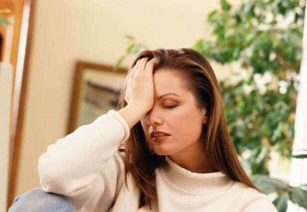

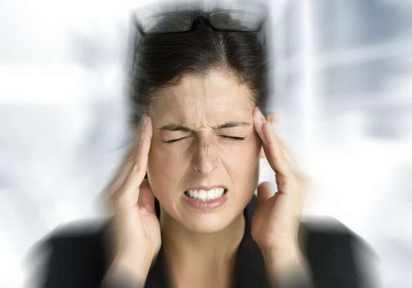

1.Толгой өвдөх\
Эдгээр нь, стрессээс болдог бөгөөд тайвширах, стрессээ тайлахад цаг гаргаж байх хэрэгтэй.

---

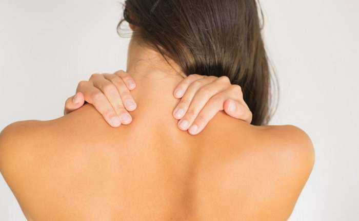

2.Хүзүү хэсгээр өвдөх\
Өөрийгөө эсвэл бусдыг буруутгах, өршөөж чадахгүй байгаагаас өвддөг. Хүмүүсийн юу танд таалагддаг талаар бодоод үзээрэй.

---

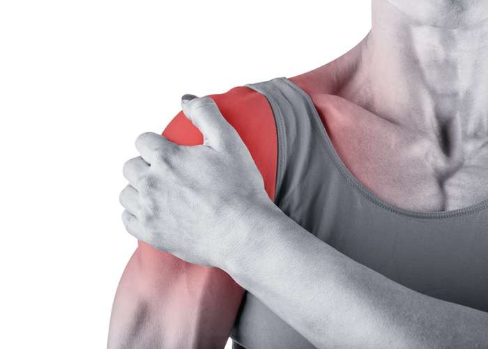

3.Мөрөөр хөшиж өвдөх\
Та, сэтгэл хөдлөлөө хэт барьдаг, сэтгэл санааны ачаалалтай байгааг заана. Бүх зүйлийг өөртөө авч ачаалдаг байдлаасаа салах хэрэгтэй

---

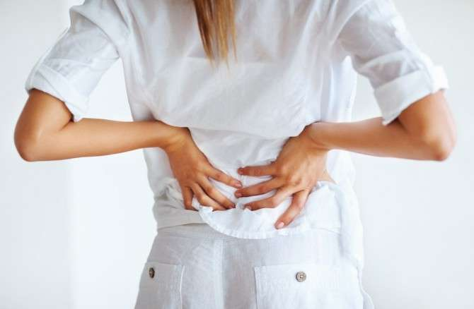

4.Нуруу өвдөх\
Сэтгэл санааны хангалттай дэмжлэг авч чаддаггүй, хайр, дэмжлэг, хүсэмжээр дутагдсанаас өвддөг

---

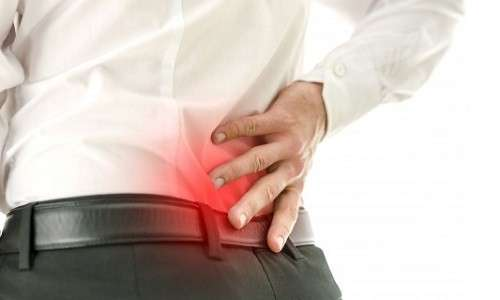

5.Нуруу бэлхүүсээр өвдөх Мөнгө санхүүгийн асуудалд хэт санаа зовдог бол байнга өвддөг

---

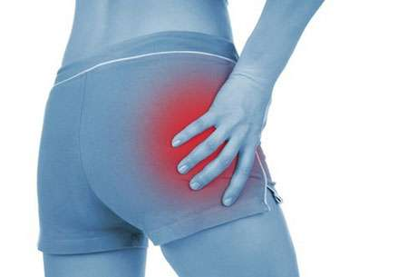

8.Аарцаг гуя хэсгээр өвдөх\
Амьдралын хөдөлгөөн, өөрчилөлтөд дасахгүй, хөл нийлүүлэн алхаж чадахгүй байх үед өвддөг.

---

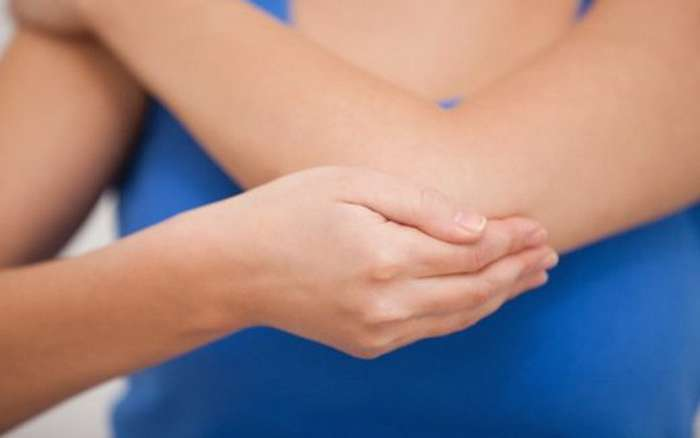

6.Гарын тохой өвдөх\
Өөрчилөлттэй холбоотой сэтгэл санаа зовох үед өвддөг. Аливаад буулт хийж амьдралаа хөнгөвчилж сурах хэрэгтэй

---

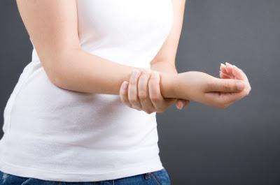

7.Гар өвдөх\
Хүссэнээрээ байж чадахгүй, бусадтай хэл амаа ололцож чадахгүй байгаа үед гар янгинан өвдөх нь бий. Найз нөхдийн хүрээгээ өргөжүүлэх, харилцаагаа тэлэх хэрэгтэйг заадаг

---

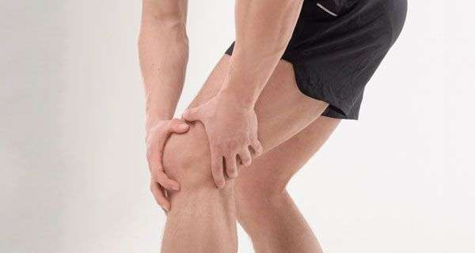

Өвдөг өвдөх\
Таны аминч зан хэтэрч буйг, мөн өөрийнхөө тухай хэт боддог байх байдал өвдөг өвдөхөд хүргэдэг

---

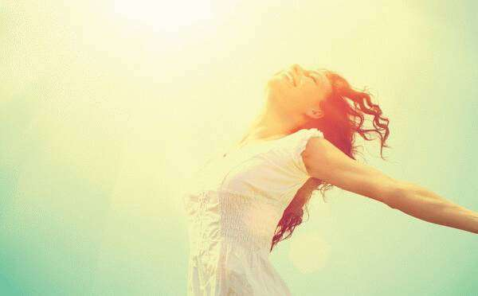

Эдгээр өвдөлтүүдийг, сэтгэл санаагаа зассанаар дарах боломж байгааг харуулахаар энэхүү мэдээг хүргэлээ. Бидний бие организм нь, амьдралын өөрчилөлтүүд, сэтгэл санааны байдлуудаас шалтгаалах магадлалтай нь нотлогдсоор байгааг сануулах нь зүйтэй биз ээ. Өөдрөг байцгаая.
