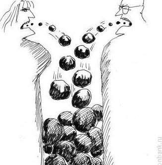

# Сэтгэлийн хөдөлгөөн дээд цэгтээ хүрсэн үед хэлэгддэг үгс хүчтэй байх боломжтой

Хэрүүл маргааны үед уурандаа хэлсэн үгс биелж эмгэнэлт байдалд оруулсан тохиолдол цөөнгүй байдаг бөгөөд тэрхүү гунигт явдал санамсаргүйгээр давхцан таарч тохиолддог уу, эсвэл сэтгэлийн хөдөлгөөн дээд цэгтээ хүрсэн үед хэлэгдэх үгс үнэхээр хүчтэй биелэх боломжтой байдаг уу, мөн хэл маань бидний “дайсан” болох боломжтой юу гэсэн асуултууд сэтгэл зүйчидийн сонирхолыг ихээхэн татдаг ч, тодорхой хариулт тайлбаргүй байсаар иржээ. Сэтгэлийн хөдөлгөөн дээд цэгтээ хүрсэн үед хэлэгддэг үгс хүчтэй байх боломжтой гэсэн судалгаа нотолгоонууд байдаг хэдий ч, ийм зүйл тохиолдсон хүмүүсийг, -“Тухайн үед л тэгж таарсан гэсэн үг, өөрийгөө уучил, санамсаргүй болсон зүйл” гэх мэтээр тайтгаруулах, сэтгэлийг нь засах гэж оролдохоос өөр юу хийх билээ, энэ нь ямар ч үр дүнгүй байдаг, тэгээд тэр хүмүүс насан туршдаа сэтгэлийн дарамтад амьдрахыг хараад сэтгэл эмзэглэж, ийм мэргэжил эзэмшсэндээ заримдаа харамсах үе ч гардаг, мөн гунигт тохиолдлын эмгэнэлт давхцал гэж өөрийгөө итгүүлэхийг хичээдэг ч, харин хэлэх үгэндээ өөрөө их анхаарал тавих болдог юм байна гэж нэгэн сэтгэл зүйч, үйлчилүүлэгчидтэй нь тохиолдсон сэтгэл эмзэглүүлсэн эмгэнэлт түүхүүдээс, сургамж болгох үүднээс дараах зүйлийг бичжээ.

-Тэр нэгэн өглөө эмэгтэй, жижигхэн зүйлээс болж нөхөртэйгээ маргалдан, урд нь хуралдсан бүхнээ хашгиран томхон хэрүүл хийсэн аж. Нөхөр нь, замын түгжрэлээс болж мотоциклтэй ажилдаа явдаг байсан бөгөөд өдөр нь, эмэгтэй нөхөр рүүгээ утасдаж, -Ажлынхаа дараа захаар дайрч, хүнс авч ирэхийг хүстэл, уур нь гараагүй байсан уу, яасан нөхөр нь дурамжхан ярьж эхэлтэл, уурандаа эмэгтэй, -Гуйлгах гээ юу? Чадахгүй, зах орохгүй бол битгий буцаж ирээрэй, хэзээ ч битгий ир! гэж орилж хашгичжээ. Өнөөх нь ч, -Завтай байж чи, өөрөө явахгүй юу гэснээр яриа нь тасарсан аж. Орой болж нөхрөө ирэхгүй болохоор, эмэгтэй бодолдоо, мөн амандаа нөхрөө хараан зүхэж бухимдаж суутал утас дуугарч автал, цагдаагийн газраас ярьж байна гээд, захын дэргэд, ачааны машин дүрэм зөрчисөн үйлдэл хийж, мотоциклтой эрэгтэй газар дээрээ нас барсан. Гар утаснаас нь таны дугаарыг оллоо гэхийг сонсоод ухаан балартан унасан аж. Ийнхүү нөхөр нь хэзээ ч ирэхээ больж, эмэгтэй, хэлсэн хэдхэн үгнээсээ болж насан туршийн сэтгэлийн шархтай болон хоцорчээ.\
-Хорин долоон жил ханилсан зүрх муутай эр нөхрөө, мөнгө төгрөгний асуудлаас болж салахаар айлган дарамталж, гомдож цөхөрмөөр аймшигт үгнүүд хэлснийх нь дараа, нөхөр нь ажил дээрээ очимогцоо зүрх нь хаагдаж нас барж, бэлэвсрэн хоцорсон бас нэг эмэгтэй, -Би мэдсээр байж, тийм байдалд оруулж хорвоогоос явуулсан гэж үргэлж өөрийгөө буруутган явдаг, ийм хүмүүст, буруугүй болохыг нь нотлоод өгөх боломж байдаггүй нь хэцүү, мөн санаандгүй тохиолдол гэж ойлгуулах, хүний амь нас бурханы гарт байдаг гэж итгүүлэхийг оролдоод ч тайтгаруулж чаддаггүй хүчин мөхөсддөг. Тиймээс, хүмүүс минь, ойр дотныхондоо хатуу үг хэлэхээс зайлсхийж байгаач, бие биенээ бодож уур цухлаа хянаж байгаач гэж мянгантаа гуйя. Бид хормын дараа, цагийн дараа, хоёр цагийн дараа, мөн маргааш юу болохыг мэдэхгүй, мэдэх ч боломжгүй гэдгээ ойлгооч дээ гэж чин сэтгэлээсээ гуйж байна хэмээн бичжээ. Сэтгэлтэй сэтгэл зүйчийн, мэргэжлийнхээ тухай сэтгэлийн үгээ хуваалцсан нийтлэлийг, агуу найрагчийнхаа, “Хүмүүс ээ! Амьддаа бие биенээ хайрла!” гэсэн ухаант үгээр өндөрлөе дөө...
