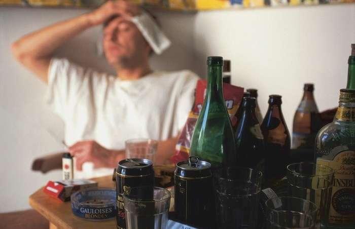
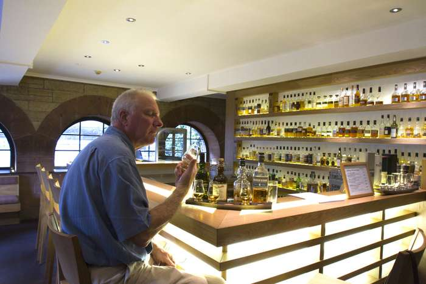

# Шар тайлах арга, бүтээгдэхүүн эрж олохоор 10 жил эрэл хайгуул хийсэн сэтгүүлчийн дүгнэлт

Канадын сэтгүүлч, өөрийн адал явдалт баялаг амьдралынхаа туршлагыг дүрслэн бичсэн нилээд хэдэн номын зохиогч Шонесси Бишоп Столл, 10 жилийн турш архи, согтууруулах ундаа ууж бие дээрээ туршисныхаа дараа 2018 онд, архи уух үе, архи уусны дараах үед олж мэдсэн зүйлсийнхээ тухай “Шарталт буюу уусны дараах өглөө эм, эмчилгээний арга хайсан нэгэн эр” хэмээх номоо хэвлүүлжээ. Эрүүл мэндээ хохироох аюултай энэхүү туршилтынхаа үед, Шонесси дэлхийн 35 оронд очиж, янз бүрийн шарталт тайлах арга, бүтээгдэхүүнүүдийг хэргэлж үзсэн бөгөөд тухайн орон бүрийн архи, уушийг орой нь уусныхаа дараа өглөөнийхөө мэдрэмжүүд, мөн тухайн улсын иргэдийн зөвлөсөн зүйлсийг хэргэлж үр дүнг нь нарийвчилан тэмдэглэн авдаг байв. Эдгээр аргуудын дунд, ардын уламжлалт аргууд, рекламддаг үнэтэй эм тан, бүр эрсдэл дагуулах амь насанд халтай үйлдлүүд хүртэл орж байв. Жишээ нь, Лас Вегаст өндөр цамхагаас үсэрч, Канадад мөстэй усанд орж үзсэн бөгөөд энэ талаар, -ер нь адреналины огцом өсөлт шарталтаас гаргадаг юм билээ гэж бичжээ. Түүний олон улс оронд шарталт тайлахын тулд хэргэлж үзсэн зүйлсээс онцгойг нь дурдвал, хонины давсалж дарсан нүд идэх, нунтагласан модны нүүрстэй сүү уух, сугандаа лайма жимс хавчуулах, оймсондоо өвс хийж өмсөх, архи уухаас өмнө оливын тос уух, австрийн шар тайлах зориулалтын өвсөн оронд унтах, Хавайн арлын шарталтын эсрэг дом засал хийлгэх зэрэг аргууд байв. Шонесси ихэвчилэн ганцаараа ууж тэмдэглэл хөтөлдөг, гэвч заримдаа бусадтай нийлэн уух удаа ч байдаг байж, Аризонад нэгэн ийм уултын дараа цөл дунд сэрсэн бөгөөд усгүй цангаж үхэх шахсан гэнэ. Бас нэг удаа Берлинд уугаад мөнгө, паспортаа хаяж бүтэн долоо хоног буудлын жижүүр дээр паспорт нь иртэл хүлээсэн гэх мэтийн архитай холбоотой олон адал явдалд өртдөг байжээ. Шонесси энэхүү туршилтынхаа явцад, цагаан архи өнгөтэй архи дарснаас цэвэр, чанартай гэдэг нь худал, архи согтууруулах ундааг хольж уухад илүү шартна гэдэг мөн худал, харин шартах эсэх нь уусан архи дарсны төрлүүдээс биш, зөвхөн уусан архины хэмжээнээс шалтгаална гэсэн дүгнэлтэд хүрчээ. Мөн ус ихээр уух нь шартуулдаггүй биш, харин ус ихээр уугаад байгаа үед хүн архи бага уух болдогтой холбоотой, шарталт нь бие организм усгүйжсэнээс болдоггүй харин бие организм дах этанол унасантай холбоотой үүсдэг хорт бодисуудаас болдог гэж үзжээ. Ингээд ямартай ч, олон жилийн аюултай судалгааныхаа үр дүнд шарталтын зовиур, зовлонг дарах дараах аргуудыг олжээ. Өглөөний цайндаа өндөг, мах, махан бүтээгдэхүүн идэх. Уургаар баялаг хүнсэнд байдаг цистейн хэмээх бодис нь дотор эрхтэнд архи нөлөөлөх хортой үйлчилэлийг багасгадаг. Мөн байцааг ихээхэн тустай гэж магтсан байна. Шарталтын байцааны шөл хүртэл байдаг гэж бичжээ. Оросууд дарсан байцааны шүүсийг шартах үедээ хэргэлдэг. В-ийн төрлийн витаминуудыг архи уухаас өмнө,12 цагаас дээш хугацаанд шингэсэн байхаар хэргэлчихсэн байхад шартахгүй. Мөн өглөөд хэрэглэх тустай, харин уг В1,В6, В12 витаминуудаа комплексоор биш тус тусад нь хэргэлэх хэрэгтэй. Ладаны үнэр, сэтгэхүйг гутралаас гайхалтай хамгаалдаг гэжээ. Шонесси мөн, энэ олон жилийн туршилтынхаа үр уршгаар, илүүдэл жин, өндөр даралт, сэтгэхүйн нилээдгүй асуудалтай болсноо харамсан дурдаад, шарталтын зовлонгоос салах, түүнд өртөхгүй байх хамгийн хялбар, энгийн арга бол хэмжээгээ мэдэж уух гэж онцолсон байна.

