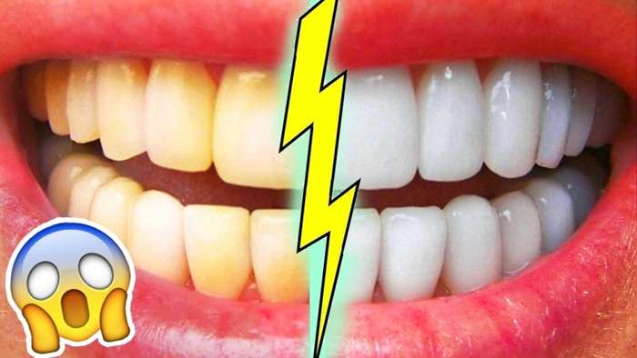

# Шүд цайруулах арга

Орчин үед, хүмүүс шүдээ цайруулахын тулд шүдний эмчийн үнэ төлбөртэй тусламж авдаг болсон. Гэтэл гарын дорх аргаар шүд цайруулах боломж байдгийг тэр болгон мэддэггүй.

-¼ цайны халбага хүнсний сода-г устай найруулан сойзоо дүрж угаадаг\
-Гүзээлзгэнэ, алим идэхэд шүд цайрна\
-Давстай усаар амаа зайлдаг\
-Өнгөтэй ундааг, шүдэндээ бусад өнгө оруулахгүйн тулд, гуурсаар уух хэрэгтэй. Зүгээр уусан тохиолдолд дараа нь заавал амаа зайлж байх\
-Сахаргүй бохь зажлахад шүдийг механикаар цэвэрлэдэг\
-Өнгө будагтай хүнсний үлдэц хэлэн дээр хуралддаг тул хэлээ байнга цэвэрлэх хэрэгтэй\
-Улаан өнгийн уруулын будаг шүдийг цагаан харагдуулдаг\
-Цайруулагч тай шүдний оо хэрэглэх\
-тамхи татдаг хүмүүс, зориулалтын шүдний оо хэрэглэх

---

