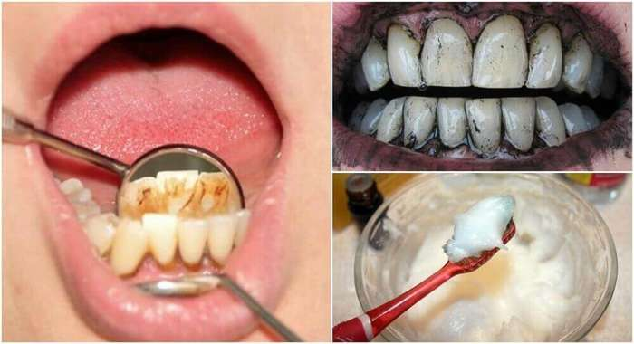

# Шүд өвдөх шалтгаан ба өвдөлт дарах зүйлс

Кариес. Шүдний эд гэмтэж эхэлсэн эхний үедээ ямар ч зовиургүй байдаг бөгөөд механик үйлчилэл, хүйтэн халууны үйлчилэлд мэтрэмтгий болно. Аяга хүйтэн ус, халуун цай уух үед өвдөлт мэдрэгдэж байгаа бол кариес эхлэчихсэн гэсэн үг. Эртхэн эмчилүүлэх хэрэгтэй.

Пульпит. Кариесийн хүндэрсэн хэлбэр болох пульпитын үед, шүд өөрөө шалтгаангүйгээр гэнэ гэнэ өвдөж эхэлдэг.

Периодонтит. Шүд юм зажилах үед хүчтэй өвдөх, дарахад өвдөх нь шүдний ёзоорыг тойрсон эдийн үрэвсэл буюу периодонтит болсон гэсэн үг.

Шүдний механик гэмтэл. Шүдний паалан гэмтсэнээс, шүдний дентит нүцгэрснээс мэдрэг болж өвдөх механик гэмтлээс үүдэлтэй өвдөлт.

Шүд өвдөх үед, юуны түрүүнд амны хөндий, шүдээ сайтар цэвэрлэ. Шүдэн завсар үлдсэн хоол хүнсний үлдэгдэл, бактеруудыг арилгах үйлдэл нь байдлыг дээрдүүлнэ. Хатуу, чихэрлэг, хэт давстай, хүйтэн, халуун зүйлс идэж улам хүчтэй өвтгөхөөс сэргийл. Эмнэлгээс хол, эмчлүүлэх боломжгүй нөхцөлд дараах аргуудыг хэрэглэх нь зүйтэй. Эдгээр аргууд нь ардын эмчилгээнээс үүдэлтэй, халдваргүйжүүлэх, ангигистамин, өвчин намдаах үйлчилэл дээр суурилсан, эдгээр нэршилүүд гараагүй байхаас өмнө хэрэглэгдэж байсан аргууд юм.

-Фитонцид. 1 ширхэг сонгинын хальсыг аяга халуун усанд хийж таглаж хандлан, уг хандаараа амаа зайлж, дараагийн балгасан хандаа аман дотроо 15 минут орчим байлгахад, амны хөндийг халдваргүйжүүлж ариутгана гэж үздэг. Хэсэг хугацааны дараа, 3 удаа давтан хийхэд өвчин намддаг байна.

-Эфирийн тос. Гаа эсвэл гвоздик, ер нь гарын дор байгаа эфирийн тосыг жижиг хөвөнд шингээж өвдөж буй шүдэндээ тавих. Үрэвслийг дарж өвдөлтийг намдаана. Хэд хэдэн удаа давтан хийх хэрэгтэй.

-Антигистамины арга. Нунтаг куркумаг хайруулын тавганд хуураад, хөргөж өвдсөн шүдэндээ түрхэхэд хавдар нь бууж, гистамины мэдрэлүүдийг блоклодгоос өвдөлт намддаг.

-Таннин. Пакеттай хар байхуу цайг бүлээн усанд дүрж, усыг нь хөнгөхөн шахаад, өвдөж буй шүдэндээ тавих. 15 орчим минутын дараа өвдөлт намдна.

-Жижиг мөсийг самбайд боож, өвдсөн шүдэндээ тавихад мэдээ алдаж өвдөлт буурна.

-1 стакан усанд 1 цайны халбага давс, 1цайны халбага соод хийж, түүгээрээ амаа зайлах нь, амны хөндийг ариутгаж, хавдрыг бууруулж, өвчнийг намдаана.

Эдгээр аргууд, эрт дээр үеэс хүмүүс хэрэглэж ирснээс харахад үр дүнтэй, мөн ямар ч сөрөг үйлчилгээ үзүүлдэггүй учираас хэрэглээд үзэхэд гэмгүй юм. Мөн шүд өвдөх үед халуун эсвэл бүлээн жин тавьж болохгүй. Улам өвднө. Шүдний ойролцоох эдийн цусны хангамж хэвтэж байх үед илүү эрчимждэгээс улам лугшиж өвддөг тул, босоо байдалд дээр байдаг болохыг анхаарах хэрэгтэй байдаг.

,

