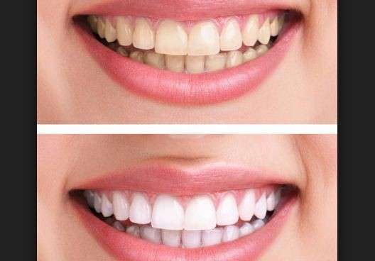
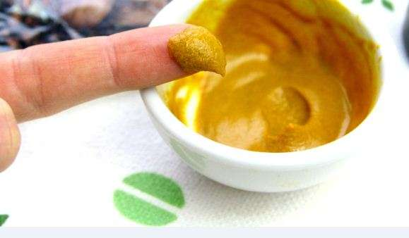

# Шүдний  “натурал” оо

Энэхүү, гарын доорхи зүйлсээр хийсэн шүдний оо нь, шүдийг цайруулж, шүдний өвдөлт болон буйл, амны хөндийн үрэвслийг эмчилэх үйлчилгээ үзүүлдэг бөгөөд оросын ард түмний дунд, олны хэрэглээгээр батлагдсан үр дүнтэйгээр шалгараад байгаа аж. Нийтийн хэрэглээнд зориулагдан үйлдвэрлэгддэг, шүд цэвэрлэх зориулалтын төрөл бүрийн оо нь, цайруулах, мөн шүдний хорхойтолт, амны хөндийн үрэвслээс сэргийлэх, эмчлэх үйлчилгээ үзүүлэх олон төрлийн химийн бодисны нэмэлттэй байдаг нь, шүдийг хэврэгшүүлж, буйл үрэвсүүлэх эрсдэл дагуулдаг. Харин ургамлын гаралтай орцуудаас бүрдсэн оо нь, шүдийг бэхжүүлж эрүүлжүүлдэг бөгөөд энэхүү цайруулах үйлчилгээтэй, гайхалтай үр дүнтэй оог хийх хялбар аргыг хүргэе.

Орц:\
-Кокосын тос – 1 хоолны халбага\
-Куркума – 5 цайны халбага\
-Гааны эфирийн тос – 5 дусал\
Шилэн аяганд, кокосын тосоо хийж, 5 цайны халбага куркума, 5 дусал гааны эфирийн тосоо нэмж хутгаад бэлэн болно. Эхлээд шүдэндээ хуруугаар түрхээд, дараа нь сойзоороо угаана. Долоо хоногт 2 удаа угаах хэрэгтэй ба шүд гайхалтай сайхан цайрдаг. Бактерийн эсрэг хүчтэй үйлчилгээтэй куркума нь, амны хөндийг цэвэрлэж, үрэвсэл, шүдний өвчинөөс сэргийлэх, эмчилэх чадвартай. Ихэнхи цайруулагчтай шүдний ооны найрлага дах фторын орц нь, шүднээс кальцийг нь угааж шүдийг гэмтээх эрсдэлтэй байдаг бол энэхүү оо нь, амны хөндий, шүдний өвчинийг эмчлэх үйлчилгээтэй байдаг байна.
